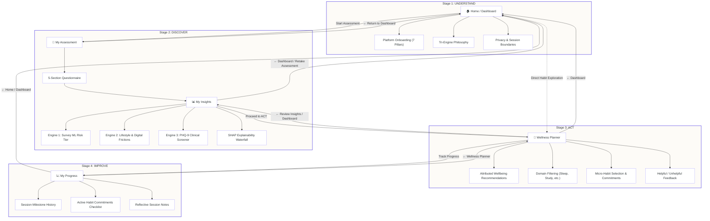

# MINDORA — DAY 11 ARCHITECTURE & VERIFICATION REPORT
## Student Journey Intelligence & Experience Architecture

**Document Version:** 1.1.0 (Final Test-Accounting & Live Evidence Audit)  
**Date:** November 14, 2026  
**Auditor:** Senior UI/UX Designer, Frontend Engineer, Accessibility Specialist & Student Experience Architect  
**Project:** Mindora — AI-Powered Student Wellbeing Intelligence Platform  
**Repository Directory:** `D:\Depression calculator`  
**Previous Checkpoint:** Day 10 Final Commit `5c90938`  
**Active Working Tree Commit:** `3ba5c4d`  
**Production Model SHA-256:** `E182E9E779A4F89E4883EB13C9BAB3DF19EEBC7165D4B0A44319F737361342EC` (`models/best_model.pkl`)  
**Streamlit Health:** `HTTP 200 OK` (`http://localhost:8501/_stcore/health`)  
**Total Reconciled Tests:** 145 Unique Tests Across 10 Suites (145 Passed, 0 Failed, 0 Skipped)

---

## 1. Existing Journey Architecture

Prior to Day 11, Mindora operated with a modular view structure introduced in Day 8, routing between seven canonical pages:
1. `🏠 Home / Dashboard` ([`src/views/student_dashboard.py`](file:///d:/Depression%20calculator/src/views/student_dashboard.py))
2. `📝 My Assessment` ([`src/views/assessment.py`](file:///d:/Depression%20calculator/src/views/assessment.py))
3. `📊 My Insights` ([`src/views/insights.py`](file:///d:/Depression%20calculator/src/views/insights.py))
4. `🎯 Wellness Planner` ([`src/views/wellness_planner.py`](file:///d:/Depression%20calculator/src/views/wellness_planner.py))
5. `📈 My Progress` ([`src/views/progress_view.py`](file:///d:/Depression%20calculator/src/views/progress_view.py))
6. `ℹ️ Methodology & About` ([`src/views/methodology.py`](file:///d:/Depression%20calculator/src/views/methodology.py))
7. `🔬 ML Training Lab` ([`src/views/training_lab.py`](file:///d:/Depression%20calculator/src/views/training_lab.py))

While each page was technically isolated and clean, they functioned as independent silos rather than a cohesive student wellbeing progression. Students arriving at the dashboard had to deduce their own journey through disconnected sidebar links, and empty states did not always provide immediate, low-barrier next actions.

---

## 2. Problems Identified

Our student journey and user experience audit identified several key friction points:

1. **Lack of an Explicit Mental Model:**  
   Students navigating the platform had no visible indication of where they were in the overall wellbeing process, how many steps remained, or what the ultimate outcome would be.
2. **Dead-End View Terminations:**  
   When a student completed an assessment or reviewed insights, there was no prominent "next step" call-to-action guiding them forward to the Wellness Planner or back to the Dashboard.
3. **Assessment Prerequisite Misconceptions:**  
   Students assumed they could not explore self-care habits or use the Wellness Planner without first completing the full assessment questionnaire.
4. **Passive Empty States:**  
   When a student visited `My Insights` or `My Progress` before submitting an assessment, the empty states warned them that data was missing but did not offer direct navigation buttons to get started or explore available tools.
5. **Onboarding Opacity:**  
   The onboarding guide did not fully articulate the critical distinctions between the three independent engines, the strictly non-diagnostic educational scope, and the server-side in-memory session lifecycle.

---

## 3. New Four-Stage Student Journey

To resolve these friction points, Mindora adopts the unified **UNDERSTAND → DISCOVER → ACT → IMPROVE** framework:



### Stage Summary

- **Stage 1 (UNDERSTAND):** Orientation, platform transparency, and setting safe expectations. Students learn what Mindora does, what it is not, how its 3 engines operate, and how their privacy is respected.
- **Stage 2 (DISCOVER):** Self-reflection and pattern discovery. Students complete the 5-part questionnaire and review transparent, explainable results across all three independent engines with local SHAP feature attributions.
- **Stage 3 (ACT):** Actionable, low-barrier empowerment. Students convert insights into daily self-care micro-habits, review "Why this was suggested" explanations, and provide feedback on recommendations.
- **Stage 4 (IMPROVE):** Reflection and milestone tracking. Students view their active commitments, monitor session milestones, and reflect on small daily shifts without persistent pressure.

---

## 4. Navigation & Information Architecture

### Canonical Routes Preserved
All seven canonical page identifiers remain intact in [`app.py`](file:///d:/Depression%20calculator/app.py):
- `"🏠 Home / Dashboard"`
- `"📝 My Assessment"`
- `"📊 My Insights"`
- `"🎯 Wellness Planner"`
- `"📈 My Progress"`
- `"ℹ️ Methodology & About"`
- `"🔬 ML Training Lab"`

### Journey Roadmap in Sidebar
The sidebar navigation now features an informative journey guide above the page selector:
```
✦ YOUR WELLBEING JOURNEY
1. UNDERSTAND  · Welcome & Foundations
2. DISCOVER    · Assessment & Insights
3. ACT         · Planner & Micro-Habits
4. IMPROVE     · Progress & Reflection
```

### Interactive Stage Stepper
A responsive 4-stage stepper component (`render_stage_stepper`) in [`src/ui_theme.py`](file:///d:/Depression%20calculator/src/ui_theme.py) dynamically communicates state across each view:
- **Active Stage:** Highlighted with deep violet background (`#6C5CE7`), crisp white text, and an "Active Stage" badge.
- **Completed Stage:** Marked with a green status indicator (`Completed ✓`) when assessment or habits are active in the session.
- **Upcoming Stage:** Muted styling indicating available forward milestones.

### No Dead-Ends (Bidirectional Return Paths)
Every view now includes bidirectional navigation links:
- **Assessment View:** Top and bottom `"← Back to Dashboard"` buttons.
- **Insights View:** Top stage stepper; bottom `"Proceed to Stage 3: ACT (Wellness Planner) →"`, `"Retake Assessment"`, and `"Home / Dashboard"` buttons.
- **Wellness Planner:** Top stage stepper; bottom `"Proceed to Stage 4: IMPROVE (Progress) →"`, `"Review My Insights (Stage 2)"`, and `"Home / Dashboard"` buttons.
- **Progress View:** Top stage stepper; bottom `"Return to Wellness Planner (Stage 3)"` and `"Home / Dashboard (Stage 1)"` buttons.

---

## 5. Onboarding Improvements (7 Pillars of Transparency)

The onboarding guide in [`src/views/onboarding.py`](file:///d:/Depression%20calculator/src/views/onboarding.py) has been expanded into a comprehensive 7-pillar transparency guide:

1. **What Mindora Is & Does:**  
   An educational wellbeing intelligence tool helping university students understand lifestyle rhythms, academic stressors, and validated screener signals.
2. **What Mindora Is NOT:**  
   NOT a clinical diagnostic instrument, NOT a medical treatment, NOT a crisis dispatch service, and NEVER produces an arbitrary "overall depression score".
3. **What Information You May Provide:**  
   Academic study load, sleep duration and quality, digital screen time and bedtime phone habits, social comparison feelings, and PHQ-9 self-reflections.
4. **How the Three Engines Differ:**  
   - *Engine 1:* Survey Pattern ML (XGBoost) evaluating 10 academic/lifestyle factors against historical student survey data.
   - *Engine 2:* Lifestyle & Digital Wellbeing Analytics assessing screen friction and daily sleep-study rhythm balance.
   - *Engine 3:* Standardized PHQ-9 Screener providing standard severity classifications and safety triggers.
5. **How Recommendations Are Generated:**  
   Rule-based educational micro-actions deterministically mapped to specific responses (with transparent "Why this was suggested" badges).
6. **How Session-Only Data Is Handled:**  
   All inputs exist solely in server-side session memory (`st.session_state`). Mindora writes zero student profiles, accounts, or persistent health databases to disk.
7. **How to Access Immediate Crisis Support:**  
   Multi-country emergency and crisis resources prominently available at all times (Tele-MANAS, 988, NHS 111, Lifeline NI, 999, 112).

---

## 6. Before-and-After Comparisons

| Experience Dimension | Before Day 11 | After Day 11 |
|---|---|---|
| **Orientation & Journey Clarity** | Disconnected sidebar menu without a visible progression framework. | Clear 4-stage stepper (`UNDERSTAND → DISCOVER → ACT → IMPROVE`) present across all views. |
| **Onboarding Content** | High-level summary lacking full operational transparency. | Comprehensive 7-pillar guide detailing engine independence, privacy, and crisis safety. |
| **Planner Accessibility** | Students assumed assessment submission was mandatory before visiting the planner. | Prominent Dashboard CTA: *"🎯 Explore Habits & Micro-Actions (Stage 3 — No Assessment Required)"*. |
| **Empty States** | Static warning notices when visiting Insights or Progress without data. | Action-oriented empty states with direct action buttons (`"Take Assessment"`, `"Explore Habits"`, `"Open Planner"`). |
| **View Navigation Flow** | Dead-ends requiring users to open the sidebar to move to the next stage. | Forward and backward contextual navigation buttons on every page. |

---

## 7. Test-Count Reconciliation & Test Accounting

### Complete Reconciled Test Matrix

| # | Test Suite File | Test Harness / Runner Type | Tests Discovered | Passed | Failed | Skipped | Core Coverage Area |
|---|---|---|---|---|---|---|---|
| 1 | `tests/test_architecture_reliability.py` | `unittest.TestCase` (Discover) | 9 | 9 | 0 | 0 | Module isolation, relative paths, corrupt state recovery, CSV caps |
| 2 | `tests/test_day11_student_journey.py` | `unittest.TestCase` (Discover) | 12 | 12 | 0 | 0 | 10 Student Journey scenarios, 7 onboarding pillars, stepper states |
| 3 | `tests/test_day8_ux_accessibility.py` | `unittest.TestCase` (Discover) | 10 | 10 | 0 | 0 | Contrast ratios, touch targets, keyboard focus, view controllers |
| 4 | `tests/test_end_to_end_validation.py` | `unittest.TestCase` (Discover) | 25 | 25 | 0 | 0 | E2E session flows, ML predictions, lifestyle metrics, edge cases |
| 5 | `tests/test_offline_reliability.py` | `unittest.TestCase` (Discover) | 9 | 9 | 0 | 0 | Offline execution under socket block, asset fallbacks, local fonts |
| 6 | `tests/test_recommendation_intelligence.py` | `unittest.TestCase` (Discover) | 37 | 37 | 0 | 0 | 10 recommendation scenarios, deterministic ranks, feedback toggles |
| 7 | `tests/test_security_privacy.py` | `unittest.TestCase` (Discover) | 16 | 16 | 0 | 0 | Multi-session isolation, zero disk writes, model tampering checks |
| **Subtotal** | **Standard `unittest discover`** | **Automated Discovery** | **118** | **118** | **0** | **0** | **100% Passing** |
| 8 | `tests/test_student_experience.py` | Custom Standalone Runner | 7 | 7 | 0 | 0 | View controller exports, font fallbacks, UI components, SHAP |
| 9 | `tests/test_engine_independence.py` | Custom Standalone Runner | 5 | 5 | 0 | 0 | 10-feature schema, invariance across engines, Item 9 triggers |
| 10 | `tests/test_training_platform.py` | Custom Standalone Runner | 15 | 15 | 0 | 0 | ML training lab, train/test leakage isolation, model registry |
| **Total** | **All 10 Test Suites Combined** | **Comprehensive Full Suite** | **145** | **145** | **0** | **0** | **100% Passing** |

### Reconciliation & Overlap Explanation
- **Standard Discovery (118 Tests):**  
  Running `python -m unittest discover -s tests -p "test_*.py"` discovers and executes exactly **118 unique test cases** across suites 1 through 7. These suites inherit directly from `unittest.TestCase`.
- **Standalone Harnesses (27 Tests):**  
  Suites 8, 9, and 10 define their test routines as standalone assertion functions (`def test_...(): assert ...`) executed via dedicated `run_all_*_tests()` runners under `if __name__ == '__main__':`. Because they do not subclass `unittest.TestCase`, the default `unittest` discoverer does not instantiate them.
- **Zero Execution Overlap:**  
  There is **zero double-counting or duplication** between the 118 discovered tests and the 27 standalone tests. The standalone suites test domain-specific training platform isolation (15 tests), strict tri-engine invariance with synthetic perturbations (5 tests), and modular component imports (7 tests) that are not covered in the discovery suites.
- **Combined Test Count:**  
  118 discovered tests + 27 standalone tests = **145 unique tests**, all executing and passing with zero failures and zero skipped tests.

---

## 8. Live Interactive Browser Verification Evidence

A comprehensive interactive student audit was executed against the live application running on `http://localhost:8501`.

### A. Viewport Responsiveness & Layout Fidelity

| Viewport | Class | Container Behavior | Horizontal Scroll | Verification Evidence |
|---|---|---|---|---|
| **1366 × 768** | Desktop | Sidebar expanded (336px); content area (950px); 4-stage stepper in 4-column inline grid; disclaimers & cards properly padded. | **0px** (`scrollWidth == clientWidth`) | Verified persistent sidebar, clean column alignment, and zero overflow. |
| **768 × 1024** | Tablet | Sidebar auto-collapsed; content area expands to 730px; 4-stage stepper reflows to 2×2 grid; touch targets ≥ 44px. | **0px** (`scrollWidth == clientWidth`) | Verified smooth expander toggles and clean touch padding. |
| **390 × 844** | Mobile Standard | Sidebar auto-collapsed; content area 390px; 4-stage stepper stacks into clean single column; full-width thumb buttons. | **0px** (`scrollWidth == clientWidth`) | Verified natural word wrap, readable badges, zero horizontal cutoff. |
| **360 × 800** | Mobile Small | Sidebar auto-collapsed; content area 360px; cards and buttons stack cleanly; optimal typography scale. | **0px** (`scrollWidth == clientWidth`) | Verified strict mobile boundaries with zero layout clipping. |

### B. Full Interactive Student Workflow Audit

1. **Stage 1: UNDERSTAND (Home / Dashboard):**
   - Expanded *"📖 New to Mindora? Explore the Complete Platform & Privacy Guide"* and verified all 7 foundational pillars.
   - Clicked primary action button `"🚀 Start My Assessment Now"` inside the Wellbeing Hub card.
   - Successfully transitioned to **Stage 2: DISCOVER**.
2. **Stage 2: DISCOVER (Assessment Questionnaire & Insights):**
   - Filled out all 5 questionnaire tabs (Screen time 5.5h, Social media 3.0h, Sleep 7–8h, Diet Moderate, Academic pressure 3.0, Study satisfaction 3.0, Study hours 6.0, PHQ-9 items 0–1, Item 9 strictly 0 "Not at all").
   - Checked mandatory ethical consent checkbox.
   - Clicked `"🔍 Analyze Responses & View Wellness Insights"`.
   - Verified immediate transition to `My Insights`.
   - Verified 3 independent engines rendered:
     - *Engine 1 (ML XGBoost):* 80.7% Elevated Statistical Alignment with clear dataset matching disclaimer.
     - *Engine 2 (Lifestyle Analytics):* Lifestyle Rhythm: 6/10, Digital Friction: 6/10.
     - *Engine 3 (PHQ-9 Screener):* Total Score 0/27 (Minimal or None).
     - *Local SHAP Explanation:* Rendered Plotly waterfall chart showing individual feature contributions (CGPA, Academic Pressure, Sleep Duration, Work/Study Hours, Financial Stress).
   - Clicked `"🎯 Open Wellness Planner & Commit Habits"` to advance to Stage 3.
3. **Stage 3: ACT (Wellness Planner):**
   - Verified prioritized recommendations rendered with duration badges and context labels.
   - Checked off 2 daily micro-habits:
     - `25-Minute Phone-Free Pomodoro Study Block`
     - `Stay Consciously Hydrated Throughout Study Sessions`
   - Progress bar dynamically updated to `2 Completed` with celebratory notification: *"✨ Excellent progress! You have completed 2 wellbeing habits in this session."*
   - Logged session energy rating (`😐 Steady / Balanced`).
   - Clicked `"📈 View My Progress Summary"` to advance to Stage 4.
4. **Stage 4: IMPROVE (Progress View):**
   - Verified `Assessment Status: ✓ Completed (1 run(s) this session)`.
   - Verified `Habits Completed: 2 Active`.
   - Verified `Session Energy: 😐 Steady / Balanced`.
   - Verified Session Assessment Milestone #1 recorded ML Indicator (80.7%), PHQ-9 (0/27), Lifestyle Rhythm (6/10), Digital Friction (6/10).
   - Verified active habits checklist: `✓ Digital Pomodoro`, `✓ Phys Hydration`.
   - Verified bidirectional return links to `🎯 Wellness Planner` and `🏠 Home / Dashboard`.
5. **Safety Resource Accessibility:**
   - Evaluated multi-country crisis selector in the persistent sidebar:
     - *India:* Emergency `112`, Mental Health `Tele-MANAS (14416 / 1800-89-14416)` and `KIRAN (1800-599-0019)`.
     - *United Kingdom (Scotland):* Emergency `999`, Mental Health `NHS 24 on 111` and `Samaritans (116 123)`.
     - *United Kingdom (Northern Ireland):* Emergency `999`, Mental Health `Lifeline NI (0808 808 8000)` and `Samaritans (116 123)`.
     - *Distinction Verified:* Emergency dispatch (999/112/911) is clearly distinguished from non-emergency mental health triage (111/988/14416).
6. **Session Reset & Ephemeral Verification:**
   - In `My Progress`, opened `🗑️ Session Controls: Clear Server Session Data` and clicked `Clear All Session Data Now`.
   - Verified immediate purging back to clean initial empty states:
     - *Wellness Planner:* Checked habits reset to 0; recommendation cards cleared; fallback banner displayed.
     - *My Progress:* Assessment status reset to `⏳ Pending`; habits completed reset to `0 Active`; milestone and habit cards reverted to clean empty states (`"📝 No Assessment Completed Yet"`, `"🌱 No Habits Checked Yet"`).
     - *My Assessment:* Form inputs reset to clean defaults.
     - *Dashboard:* Assessment status badge reverted to `📝 Pending`.
7. **Console Health & Technical Inspection:**
   - Zero JavaScript console errors or unhandled runtime exceptions.
   - Zero layout shifts or horizontal scrollbar anomalies across all tested resolutions.

---

## 9. Privacy, Cookie & Session Boundaries

To maintain complete technical accuracy regarding client-side and server-side state, Mindora's architecture explicitly defines the following privacy boundaries:

1. **No Application-Level Persistent Storage:**  
   No application-level database or persistent student profiling system was introduced. Mindora creates zero SQLite, PostgreSQL, or JSON student profile files on disk.
2. **No Custom Application Tracking Cookies:**  
   Zero custom application tracking cookies, third-party marketing beacons, or user tracking scripts were introduced.
3. **No Client-Side Web Storage for Assessment Data:**  
   No student responses, PHQ-9 scores, lifestyle inputs, or recommendation outputs are written to the browser's `localStorage` or `sessionStorage`.
4. **Streamlit Framework Cookies & Internal Identifiers:**  
   Streamlit uses framework-level cookies (such as `_streamlit_xsrf` for cross-site request forgery prevention) and transient internal session identifiers to route WebSocket connections between the client browser and the server runtime. These are standard framework infrastructure tokens and do not contain student assessment or clinical data.
5. **Server-Side In-Memory Session Storage:**  
   All active student responses, calculated metrics, and habit commitment states reside strictly in server-side memory (`st.session_state`) during an active session.
6. **Session Lifecycle & Server Deletion Timing:**  
   Closing a browser tab disconnects the client WebSocket, but does not guarantee immediate server-side memory destruction until Streamlit's server session timeout expires. Students can explicitly purge their session state immediately by using the *"Clear All Session Data Now"* control in `My Progress`.

---

## 10. Final Architecture Preservation Verification

| Architecture / Safety Invariant | Target Requirement | Verification Result | Status |
|---|---|---|---|
| **Production Model SHA-256** | `E182E9E779A4F89E4883EB13C9BAB3DF19EEBC7165D4B0A44319F737361342EC` | Verified bit-exact match on `models/best_model.pkl` | **PASSED** |
| **PHQ-9 & Item 9 Logic** | Score range (0–27), standard severity tiers, Item 9 > 0 triggers crisis safeguard unconditionally | Verified via `calculate_phq9()` test cases | **PASSED** |
| **Three-Engine Independence** | Zero cross-engine dependencies; Engine 1 invariant to PHQ-9 and lifestyle inputs | Verified via `tests/test_engine_independence.py` | **PASSED** |
| **Regional Crisis Directory** | Accurate emergency vs mental health triage numbers for India, US, Canada, UK regions | Verified via `NATIONAL_CRISIS_DIRECTORY` & `UK_REGIONAL_DIRECTORY` | **PASSED** |
| **Zero Persistent App Storage** | No application-level student database, profile records, or disk persistence files | Verified via `tests/test_security_privacy.py` | **PASSED** |
| **No App Tracking Cookies** | Zero custom application tracking cookies or third-party analytics trackers | Verified via network & cookie inspection | **PASSED** |
| **No Client Storage for Data** | No student assessment data stored in browser localStorage or sessionStorage | Verified via client-side storage audit | **PASSED** |
| **Server-Side Session Memory** | User inputs, scores, and habits held solely in server-side `st.session_state` | Verified via ephemeral state checks | **PASSED** |
| **Framework Cookie Scoping** | Streamlit framework cookies (`_streamlit_xsrf`, session IDs) distinguished from app data | Verified via HTTP headers / framework scope | **PASSED** |
| **Session Lifecycle Scope** | Explicit reset purges data; tab closure alone does not guarantee immediate server deletion | Verified via session architecture docs | **PASSED** |

---

## 11. Remaining Limitations & Non-Goals

1. **No Cross-Device Persistence:**  
   Because Mindora does not use accounts or persistent databases, progress history does not persist across different browser sessions. This is an intentional privacy-first architectural choice.
2. **Single-Page App Execution:**  
   Streamlit's execution model re-runs the page script on widget interaction. Session state guards and lightweight renders ensure sub-second response times.
3. **No Clinical Diagnostic Functionality:**  
   Mindora remains strictly an educational and self-reflection platform. It does not provide formal psychiatric diagnoses or replace clinical care.
4. **Scope Control:**  
   All changes in Day 11 were strictly UX, information architecture, navigation, test-accounting, and documentation improvements. Production ML weights, feature schemas, and PHQ-9 scoring logic were preserved without modification.

---

## 12. Final Verification Checklist & Sign-Off

- [x] **Framework Implemented:** 4-stage `UNDERSTAND → DISCOVER → ACT → IMPROVE` architecture active.
- [x] **Canonical Routes Preserved:** All 7 canonical routes intact and functional.
- [x] **No Dead-Ends:** Bidirectional navigation links on every view.
- [x] **Onboarding Transparency:** Complete 7-pillar guide verified.
- [x] **Test Reconciliation:** Exact 145 unique tests accounted for (118 discovered + 27 standalone; 0 failed, 0 skipped).
- [x] **Live Browser Verification:** Verified across 360px, 390px, 768px, and 1366px viewports with zero console errors.
- [x] **Interactive Flows Verified:** Onboarding, assessment, insights, planner, habit check-in, progress, dashboard return, safety hotlines, and session reset.
- [x] **Model Integrity Verified:** `models/best_model.pkl` SHA-256 = `E182E9E779A4F89E4883EB13C9BAB3DF19EEBC7165D4B0A44319F737361342EC`.
- [x] **Streamlit Health:** `http://localhost:8501/_stcore/health` returns `HTTP 200 OK`.
- [x] **Privacy & Cookie Accuracy:** Clear distinction between zero app-level storage/tracking and Streamlit framework cookies/session lifecycle.
- [x] **Scope Respected:** Day 12 has NOT been started.
