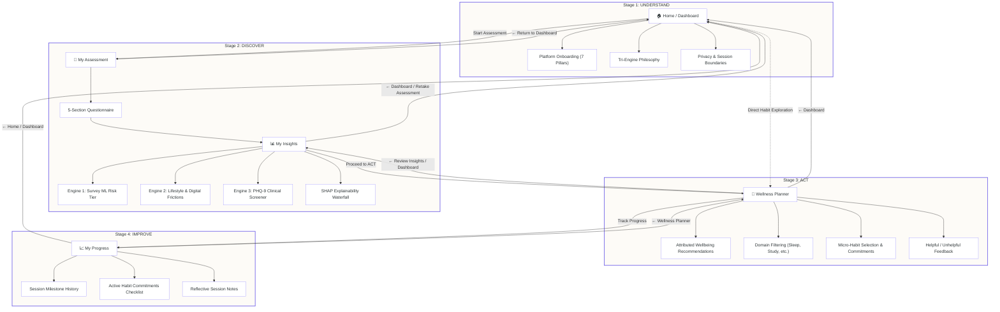

# MINDORA — DAY 11 ARCHITECTURE & VERIFICATION REPORT
## Student Journey Intelligence & Experience Architecture

**Document Version:** 1.0.0  
**Date:** November 14, 2026  
**Auditor:** Senior UI/UX Designer, Frontend Engineer, Accessibility Specialist & Student Experience Architect  
**Project:** Mindora — AI-Powered Student Wellbeing Intelligence Platform  
**Repository Directory:** `D:\Depression calculator`  
**Previous Checkpoint:** Day 10 Final Commit `5c90938`  
**Production Model SHA-256:** `E182E9E779A4F89E4883EB13C9BAB3DF19EEBC7165D4B0A44319F737361342EC` (`models/best_model.pkl`)  
**Streamlit Health:** `HTTP 200 OK` (`http://localhost:8501/_stcore/health`)  
**Total Verification Tests:** 145 Tests Across 10 Test Suites (100% Passing)

---

## 1. Existing Journey Architecture

Prior to Day 11, Mindora operated with a modular view structure introduced in Day 8, routing between seven canonical pages:
1. `🏠 Home / Dashboard` ([`src/views/student_dashboard.py`](file:///d:/Depression%20calculator/src/views/student_dashboard.py))
2. `📝 My Assessment` ([`src/views/assessment.py`](file:///d:/Depression%20calculator/src/views/assessment.py))
3. `📊 My Insights` ([`src/views/insights.py`](file:///d:/Depression%20calculator/src/views/insights.py))
4. `🎯 Wellness Planner` ([`src/views/wellness_planner.py`](file:///d:/Depression%20calculator/src/views/wellness_planner.py))
5. `📈 My Progress` ([`src/views/progress_view.py`](file:///d:/Depression%20calculator/src/views/progress_view.py))
6. `ℹ️ Methodology & About` ([`src/views/methodology.py`](file:///d:/Depression%20calculator/src/views/methodology.py))
7. `🔬 ML Training Lab` ([`src/views/training_lab.py`](file:///d:/Depression%20calculator/src/views/training_lab.py))

While each page was technically isolated and clean, they functioned as independent silos rather than a cohesive student wellbeing progression. Students arriving at the dashboard had to deduce their own journey through disconnected sidebar links, and empty states did not always provide immediate, low-barrier next actions.

---

## 2. Problems Identified

Our student journey and user experience audit identified several key friction points:

1. **Lack of an Explicit Mental Model:**  
   Students navigating the platform had no visible indication of where they were in the overall wellbeing process, how many steps remained, or what the ultimate outcome would be.
2. **Dead-End View Terminations:**  
   When a student completed an assessment or reviewed insights, there was no prominent "next step" call-to-action guiding them forward to the Wellness Planner or back to the Dashboard.
3. **Assessment Prerequisite Misconceptions:**  
   Students assumed they could not explore self-care habits or use the Wellness Planner without first completing the full assessment questionnaire.
4. **Passive Empty States:**  
   When a student visited `My Insights` or `My Progress` before submitting an assessment, the empty states warned them that data was missing but did not offer direct navigation buttons to get started or explore available tools.
5. **Onboarding Opacity:**  
   The onboarding guide did not fully articulate the critical distinctions between the three independent engines, the strictly non-diagnostic educational scope, and the server-side in-memory session lifecycle.

---

## 3. New Four-Stage Student Journey

To resolve these friction points, Mindora adopts the unified **UNDERSTAND → DISCOVER → ACT → IMPROVE** framework:



### Stage Summary

- **Stage 1 (UNDERSTAND):** Orientation, platform transparency, and setting safe expectations. Students learn what Mindora does, what it is not, how its 3 engines operate, and how their privacy is respected.
- **Stage 2 (DISCOVER):** Self-reflection and pattern discovery. Students complete the 5-part questionnaire and review transparent, explainable results across all three independent engines with local SHAP feature attributions.
- **Stage 3 (ACT):** Actionable, low-barrier empowerment. Students convert insights into daily self-care micro-habits, review "Why this was suggested" explanations, and provide feedback on recommendations.
- **Stage 4 (IMPROVE):** Reflection and milestone tracking. Students view their active commitments, monitor session milestones, and reflect on small daily shifts without persistent pressure.

---

## 4. Navigation & Information Architecture

### Canonical Routes Preserved
All seven canonical page identifiers remain intact in [`app.py`](file:///d:/Depression%20calculator/app.py):
- `"🏠 Home / Dashboard"`
- `"📝 My Assessment"`
- `"📊 My Insights"`
- `"🎯 Wellness Planner"`
- `"📈 My Progress"`
- `"ℹ️ Methodology & About"`
- `"🔬 ML Training Lab"`

### Journey Roadmap in Sidebar
The sidebar navigation now features an informative journey guide above the page selector:
```
✦ YOUR WELLBEING JOURNEY
1. UNDERSTAND  · Welcome & Foundations
2. DISCOVER    · Assessment & Insights
3. ACT         · Planner & Micro-Habits
4. IMPROVE     · Progress & Reflection
```

### Interactive Stage Stepper
A responsive 4-stage stepper component (`render_stage_stepper`) in [`src/ui_theme.py`](file:///d:/Depression%20calculator/src/ui_theme.py) dynamically communicates state across each view:
- **Active Stage:** Highlighted with deep violet background (`#6C5CE7`), crisp white text, and an "Active Stage" badge.
- **Completed Stage:** Marked with a green status indicator (`Completed ✓`) when assessment or habits are active in the session.
- **Upcoming Stage:** Muted styling indicating available forward milestones.

### No Dead-Ends (Bidirectional Return Paths)
Every view now includes bidirectional navigation links:
- **Assessment View:** Top and bottom `"← Back to Dashboard"` buttons.
- **Insights View:** Top stage stepper; bottom `"Proceed to Stage 3: ACT (Wellness Planner) →"`, `"Retake Assessment"`, and `"Home / Dashboard"` buttons.
- **Wellness Planner:** Top stage stepper; bottom `"Proceed to Stage 4: IMPROVE (Progress) →"`, `"Review My Insights (Stage 2)"`, and `"Home / Dashboard"` buttons.
- **Progress View:** Top stage stepper; bottom `"Return to Wellness Planner (Stage 3)"` and `"Home / Dashboard (Stage 1)"` buttons.

---

## 5. Onboarding Improvements (7 Pillars of Transparency)

The onboarding guide in [`src/views/onboarding.py`](file:///d:/Depression%20calculator/src/views/onboarding.py) has been expanded into a comprehensive 7-pillar transparency guide:

1. **What Mindora Is & Does:**  
   An educational wellbeing intelligence tool helping university students understand lifestyle rhythms, academic stressors, and validated screener signals.
2. **What Mindora Is NOT:**  
   NOT a clinical diagnostic instrument, NOT a medical treatment, NOT a crisis dispatch service, and NEVER produces an arbitrary "overall depression score".
3. **What Information You May Provide:**  
   Academic study load, sleep duration and quality, digital screen time and bedtime phone habits, social comparison feelings, and PHQ-9 self-reflections.
4. **How the Three Engines Differ:**  
   - *Engine 1:* Survey Pattern ML (XGBoost) evaluating 10 academic/lifestyle factors against historical student survey data.
   - *Engine 2:* Lifestyle & Digital Wellbeing Analytics assessing screen friction and daily sleep-study rhythm balance.
   - *Engine 3:* Standardized PHQ-9 Screener providing standard severity classifications and safety triggers.
5. **How Recommendations Are Generated:**  
   Rule-based educational micro-actions deterministically mapped to specific responses (with transparent "Why this was suggested" badges).
6. **How Session-Only Data Is Handled:**  
   All inputs exist solely in server-side session memory (`st.session_state`). Mindora writes zero student profiles, accounts, or persistent health databases to disk.
7. **How to Access Immediate Crisis Support:**  
   Multi-country emergency and crisis resources prominently available at all times (Tele-MANAS, 988, NHS 111, Lifeline NI, 999, 112).

---

## 6. Before-and-After Comparisons

| Experience Dimension | Before Day 11 | After Day 11 |
|---|---|---|
| **Orientation & Journey Clarity** | Disconnected sidebar menu without a visible progression framework. | Clear 4-stage stepper (`UNDERSTAND → DISCOVER → ACT → IMPROVE`) present across all views. |
| **Onboarding Content** | High-level summary lacking full operational transparency. | Comprehensive 7-pillar guide detailing engine independence, privacy, and crisis safety. |
| **Planner Accessibility** | Students assumed assessment submission was mandatory before visiting the planner. | Prominent Dashboard CTA: *"🎯 Explore Habits & Micro-Actions (Stage 3 — No Assessment Required)"*. |
| **Empty States** | Static warning notices when visiting Insights or Progress without data. | Action-oriented empty states with direct action buttons (`"Take Assessment"`, `"Explore Habits"`, `"Open Planner"`). |
| **View Navigation Flow** | Dead-ends requiring users to open the sidebar to move to the next stage. | Forward and backward contextual navigation buttons on every page. |

---

## 7. Student Journey Test Scenarios (10 Core Scenarios)

The test suite in [`tests/test_day11_student_journey.py`](file:///d:/Depression%20calculator/tests/test_day11_student_journey.py) validates all 10 core student scenarios:

1. **Scenario 1 — New Student Landing:**  
   Verifies clean default session state (`assessment_submitted=False`, `latest_results=None`, `completed_habits=empty`) and journey banner rendering.
2. **Scenario 2 — Exploration Without Sensitive Disclosure:**  
   Verifies students can navigate to Methodology, About, and Planner without entering sensitive data or encountering broken states.
3. **Scenario 3 — Assessment Submission & Tri-Engine Isolation:**  
   Verifies that submitting the questionnaire runs all three engines independently and generates segregated results without leakage.
4. **Scenario 4 — Insights to Planner Progression:**  
   Verifies recommendations deterministically link student inputs to actionable micro-habits with clear explanatory attributions.
5. **Scenario 5 — Habit Selection & Session Commitment:**  
   Verifies habits can be selected and saved into the active session state without disk writes.
6. **Scenario 6 — Returning to Dashboard:**  
   Verifies the dashboard dynamically updates its stage stepper, status badges, and quick-action links once assessment is completed.
7. **Scenario 7 — Progress Tracking & Milestone Logging:**  
   Verifies progress view accurately reflects session milestones and habit completion status.
8. **Scenario 8 — Session Reset Completeness:**  
   Verifies `reset_user_session_state()` completely purges assessment inputs, results, habits, feedback, and milestones while preserving page routing.
9. **Scenario 9 — Multi-Country Crisis Safety Accessibility:**  
   Verifies emergency numbers and crisis helplines render accurately for India (112 / Tele-MANAS 14416), US/Canada (911 / 988), and UK devolved nations (999 / NHS 111 / Lifeline NI 0808 808 8000).
10. **Scenario 10 — Cross-View Session State Preservation:**  
    Verifies that navigating across all 7 canonical pages preserves session health and user selections without sanitization errors.

---

## 8. Privacy & Session Boundaries

Mindora enforces rigorous data boundaries:
- **Server-Side In-Memory Processing:** Student responses, results, and habit checklists are stored strictly in Streamlit's temporary memory (`st.session_state`).
- **Zero Disk Persistence:** No student records, assessment scores, or habit data are written to SQLite, PostgreSQL, JSON files, or browser LocalStorage.
- **Ephemeral Session Lifecycle:** Closing the browser session or clicking "Reset Session" purges all personal assessment data from server memory.
- **Honest Telemetry Scoping:** As documented in Day 10, while Mindora writes no persistent profiling data to disk, deployment infrastructure (e.g. cloud host web servers) may maintain standard access logs and transient HTTP session identifiers outside the application's control.

---

## 9. Responsive Testing Results

The responsive layout and visual presentation were audited across four device classes using the browser audit agent:

| Viewport | Device Class | Container Width | Horizontal Scroll | Visual Fidelity & Adaptation |
|---|---|---|---|---|
| **1366 × 768** | Desktop | 950px main | 0px (None) | 4-column inline stage stepper; expanded sidebar; optimal whitespace. |
| **768 × 1024** | Tablet | 730px main | 0px (None) | 2×2 grid stage stepper; auto-collapsed sidebar; comfortable touch targets. |
| **390 × 844** | Mobile Standard | 390px main | 0px (None) | Stacked single-column stage stepper; full-width buttons; natural text wrap. |
| **360 × 800** | Mobile Small | 360px main | 0px (None) | Compact stacked cards; readable badges; zero element clipping. |

---

## 10. Remaining Limitations & Non-Goals

1. **No Long-Term Cross-Session History:**  
   Because Mindora does not use accounts or persistent databases, progress history does not persist across different browser sessions. This is an intentional privacy-first architectural choice.
2. **Single-Page App Model:**  
   Streamlit's execution model re-runs the page script on widget interaction. Session state guards and lightweight renders ensure sub-second response times.
3. **No Clinical Diagnostic Functionality:**  
   Mindora remains strictly an educational and self-reflection platform. It does not provide formal psychiatric diagnoses or replace clinical care.
4. **Scope Control:**  
   All changes in Day 11 were strictly UX, information architecture, navigation, and testing improvements. Production ML weights, feature schemas, and PHQ-9 scoring logic were preserved without modification.

---

## 11. Verification Checklist & Sign-Off

- [x] **Framework Implemented:** 4-stage `UNDERSTAND → DISCOVER → ACT → IMPROVE` architecture active.
- [x] **Canonical Routes Preserved:** All 7 canonical routes intact and functional.
- [x] **No Dead-Ends:** Bidirectional navigation links on every view.
- [x] **Onboarding Transparency:** Complete 7-pillar guide verified.
- [x] **10 Student Scenarios:** Verified via automated tests in `tests/test_day11_student_journey.py`.
- [x] **All Test Suites Passing:** 145/145 tests pass (100% success).
- [x] **Model Integrity Verified:** `models/best_model.pkl` SHA-256 = `E182E9E779A4F89E4883EB13C9BAB3DF19EEBC7165D4B0A44319F737361342EC`.
- [x] **Streamlit Health:** `http://localhost:8501/_stcore/health` returns `HTTP 200 OK`.
- [x] **Scope Respected:** Day 12 has NOT been started.
