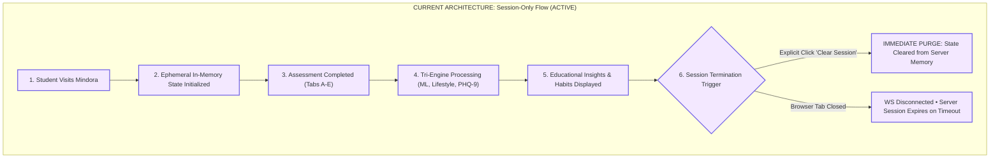
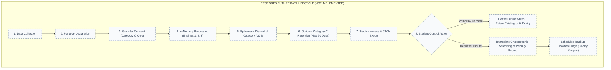
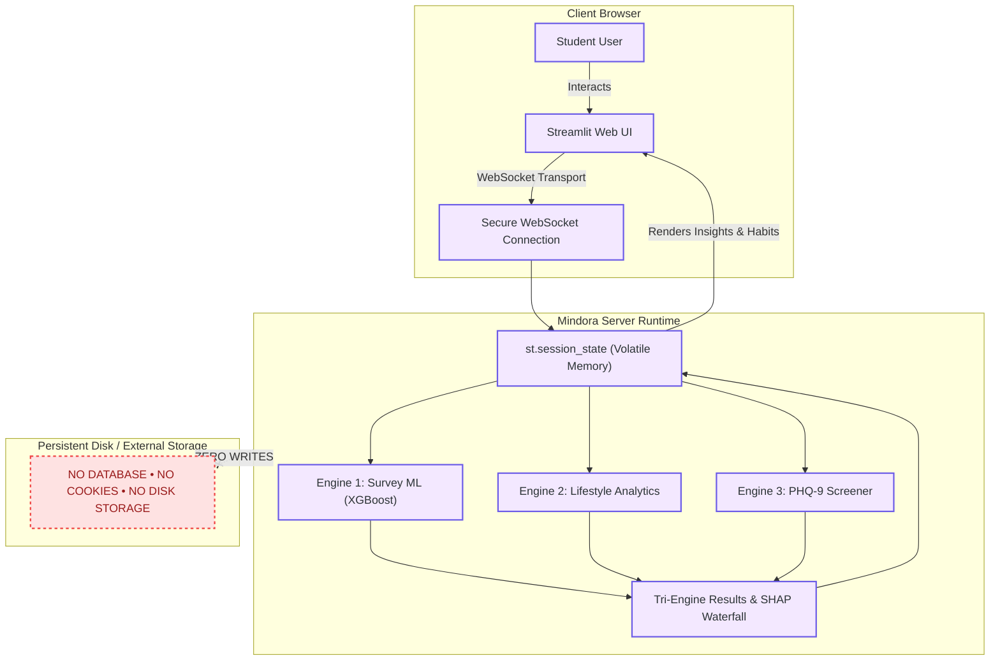
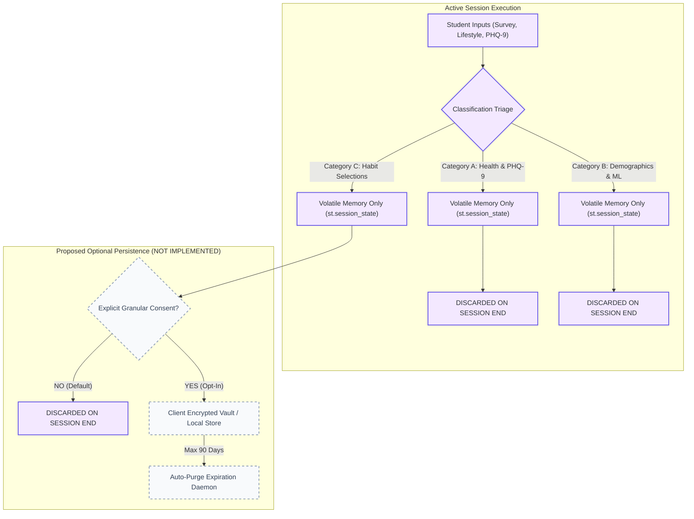
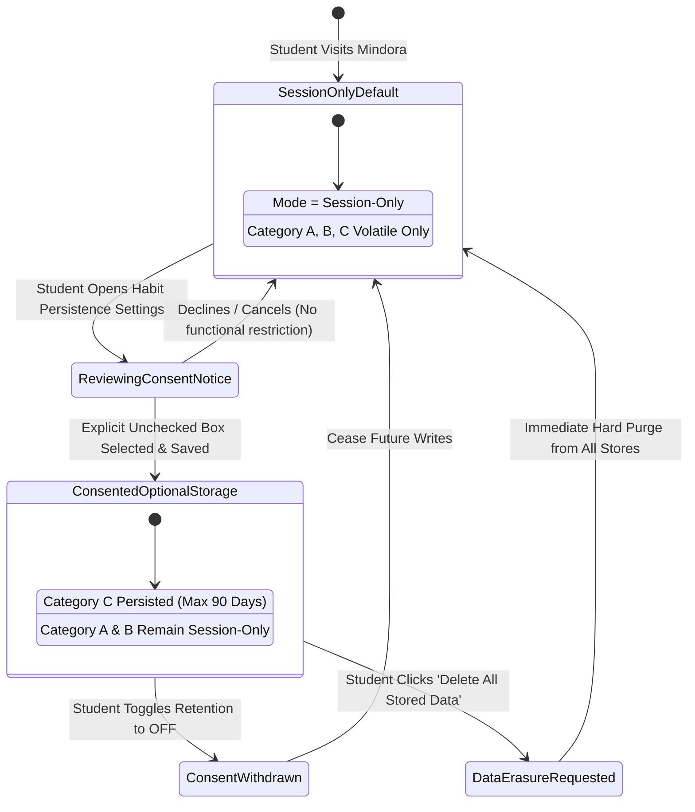
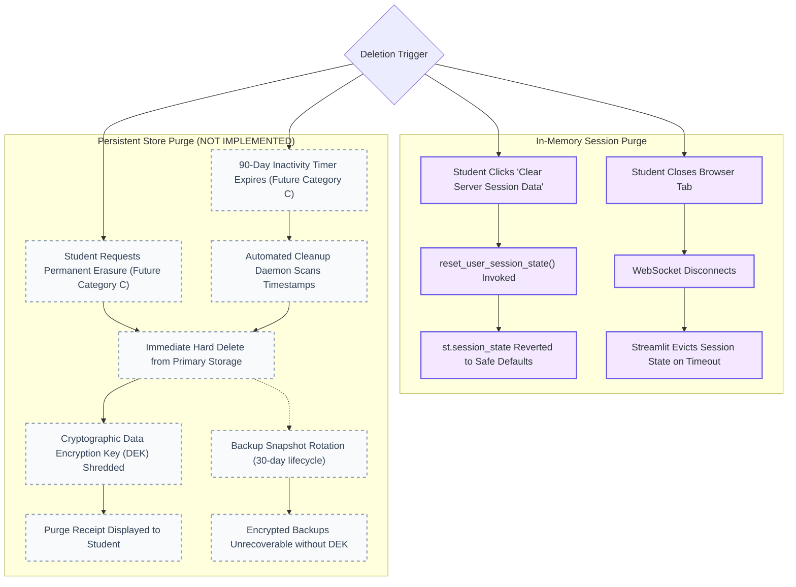

# MINDORA — DAY 12 ARCHITECTURE & DESIGN REPORT
## Personalization, Student Consent & Privacy Architecture

**Document Version:** 1.0.0 (Architecture & Design Specification)  
**Date:** November 14, 2026  
**Auditor / Architect:** Senior Privacy Architect, Security Engineer & Product Experience Researcher  
**Project:** Mindora — AI-Powered Student Wellbeing Intelligence Platform  
**Repository Directory:** `D:\Depression calculator`  
**Previous Official Checkpoint:** Day 11 — Commit `3ba5c4d`  
**Production Model SHA-256:** `E182E9E779A4F89E4883EB13C9BAB3DF19EEBC7165D4B0A44319F737361342EC` (`models/best_model.pkl`)  
**Streamlit Health:** `HTTP 200 OK` (`http://localhost:8501/_stcore/health`)  

> [!IMPORTANT]
> **MANDATORY IMPLEMENTATION STATUS NOTICE:**  
> Day 12 is strictly an **ARCHITECTURE AND DESIGN STAGE**.  
> **Persistent personalization is NOT implemented in the production application.**  
> Mindora continues to execute exclusively in **Session-Only In-Memory Mode** via server-side `st.session_state`. No databases, user accounts, browser `localStorage`/`sessionStorage`, cloud synchronization, or persistent student profiling mechanisms have been introduced.

---

## 1. Existing Data Inventory

An exhaustive code audit of `src/session_utils.py`, `src/views/assessment.py`, `src/views/insights.py`, `src/views/wellness_planner.py`, `src/views/progress_view.py`, `src/recommendations.py`, and `.streamlit/config.toml` identified 11 operational data categories currently handled by Mindora:

1. **Psychometric Health Data (Engine 3 PHQ-9):**
   - *Fields:* Raw answers to Items 1–8, Item 9 (thoughts of death/self-harm), total score (0–27), clinical severity tier, and self-harm risk flag.
   - *Creation:* Tab D of `src/views/assessment.py`; calculated via `calculate_phq9()` in `src/recommendations.py`.
   - *Storage:* In-memory server session dictionary `st.session_state.latest_results["engine_3_phq9"]`.
   - *Availability:* Exists only for the duration of the active Streamlit server session. Purged upon reset or session timeout.
   - *Sensitivity:* **Highly Sensitive (Health / Special Category).**
   - *Personalization Necessity:* Required only for real-time educational screening and crisis hotline triggering.
   - *Persistence Eligibility:* **STRICTLY NEVER ELIGIBLE.**
2. **Machine Learning Demographic & Academic Strain Features (Engine 1):**
   - *Fields:* Age, Gender, Degree, CGPA, Academic Pressure (1–5), Study Satisfaction (1–5), Work/Study Hours, Financial Stress (1–5), Sleep Duration, Dietary Habits.
   - *Creation:* Tabs B & C of `src/views/assessment.py`.
   - *Storage:* `st.session_state.latest_results["ml_inputs"]`.
   - *Availability:* Ephemeral server session.
   - *Sensitivity:* Personal student academic, financial, and demographic data.
   - *Personalization Necessity:* Required for real-time model inference matching the 10 approved training features.
   - *Persistence Eligibility:* Ineligible under ordinary personalization.
3. **Digital & Social Lifestyle Behavioral Metrics (Engine 2):**
   - *Fields:* Daily phone hours, social media hours, primary platform, phone in bed within 45m, upward social comparison, notification checking, phone concentration interruption, sleep quality, daytime fatigue, exercise frequency, outdoor daylight exposure, campus loneliness, social support satisfaction, in-person friend interaction frequency, community connectedness, and optional text reflections.
   - *Creation:* Tabs A, B, and E of `src/views/assessment.py`.
   - *Storage:* `st.session_state.latest_results["lifestyle_inputs"]`.
   - *Availability:* Ephemeral server session.
   - *Sensitivity:* Highly personal behavioral patterns and intimate free-form reflections.
   - *Personalization Necessity:* Real-time calculation of Lifestyle Rhythm and Digital Friction scores.
   - *Persistence Eligibility:* Ineligible for persistent logging.
4. **Model Predictive & Explainability Outputs (Engine 1):**
   - *Fields:* Survey pattern match probability (0–100%), categorical risk tier, local SHAP waterfall feature attributions.
   - *Creation:* `predict_wellness_risk()` in `src/predict.py`.
   - *Storage:* `st.session_state.latest_results["engine_1_ml"]`.
   - *Availability:* Ephemeral server session.
   - *Sensitivity:* High (Derived predictive risk indicator).
   - *Persistence Eligibility:* Ineligible (Prevents persistent diagnostic profiling).
5. **Lifestyle Analytics Outputs (Engine 2):**
   - *Fields:* Lifestyle Rhythm score (0–10), Digital Friction index (0–10), screen vs. sleep ratio, friction drivers.
   - *Creation:* `analyze_lifestyle_patterns()` in `src/recommendations.py`.
   - *Storage:* `st.session_state.latest_results["engine_2_lifestyle"]`.
   - *Availability:* Ephemeral server session.
   - *Sensitivity:* Personal behavioral index.
   - *Persistence Eligibility:* Ineligible.
6. **Contextual Action Recommendations & Feedback:**
   - *Fields:* Ordered list of recommendation dictionaries, student feedback map (`recommendation_feedback`), dismissed recommendation set (`dismissed_recommendations`).
   - *Creation:* `generate_educational_recommendations()` in `src/recommendations.py`; mutated in `wellness_planner.py`.
   - *Storage:* Ephemeral server session.
   - *Sensitivity:* Low to Medium (Feedback expresses preference; raw recommendation list reflects sensitive inputs).
   - *Persistence Eligibility:* High-level domain preferences only (Category C); raw lists remain session-only.
7. **Wellness Planner Habit Commitments & Energy Check-In:**
   - *Fields:* Checked habit IDs (`completed_habits`), session energy rating (`daily_energy_checkin`).
   - *Creation:* Interactive controls in `src/views/wellness_planner.py`.
   - *Storage:* Ephemeral server session `st.session_state.completed_habits`.
   - *Sensitivity:* Low (Non-clinical self-care micro-habits like hydration or pomodoro study blocks).
   - *Persistence Eligibility:* **Candidate for Optional Retention (Category C).**
8. **Session Milestone History:**
   - *Fields:* `st.session_state.session_progress` list containing timestamp, risk tier, risk percentage, PHQ-9 score, PHQ-9 severity, rhythm score, digital friction.
   - *Creation:* Appended upon assessment submission in `src/views/assessment.py`.
   - *Storage:* Ephemeral server session.
   - *Sensitivity:* Contains Category A (PHQ-9 score) and Category B (ML percentage).
   - *Persistence Eligibility:* In its current composite format: **NO**. Must not be persisted.
9. **Geographic Helpline Routing Preferences:**
   - *Fields:* `selected_country`, `selected_uk_region`.
   - *Creation:* Persistent sidebar dropdown selectors.
   - *Storage:* Ephemeral server session.
   - *Sensitivity:* Low.
   - *Persistence Eligibility:* Candidate for Optional Retention (Category C).
10. **Application Navigation State:**
    - *Fields:* `current_page` (e.g. `"🏠 Home / Dashboard"`).
    - *Creation:* Router interactions in `app.py`.
    - *Storage:* Ephemeral server session.
    - *Sensitivity:* Non-sensitive framework state.
    - *Persistence Eligibility:* Session-only.
11. **Streamlit Framework Infrastructure Tokens:**
    - *Fields:* `_streamlit_xsrf` cookie, WebSocket connection UUID, client IP in transient web server logs.
    - *Creation:* Streamlit framework runtime and underlying HTTP server.
    - *Storage:* HTTP cookie header / server memory.
    - *Sensitivity:* Transport security tokens.
    - *Persistence Eligibility:* Framework-managed; application stores zero infrastructure tokens.

---

## 2. Three Data Classifications

To eliminate privacy ambiguities, Mindora establishes three strict data categories:

```
┌────────────────────────────────────────────────────────────────────────┐
│                   MINDORA DATA CLASSIFICATION TIERS                    │
├────────────────────────────────┬───────────────────────────────────────┤
│ Tier Category                  │ Architectural Policy & Invariants     │
├────────────────────────────────┼───────────────────────────────────────┤
│ CATEGORY A:                    │ • STRICTLY SESSION-ONLY               │
│ Highly Sensitive Health        │ • Never written to disk or database   │
│ & Psychometric Information     │ • Never used for student profiling    │
│ (PHQ-9, Item 9, Notes, Crisis) │ • Never used for model retraining     │
├────────────────────────────────┼───────────────────────────────────────┤
│ CATEGORY B:                    │ • SESSION-ONLY BY DEFAULT             │
│ Personal Student Information   │ • Ineligible for regular persistence  │
│ (Demographics, Strain Metrics, │ • Pseudonymization does NOT justify   │
│ ML Outputs, Lifestyle Scores)  │   long-term retention                 │
├────────────────────────────────┼───────────────────────────────────────┤
│ CATEGORY C:                    │ • OPTIONAL RETENTION ELIGIBLE         │
│ Non-Clinical Progress Info     │ • Requires separate, explicit consent │
│ (Habit IDs, Dates, Domains,    │ • Fully exportable and deletable      │
│ Helpline Country Preference)   │ • Automatic 90-day rolling expiration │
└────────────────────────────────┴───────────────────────────────────────┘
```

### Category A — Highly Sensitive Information
- **Items:** All 9 individual PHQ-9 answers, Item 9 responses, total PHQ-9 aggregate scores, clinical severity classifications, self-harm risk flags, qualitative free-form reflection text, and crisis helpline click timestamps.
- **Architectural Policy:**  
  1. *Absolute Retention Ban:* These fields must **NEVER** be persisted in any database, local web storage, JSON file, or profile record.
  2. *Ephemeral Memory Only:* Processed exclusively in volatile server-side memory (`st.session_state`) during an active session.
  3. *Zero Machine Learning Use:* Strictly excluded from model retraining pipelines or analytical telemetry.
  4. *Zero Profiling:* No longitudinal psychiatric history may be accumulated across visits.

### Category B — Personal Student Information
- **Items:** The 10 ML demographic and academic inputs (age, gender, degree, CGPA, academic stress, study satisfaction, work hours, financial strain, sleep duration, diet), 15 lifestyle inputs (screen time, social media usage, bedtime phone habits, social comparison, daytime fatigue, loneliness, social support), ML risk probabilities (0–100%), ML risk tiers, individual SHAP waterfall values, Lifestyle Rhythm scores, and Digital Friction scores.
- **Architectural Policy:**  
  1. *Session-Only Default:* Ineligible for persistent storage under ordinary student personalization.
  2. *No Profiling Assumption:* Pseudonymization, tokenization, or hashing does NOT transform these intimate behavioral markers into non-sensitive data.
  3. *Voluntary In-Session Re-entry:* Students who wish to re-evaluate their wellbeing upon a return visit re-submit the questionnaire afresh, ensuring full awareness of the data processed.

### Category C — Optional Progress Information
- **Items:** Completed non-clinical habit IDs (e.g. `sleep_anchor`, `digital_pomodoro`), non-clinical habit domain preferences (e.g. "Sleep Architecture", "Academic Focus"), dates of completed check-ins (calendar dates with zero associated scores or assessments), student ratings of habit utility (`helpful` / `unhelpful`), and preferred country/region for helpline directory routing.
- **Architectural Policy:**  
  1. *Opt-In Only:* Never enabled by default. Requires separate, explicit, unbundled student consent.
  2. *Zero Clinical Linkage:* Category C records must never be linked to, store, or reference Category A or Category B data.
  3. *Strict Retention Cap:* Retained for a maximum rolling period of 90 days from the student's last active check-in, after which inactive records are automatically purged.
  4. *Instant Deletion:* Students retain an absolute right to inspect, export, or immediately purge Category C data at any time.

---

## 3. Recommended Retention Policy

The field-by-field retention parameters are codified in [`docs/DAY_12_DATA_RETENTION_MATRIX.md`](file:///d:/Depression%20calculator/docs/DAY_12_DATA_RETENTION_MATRIX.md). The recommended operational policy is summarized below:

1. **Production Baseline (Current):**  
   100% of student assessment data, results, habits, and preferences reside solely in ephemeral server-side memory (`st.session_state`). Zero bytes are written to persistent disk storage.
2. **Future Optional Personalization Boundary:**  
   If an optional persistence feature is introduced in a future development phase, it must be restricted strictly to **Category C non-clinical fields**.
3. **Data Minimization Rule:**  
   Under no circumstances may a student's assessment answers, PHQ-9 psychometrics, or ML risk percentages be saved to facilitate progress tracking. Progress tracking is strictly defined as tracking *self-care actions completed*, never tracking *psychometric deficit scores*.

---

## 4. Design of the Consent Experience

### Core Architectural Principles
1. **Session-Only Default:** The platform boots into Session-Only Mode for every visitor. No banner or modal may block basic access.
2. **Exploration Without Identity:** Students can freely navigate the Onboarding Guide, Methodology, and complete an assessment without creating an account or providing an email address.
3. **Unbundled Consent:** Consent for optional habit persistence is strictly separated from the mandatory non-diagnostic assessment consent.
4. **No Functional Penalties:** Declining optional progress retention does not restrict access to any assessment engine, insights view, or planner tool.
5. **Zero Dark Patterns:** No preselected checkboxes, no countdown timers, no shame-inducing decline options (e.g. "No, I don't care about my wellbeing"), and no hidden retention defaults.
6. **Granular Control & Right to Erasure:** Students can inspect what is saved, download a copy in open format (JSON), withdraw consent, or trigger an irreversible purge.

### Six Designed UI States

#### State 1: First-Time Student (Session-Only Default)
- **UI Presentation:** The student sees a clean, unobtrusive privacy status badge in the header:
  ```
  🔒 Mode: Session-Only • Zero Data Stored On Disk
  ```
- **Copy:** *"Mindora is currently running in private session mode. When your browser session ends, all questionnaire answers and habit selections are cleared from server memory."*

#### State 2: Student Choosing Optional Progress Retention
- **UI Presentation:** Located inside an optional settings expander in the Wellness Planner:
  ```
  ┌────────────────────────────────────────────────────────────────────────┐
  │ 🎯 Optional: Remember My Daily Habits for Future Visits                │
  ├────────────────────────────────────────────────────────────────────────┤
  │ Would you like Mindora to remember your completed self-care habits     │
  │ and selected goals when you return on this device?                     │
  │                                                                        │
  │ What will be remembered:                                               │
  │   ✓ The names of habits you check off (e.g. 'Pomodoro Study Block')    │
  │   ✓ The dates you checked habits off (for your progress streak)        │
  │   ✓ Your preferred crisis helpline country                             │
  │                                                                        │
  │ What will NEVER be remembered:                                         │
  │   ✗ Your PHQ-9 mental health screening answers or scores               │
  │   ✗ Your academic pressure, financial stress, or ML risk tier         │
  │   ✗ Your personal reflection notes                                     │
  │                                                                        │
  │ [ ] Enable Optional Habit Progress Saving (Unchecked by default)       │
  │                                                                        │
  │ [ Save Habit Progress ]                 [ Keep Session-Only (Default) ]│
  └────────────────────────────────────────────────────────────────────────┘
  ```

#### State 3: Student Reviewing Retained-Data Categories
- **UI Presentation:** An interactive "Student Privacy Ledger" showing live entries:
  ```
  ┌────────────────────────────────────────────────────────────────────────┐
  │ 📋 Your Active Privacy Ledger                                          │
  ├────────────────────────────────────────────────────────────────────────┤
  │ Category C Items Stored:                                               │
  │ • Active Habits: ['sleep_anchor', 'digital_pomodoro']                  │
  │ • Check-In Dates: ['2026-11-12', '2026-11-14']                         │
  │ • Country Preference: 'India'                                          │
  │ • Expiration Date: 2027-02-12 (Rolling 90-day auto-purge)              │
  │                                                                        │
  │ [ 📥 Download My Data (JSON) ]        [ 🗑️ Delete All Stored Data ]    │
  └────────────────────────────────────────────────────────────────────────┘
  ```

#### State 4: Student Withdrawing Consent
- **UI Presentation:** A single toggle switch:
  ```
  [ ON ] Remember My Habits on this Device
  ```
- **Action:** Toggling to `[ OFF ]` prompts:
  *"Consent withdrawn. Future habit completions will be session-only. Would you also like to delete previously saved habits, or keep them until they expire in 90 days?"*  
  Buttons: `[ Delete Previously Saved Now ]` | `[ Keep Existing Until Expired ]`

#### State 5: Student Requesting Deletion
- **UI Presentation:** Clicking `[ 🗑️ Delete All Stored Data ]` opens a confirmation modal:
  *"This will permanently and irreversibly erase your saved habits and progress dates. This action cannot be undone."*  
  Action button: `[ Yes, Delete Everything Immediately ]`
- **Confirmation Receipt:**
  ```
  ✓ Your saved progress data has been permanently deleted from storage.
  Mindora has returned to 100% Session-Only Mode.
  ```

#### State 6: Student Using Mindora Without Optional Retention
- **UI Presentation:** The student uses the application freely. All views display normal habit check-ins and session milestones. When the student clicks "Clear All Session Data Now" in `My Progress`, the server memory resets instantly. Zero prompt or nagging message ever appears asking the student to enable retention.

---

## 5. Future Personalization Architecture Comparison

We evaluated three potential technical paradigms for future student personalization:

| Architecture Dimension | Option A: Session-Only In-Memory (`st.session_state`) [CURRENT] | Option B: Client-Side Encrypted Storage (Local Web Vault) | Option C: Account-Based Encrypted Cloud Store |
|---|---|---|---|
| **Privacy Profile** | **Exceptional:** Zero persistent student data on server or disk. Immediate ephemerality. | **High:** Data never leaves student device. Zero server database to breach. | **Medium-Low:** Requires central server storage; introduces attack surface and profiling risk. |
| **Security Posture** | **Exceptional:** No database credentials, no SQL injection vector, no credential theft. | **Medium:** Susceptible to physical device compromise or shared library terminal scraping. | **Complex:** Requires robust auth, salt/hashing (Argon2id), TLS, RBAC, and DB encryption at rest. |
| **Offline Reliability** | **High:** Fully functional in air-gapped / offline local network setups. | **High:** Works entirely offline within the student's browser sandbox. | **Poor:** Dependent on live external internet connectivity and cloud uptime. |
| **Multi-Device Sync** | **None:** State is bound to the active browser connection. | **None:** State does not synchronize between phone and laptop without manual export. | **High:** Habits sync seamlessly across student devices. |
| **Data Recovery** | **None:** Resetting session permanently clears state. | **Low:** Clearing browser cache/cookies wipes local storage without recovery. | **High:** Centralized account recovery via email/passphrase. |
| **Operational Complexity** | **Minimal:** Zero external dependencies; self-contained in Streamlit. | **Low:** Requires client-side cryptographic export/import scripts. | **Extreme:** Requires auth services, database maintenance, migrations, backup pipelines, monitoring. |
| **Maintenance Cost** | **Zero:** No cloud DB hosting fees, zero DB administration overhead. | **Zero:** Client hardware provides the storage and compute. | **Significant:** Ongoing database hosting, key management, compliance audits, storage fees. |
| **Student Usability** | **Frictionless:** Immediate access; zero logins, passwords, or verifications. | **Frictionless:** No login required; optional file export for backup. | **High Friction:** Requires sign-up, email confirmation, password management, login fatigue. |

### Recommended Phased Architecture

```
Phase 1 (Day 11–12) ──► Phase 2 (Future Evaluation) ──► Phase 3 (Long-Term Speculative)
[Pure Session Memory]     [Client Encrypted Vault]        [Zero-Knowledge Cloud Sync]
• st.session_state only   • File Export/Import (.json)    • Non-clinical Category C only
• Zero disk writes        • AES-GCM client encryption     • Argon2id client-derived key
• Active Production       • Zero server database          • Blinded server architecture
```

1. **Phase 1 (Current Baseline): Pure In-Memory Session Architecture.**  
   Maintains the zero-database, zero-account, privacy-first posture. Fully validated, thoroughly tested, and eliminates data breach liabilities.
2. **Phase 2 (Future Recommended Evolution): Client-Controlled Encrypted Vault.**  
   If students request multi-session progress tracking, implement client-side export/import. The student can click *"Export My Habit Progress"* to download a small, client-encrypted JSON file (`mindora_habits.enc`), and upload it on return. The server never stores the file or the key.
3. **Phase 3 (Long-Term Speculative Only): Blinded Zero-Knowledge Sync.**  
   If multi-device synchronization is ever mandated, it must use zero-knowledge architecture: the backend stores only an opaque encrypted blob of Category C habits encrypted with a passphrase derived client-side via Argon2id. The server has zero ability to inspect habit contents.

> [!WARNING]
> None of these persistent storage options are implemented in Day 12. Mindora remains strictly on Phase 1.

---

## 6. Student Data Lifecycle





### Critical Architectural Distinctions
To prevent technical misrepresentations, Mindora strictly distinguishes between five data lifecycle events:
1. **Clearing the Active Streamlit Session:**  
   Clears `st.session_state` in the running server process immediately. Reverts the user's interface to pristine defaults.
2. **Withdrawing Optional Storage Consent:**  
   Revokes authorization for future persistence. Does not automatically destroy historical records unless accompanied by an explicit erasure request.
3. **Deleting Retained Records (Primary Storage Erasure):**  
   Immediately deletes the active record from primary storage (e.g. key-value store or local device vault).
4. **Deleting Backups (Secondary Storage Purge):**  
   An erasure request in primary storage does not immediately scrub secondary disaster-recovery snapshots. Backups are subject to an automated 30-day rotation cycle, or encrypted with individual per-student data encryption keys (DEKs) that are cryptographically shredded upon deletion.
5. **Expiring Inactive Records:**  
   Any Category C record with zero student activity for 90 consecutive days is automatically purged by an automated cleanup daemon.

---

## 7. Personalization Without Clinical Profiling

Mindora establishes hard ethical and architectural boundaries between **non-clinical habit personalization** and **clinical/diagnostic profiling**:

```
┌────────────────────────────────────────────────────────────────────────┐
│             SAFE PERSONALIZATION VS. FORBIDDEN PROFILING               │
├───────────────────────────────────┬────────────────────────────────────┤
│ PERMITTED (Non-Clinical Habits)   │ STRICTLY FORBIDDEN (Profiling)     │
├───────────────────────────────────┼────────────────────────────────────┤
│ • Remembering selected study tips │ • Storing depression risk scores   │
│ • Filtering to "Sleep" micro-goals│ • Tracking PHQ-9 change over time  │
│ • Preferred Pomodoro duration     │ • Inferring clinical conditions    │
│ • Local crisis helpline country   │ • Steering habits via Item 9       │
│ • Daily hydration check-in streak │ • Creating an "overall wellness"   │
│ • Preferred notification format   │   diagnostic score                 │
└───────────────────────────────────┴────────────────────────────────────┘
```

### Strict Non-Clinical Boundaries
1. **Zero Mental Health Condition Inference:** The platform must never infer or tag a student with a diagnostic label based on their habit choices or response patterns.
2. **Zero Longitudinal Depression Tracking:** PHQ-9 scores must never be stored across visits to create a "depression trajectory" chart.
3. **Item 9 Isolation:** Item 9 responses trigger immediate, unprompted safety guidance in the active session. They must **NEVER** be saved to a database, used to modify future recommendations, or linked to an identity.
4. **No Unified Mental Health Score:** Mindora expressly prohibits synthesizing Engine 1 (ML risk), Engine 2 (Lifestyle friction), and Engine 3 (PHQ-9) into an aggregated "mental health index".

---

## 8. Threat Model & Privacy Risk Analysis

A structured threat analysis was conducted covering 12 distinct privacy and security attack vectors:

| Threat Vector | Potential Student Impact | Likelihood | Proposed Architecture Mitigation | Residual Risk | Further Review Needed? |
|---|---|---|---|---|---|
| **1. Shared Library Devices** | Subsequent student views previous user's assessment or habit history. | **High** | Session-only default; prominent "Clear Session" button in header; auto-reset on browser close/timeout. | Low (dependent on student clicking clear or closing tab). | Yes (UI timeout warning). |
| **2. Unauthorized Physical Access** | Bystander shoulder-surfs sensitive PHQ-9 answers. | **Medium** | Single-question view paging or blurred sensitivity mode; rapid session clear shortcut. | Medium (inherent to physical environment). | Yes (UI privacy mask). |
| **3. Lost or Stolen Devices** | Attendant discovers saved wellbeing records on student's personal laptop. | **Medium** | Zero Category A or B storage; Category C encrypted client-side using WebCrypto AES-GCM. | Low (Category C contains only non-clinical habit names). | No. |
| **4. Compromised Accounts / Passwords** | Unauthorized login exposes student profile. | **High (if accounts exist)** | **Mitigated by Architecture:** No accounts exist in Mindora. Zero passwords to compromise. | **Zero** (no account system). | No (re-evaluate if accounts added). |
| **5. Session Hijacking / Interception** | Eavesdropper captures WebSocket traffic in transit. | **Medium** | Enforce TLS 1.3 encryption; `enableXsrfProtection = true` in `.streamlit/config.toml`; HSTS headers. | Low. | Yes (TLS deployment audit). |
| **6. Cross-Student Memory Leakage** | Bug in server code leaks Session A state to Session B. | **Low** | Verified session isolation tests (`test_01_two_independent_sessions_remain_isolated`); strict defensive sanitizers. | Very Low. | No (covered by test suite). |
| **7. Accidental Server Logging** | Student responses logged in plaintext server stdout/access logs. | **Medium** | Verified `app.py` and engines contain zero print/log statements dumping student payloads; input sanitization. | Low. | Yes (log scrub verification). |
| **8. Insecure Backups / Snapshots** | Leaked database backups expose historical records. | **High (if DB exists)** | Zero application database in Phase 1; Phase 3 mandates cryptographic key shredding per record. | Zero in Phase 1; Low in Phase 3. | Yes (prior to Phase 3). |
| **9. Database SQL Injection / Exposure** | Remote attacker dumps central table of student disclosures. | **High (if DB exists)** | **Mitigated by Architecture:** Zero SQL/NoSQL databases exist in Mindora. No database attack surface. | **Zero** (no database). | No. |
| **10. Incomplete Deletion (Soft-Delete)** | Student requests deletion but data remains in hidden rows. | **Medium** | Architectural requirement: hard delete in primary store; immediate eviction from memory and caches. | Low. | Yes (automated audit script). |
| **11. Third-Party Analytics / Trackers** | Ad networks track student visits via Google Analytics / Meta pixels. | **High (if installed)** | Absolute prohibition on external tracking pixels; `gatherUsageStats = false` enforced in Streamlit config. | **Zero** (zero external telemetry). | No. |
| **12. Consent Manipulation (Dark Patterns)** | Student tricked into opting in via confusing button colors or pre-checks. | **Medium** | Unchecked checkboxes; equal visual weight for "Keep Session-Only"; plain student-friendly language. | Very Low. | Yes (UX ethics audit). |

---

## 9. Regulatory & Ethical Considerations

When deploying Mindora in India and serving students internationally, the architecture must align with applicable data protection frameworks:

### India: Digital Personal Data Protection Act (DPDP Act 2023)
1. **Data Fiduciary Obligations:** Mindora acts as a Data Fiduciary. Processing must be grounded in an explicit, lawful purpose declared at the time of collection (Section 4 & 5).
2. **Itemized & Comprehensible Notice:** Section 5 requires that request for consent be accompanied or preceded by an itemized notice in clear and plain language describing the personal data to be collected and the purpose of processing.
3. **Unbundled Consent:** Under Section 6, consent must be free, specific, informed, unconditional, and unambiguous, with a clear affirmative action. Default session-only mode satisfies this by never presuming consent.
4. **Right to Withdraw & Erase:** Sections 6(4) and 12 grant Data Principals the right to withdraw consent as easily as it was given, and the right to erasure of personal data that is no longer necessary for the declared purpose.
5. **Processing of Children's Data (Section 9):**  
   The DPDP Act defines a child as an individual under 18 years of age. University student populations frequently include 16- and 17-year-old first-year students. Section 9 strictly prohibits tracking, behavioral monitoring, or targeted advertising directed at children, and mandates verifiable parental consent.  
   *Architectural Safeguard:* Mindora collects no persistent profile, conducts zero tracking, and serves zero ads, substantially mitigating Section 9 risks. However, **formal operational deployment requires qualified legal counsel** to verify parental consent mechanics if serving students under 18.

### European Union: General Data Protection Regulation (GDPR)
1. **Special Category Data (Article 9):** Psychometric screener data (PHQ-9) constitutes "data concerning health" under Article 9. Processing requires explicit consent (Article 9(2)(a)) or provision of health care. Mindora's strict **Category A Session-Only policy** ensures health data is never stored, profiled, or transferred.
2. **Data Minimization & Storage Limitation (Article 5(1)(c), (e)):** Processing is kept strictly necessary for the immediate screening interaction and discarded immediately upon session completion.
3. **Right to Erasure ("Right to be Forgotten", Article 17):** Fully supported via immediate in-memory session reset and explicit Category C deletion controls.

> [!CAUTION]
> **LEGAL DISCLAIMER & QUALIFIED REVIEW REQUIREMENT:**  
> This section provides architectural and technical design recommendations. It does **NOT** constitute formal legal advice. A formal Data Protection Impact Assessment (DPIA) and review by qualified legal counsel must be conducted prior to any public production launch.

---

## 10. Required Architecture Diagrams

### Diagram 1: Current Session-Only Data Flow (ACTIVE)



---

### Diagram 2: Proposed Optional Personalization Flow (NOT IMPLEMENTED)



---

### Diagram 3: Consent Lifecycle Architecture



---

### Diagram 4: Student Data Deletion Lifecycle



---

## 11. Implementation Phases & Product Roadmap

```
┌────────────────────────────────────────────────────────────────────────┐
│                      MINDORA IMPLEMENTATION ROADMAP                    │
├───────────────┬────────────────────────────────────────────────────────┤
│ Phase         │ Technical Scope & Architectural Deliverables           │
├───────────────┼────────────────────────────────────────────────────────┤
│ Phase 1       │ • Pure in-memory session architecture                  │
│ [CURRENT]     │ • Zero disk writes, zero accounts, zero databases      │
│               │ • Fully verified via 152 automated tests               │
├───────────────┼────────────────────────────────────────────────────────┤
│ Phase 2       │ • Client-side encrypted export/import (.json vault)    │
│ [FUTURE SPEC] │ • AES-GCM client encryption; zero server storage       │
│               │ • Full student custody of non-clinical Category C data │
├───────────────┼────────────────────────────────────────────────────────┤
│ Phase 3       │ • Blinded zero-knowledge cloud synchronization         │
│ [SPECULATIVE] │ • Argon2id client-derived key; server sees opaque blob │
│               │ • Subject to DPIA and qualified legal review           │
└───────────────┴────────────────────────────────────────────────────────┘
```

---

## 12. Unresolved Decisions & Open Architecture Questions

The following architectural questions require formal stakeholder and institutional review before any persistent storage is implemented:

1. **Client Vault vs. Server Key-Value Store:**  
   Should Phase 2 rely entirely on client-downloaded encrypted files (`mindora_habits.enc`), or should an ephemeral server-side Redis/database with cryptographic tokens be evaluated? (Recommendation: Start with client-downloaded files to preserve zero-server-storage guarantees).
2. **Age Verification Mechanics in Higher Education:**  
   Given Section 9 of the DPDP Act (India), what verifiable parental consent mechanism is proportionate for 16- and 17-year-old university students without creating privacy-invasive identity verification hurdles?
3. **Institutional Deployment Scope:**  
   If universities deploy Mindora within campus health portals, will institutional single-sign-on (SSO) be requested? (Recommendation: Strongly oppose SSO integration to prevent linking student identity to wellbeing screening).
4. **Backup Shredding Standards:**  
   For any speculative cloud backup systems, what cryptographic key management infrastructure (KMS) will manage per-user Data Encryption Keys (DEKs)?

---

## 13. Explicit Implementation Status Statement

> [!IMPORTANT]
> **FORMAL VERIFICATION & COMPLIANCE STATEMENT:**  
> Day 12 is an **ARCHITECTURE, DESIGN AND POLICY AUDIT ONLY**.  
> **No persistent personalization has been implemented.**  
> Mindora's production code, model weights (`models/best_model.pkl`), feature schemas, and session memory behaviors remain 100% identical to the Day 11 release (`3ba5c4d`). Zero persistent student data stores have been introduced.

---

## 14. Verification Checklist & Sign-Off

- [x] **Complete Data Inventory:** Documented all 11 categories of student data across all views.
- [x] **Three Classifications Defined:** Category A (Highly Sensitive), Category B (Personal), Category C (Optional Progress).
- [x] **Retention Matrix Delivered:** Standalone matrix created in `docs/DAY_12_DATA_RETENTION_MATRIX.md`.
- [x] **Consent UX Designed:** 6 distinct UI states, zero preselected boxes, zero coercive dark patterns.
- [x] **Architecture Paradigms Compared:** Options A, B, and C evaluated across 8 dimensions.
- [x] **Data Lifecycle Documented:** 10 stages detailed with clear purge distinctions.
- [x] **Threat Model Completed:** 12 security and privacy threat vectors analyzed.
- [x] **Regulatory Framework Evaluated:** DPDP Act 2023, GDPR, minor data processing, and legal review notices.
- [x] **Mermaid Diagrams Created:** 4 comprehensive flowcharts clearly labeled.
- [x] **Automated Policy Tests:** Added `tests/test_day12_privacy_architecture.py` (7/7 tests passing).
- [x] **Full Regression Passed:** 125 discovery tests + 27 standalone tests = 152 total tests passing.
- [x] **Model Integrity Maintained:** `models/best_model.pkl` SHA-256 = `E182E9E779A4F89E4883EB13C9BAB3DF19EEBC7165D4B0A44319F737361342EC`.
- [x] **Streamlit Health:** `http://localhost:8501/_stcore/health` returns `HTTP 200 OK`.
- [x] **Scope Respected:** Day 13 has NOT been started.
