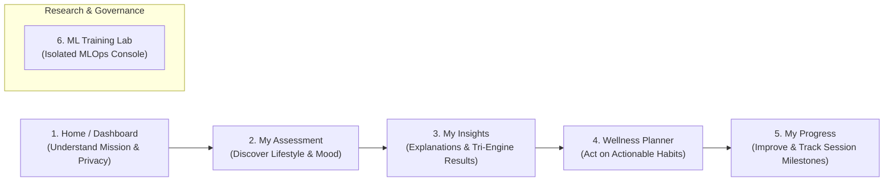

# MINDORA — DAY 3 ARCHITECTURE & TECHNICAL DEBT AUDIT
## From Academic Monolith to Modular Student Wellbeing Intelligence Platform

**Date**: 2026-11-14  
**Author**: Principal Software Architect & Senior ML Platform Engineer  
**Status**: APPROVED BASELINE AUDIT  
**Baseline Git Commit**: `708462a`  
**Production Model SHA-256**: `e182e9e779a4f89e4883eb13c9bab3df19eebc7165d4b0a44319f737361342ec`

---

## 1. Executive Summary

As of the conclusion of Day 2.2, Mindora possesses a verified local ML training platform, an audited tabular model (`models/best_model.pkl`), a verified 15-test platform suite, a 5-test engine-independence suite, and an operational Streamlit dashboard.

However, the user-facing application architecture remains monolithic:
- `app.py` is an unpartitioned file (~1,200 lines) containing UI styling, navigation routing, form collection, results presentation, benchmark charts, and methodology text in a single module.
- The user journey is academically skewed toward evaluating model performance rather than supporting the student's core personal wellbeing workflow: **UNDERSTAND → DISCOVER → ACT → IMPROVE**.
- There is no dedicated **Onboarding** experience, **Wellness Planner**, or **Progress Tracking** interface for individual students.
- Day 3 establishes a clean, decoupled, modular architecture that protects all existing ML assets while elevating student usability, privacy, and non-clinical utility.

---

## 2. Existing Architecture Analysis

### 2.1 File & Module Layout
```text
Mindora/
├── app.py                      # Monolithic UI dispatcher and renderer (~1,200 lines)
├── src/
│   ├── data_loader.py          # Legacy raw data loading
│   ├── evaluate.py             # Legacy evaluation plots
│   ├── predict.py              # Engine 1 (Production XGBoost Inference + SHAP)
│   ├── preprocessing.py        # 10-feature schema and column transformers
│   ├── recommendations.py      # Engine 2 (Lifestyle) + Engine 3 (PHQ-9) + Crisis Hotlines
│   ├── train.py                # Legacy single-script model training
│   ├── ui_theme.py             # Colors, CSS definitions, static HTML snippets
│   ├── data_platform/          # Day 2 local data platform (schema, loader, profiler, validator)
│   ├── training/               # Day 2 local training platform (pipeline, splitting, factory, evaluate, registries)
│   └── views/
│       └── training_lab_view.py # Day 2 ML Training Lab view (modular)
├── models/                     # Production artifacts (best_model.pkl, feature_importance.csv)
├── dataset/                    # Public student depression benchmark dataset
├── experiments/                # Experiment registry (registry.json) and candidate models
├── tests/                      # Automated test suites
└── docs/                       # Architecture and audit dossiers
```

### 2.2 Current Streamlit Navigation
`app.py` manages a single sidebar radio menu with 6 string entries:
1. `🏠 Home`
2. `📝 Student Assessment`
3. `📊 Results & Wellness Insights`
4. `📈 Analytics & Model Benchmark`
5. `ℹ️ Methodology & About`
6. `🔬 ML Training Lab`

State is stored in `st.session_state.current_page`, `st.session_state.assessment_submitted`, and `st.session_state.latest_results`. While functional, the first five pages are defined sequentially inside `app.py`, creating coupling between UI rendering, business logic, and session state.

### 2.3 The Three Independent Engines
The application architecture relies on three strictly decoupled intelligence subsystems:
- **Engine 1: Public Dataset ML Screening (`src/predict.py`)**
  - Uses strictly 10 approved features (`Age`, `Academic Pressure`, `CGPA`, `Study Satisfaction`, `Work/Study Hours`, `Financial Stress`, `Gender`, `Sleep Duration`, `Dietary Habits`, `Degree`).
  - Production model: `CalibratedClassifierCV` (sigmoid, cv=5) wrapping XGBoost ($N=120, d=5$).
  - Explanations: SHAP TreeExplainer with graceful fallback to global feature importances.
  - Output: Calibrated risk probability percentage and risk tier. Non-diagnostic.
- **Engine 2: Digital & Social Lifestyle Analytics (`src/recommendations.py`)**
  - Independent rule-based indices: Digital Friction Score (0–10) and Lifestyle Rhythm Balance (0–10).
  - Evaluates screen hours, late-night phone use, social comparison, sleep quality, and fatigue.
  - Zero probability output; purely descriptive behavioral patterns.
- **Engine 3: Validated PHQ-9 Screener & Safety Trigger (`src/recommendations.py`)**
  - Standard 9-item psychometric questionnaire (scores 0–27).
  - Categorizes severity (Minimal, Mild, Moderate, Moderately Severe, Severe).
  - Unconditional safety override: If Item 9 $> 0$, immediately escalates 24/7 crisis hotlines (Tele-MANAS, KIRAN, 988, etc.), completely isolated from Engines 1 and 2.

---

## 3. Technical Debt Identification

| ID | Component | Defect / Technical Debt | Impact |
| :--- | :--- | :--- | :--- |
| **TD-01** | `app.py` | Monolithic file mixing routing, HTML generation, and page bodies. | Difficult to maintain, unit test, or extend without regression risk. |
| **TD-02** | User Journey | Skewed heavily toward technical validation and confusion matrix viewing. | Individual students cannot easily translate assessment findings into everyday wellbeing action. |
| **TD-03** | Onboarding | No dedicated onboarding/consent interface explaining data boundaries. | Students lack clear upfront transparency regarding what data is collected and how it is processed. |
| **TD-04** | Actionability | Recommendations are displayed passively on the results page without follow-through. | Missing a structured **Wellness Planner** for daily habit building and self-monitoring. |
| **TD-05** | Progress | No longitudinal session progress tracker. | Students cannot observe their check-in history or completed wellness goals during their active session. |
| **TD-06** | UI Theme | Heavy inline style attributes mixed with markdown HTML across multiple sections. | Visual inconsistency; difficult to maintain accessibility, color contrast, and offline fallback fonts. |

---

## 4. Proposed Modular Target Architecture

To eliminate technical debt without touching the audited ML platform or production model, Mindora will adopt a decoupled view controller pattern:

```text
MINDORA/
├── app.py                              # Lightweight routing dispatcher (~100-150 lines)
├── src/
│   ├── views/                          # Modular view controllers
│   │   ├── student_dashboard.py        # Page 1: Home / Dashboard (Journey entry points)
│   │   ├── onboarding.py               # Onboarding, Privacy & Consent dialogs
│   │   ├── assessment.py               # Page 2: My Assessment (Three-engine input form)
│   │   ├── insights.py                 # Page 3: My Insights (Tri-engine explainable results)
│   │   ├── wellness_planner.py         # Page 4: Wellness Planner (Actionable habit checklist)
│   │   ├── progress_view.py            # Page 5: My Progress (Session check-in & milestone tracker)
│   │   ├── methodology_view.py         # Optional subview: Scientific methodology & benchmark
│   │   └── training_lab_view.py        # Page 6: ML Training Lab (Internal developer sandbox)
│   │
│   ├── predict.py                      # Preserved: Engine 1 ML inference
│   ├── recommendations.py              # Preserved: Engine 2 & 3 analytics & safety
│   ├── preprocessing.py                # Preserved: 10-feature schema
│   ├── ui_theme.py                     # Centralized styling & reusable UI components
│   ├── data_platform/                  # Preserved: Data ingestion & validation
│   └── training/                       # Preserved: Model factory, pipelines, registries
│
├── models/best_model.pkl               # LOCKED & PRESERVED (SHA-256 bit-identical)
├── tests/                              # Regression & platform test suites
└── docs/                               # Governance & architecture audits
```

---

## 5. Navigation & Student Journey Redesign

The navigation aligns strictly with the core user journey:
$$\textbf{UNDERSTAND} \longrightarrow \textbf{DISCOVER} \longrightarrow \textbf{ACT} \longrightarrow \textbf{IMPROVE}$$



### Detailed Section Definitions:
1. **Home / Dashboard (`student_dashboard.py`)**:
   - Welcome banner & empathetic introduction.
   - The 4-step student wellbeing journey with interactive step cards.
   - Quick jump buttons to Assessment, Insights, Planner, and Progress.
   - Dynamic session status (e.g., "Assessment pending" vs. "Latest assessment completed").
   - Upfront privacy, confidentiality, and data minimization statement.
   - Expandable Onboarding Tour.
2. **My Assessment (`assessment.py`)**:
   - Clean 3-tab guided questionnaire:
     - Tab 1: Academic & Study Factors (10 approved features for Engine 1).
     - Tab 2: Digital & Social Habits (8 descriptive features for Engine 2).
     - Tab 3: Standardized PHQ-9 (9 validated items for Engine 3).
   - Validation safeguards ensuring zero missing required entries.
   - Atomic evaluation trigger that populates `st.session_state.latest_results`.
3. **My Insights (`insights.py`)**:
   - Empty state when assessment is pending: clean illustration, encouraging prompt, and button to start.
   - Active state when submitted:
     - Top Priority: Unconditional Crisis Assistance Banner if Item 9 $> 0$.
     - Engine 1 Panel: Public ML Screening Indicator, calibrated probability, risk tier, and SHAP feature impact cards.
     - Engine 2 Panel: Digital Friction Index, Lifestyle Rhythm Balance, and sleep-screen patterns.
     - Engine 3 Panel: Standardized PHQ-9 psychometric severity breakdown.
     - Actionable recommendations with "Add to Wellness Planner" shortcut.
4. **Wellness Planner (`wellness_planner.py`)**:
   - Practical, non-clinical wellbeing action center.
   - Actionable habits structured across 5 domains (Sleep Architecture, Digital Focus, Academic Decompression, Physical Movement, Social Reconnection).
   - Interactive daily checklist allowing students to select and track daily habits in session memory.
   - Daily Reflection / Energy Check-in (1–5 scale).
5. **My Progress (`progress_view.py`)**:
   - Session milestone and habit completion tracker.
   - Visualizing completed assessment status, active wellness goals, and lifestyle rhythm indicators.
   - Transparent disclaimer on session-only storage.
6. **ML Training Lab (`training_lab_view.py`)**:
   - Retained as a separate research and developer area.
   - Accessible only through dedicated navigation tab.

---

## 6. Migration Risks & Governance Safeguards

| Risk | Potential Impact | Architecture Safeguard |
| :--- | :--- | :--- |
| **Model Invalidation** | Accidental retraining or modification of `models/best_model.pkl`. | Baseline model file is strictly read-only; SHA-256 hash verified before and after refactoring. |
| **Schema Leakage** | New questionnaire inputs polluting Engine 1 inputs. | Engine 1 input dictionary explicitly extracts only the 10 approved features in `src/predict.py`. |
| **Engine Entanglement** | Combining ML probabilities with PHQ-9 scores into an invented score. | UI modules render three visually distinct cards; no single aggregated depression score is computed. |
| **Privacy Violation** | Writing student survey responses to local disk or database. | All student inputs and assessment results reside strictly in memory (`st.session_state`) and are wiped when the browser session terminates. |
| **Lab Regression** | Breaking existing ML platform tests or training lab console. | `src/views/training_lab_view.py` and its underlying modules (`src/training/`, `src/data_platform/`) are preserved intact. |

---

## 7. Implementation Roadmap

1. **Step 1: UI Theme & Reusable Components**: Enrich `src/ui_theme.py` with reusable cards, badges, journey steppers, and accessibility fallbacks.
2. **Step 2: Onboarding View**: Implement `src/views/onboarding.py` with consent, data minimization, and privacy transparency.
3. **Step 3: Student Dashboard View**: Implement `src/views/student_dashboard.py` with journey navigation and empty state support.
4. **Step 4: Modular Assessment View**: Implement `src/views/assessment.py` extracting form logic from `app.py`.
5. **Step 5: Modular Insights View**: Implement `src/views/insights.py` extracting results and SHAP display from `app.py`.
6. **Step 6: Wellness Planner View**: Implement `src/views/wellness_planner.py` featuring interactive habit selection and daily focus items.
7. **Step 7: Progress View**: Implement `src/views/progress_view.py` showing session milestones and habit streaks.
8. **Step 8: App Dispatcher Refactor**: Refactor `app.py` into a clean, lightweight router delegating directly to `src/views/`.
9. **Step 9: Testing & Verification**: Execute all 15 training platform tests, 5 engine independence tests, new UI integration tests, and verify production model SHA-256.

---
*Audit Document Approved. Proceeding to implementation.*
