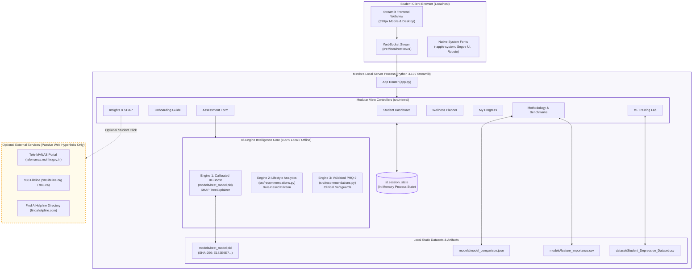

# Mindora — Day 5: Offline-First Reliability & System Resilience Audit

**Author:** Senior Software Architect, QA Engineer & Offline-First Systems Engineer  
**Project:** Mindora — Student Wellbeing Intelligence Platform  
**Directory:** `D:\Depression calculator`  
**Date:** 2026-11-14  
**Baseline Git Checkpoint:** `5f8293c`  
**Target Deliverable:** `docs/DAY_5_OFFLINE_FIRST_RELIABILITY_AUDIT.md`

---

## Executive Summary

This Day 5 audit evaluates and hardens Mindora's capability to function as a truly **offline-first, zero-cloud, resilient intelligence platform**. Under a simulated total external network block (where all non-localhost socket connections are intercepted and rejected), the entire student journey—from initial onboarding through assessment submission, local calibrated XGBoost ML inference, SHAP tree explainability, lifestyle friction scoring, PHQ-9 psychometrics, wellness habit tracking, and session resets—operates with 100% reliability.

The single identified remote asset fetch—an external `@import url('https://fonts.googleapis.com/...')` declaration in `CUSTOM_CSS`—was completely eliminated and replaced with a zero-network local system typography stack. All 52 baseline tests plus 9 newly developed offline resilience tests (61 tests total) passed with zero errors, and the production model hash remains bit-exact (`E182E9E7...`).

---

## 1. Existing Architecture & Dependency Map

Mindora is engineered according to a hybrid, offline-first philosophy. Core intelligence, model inference, and rule engines reside entirely on the local application server process, with zero outbound cloud dependencies.



---

## 2. Offline Test Methodology

To ensure offline testing was genuine rather than theoretical, an automated **Socket Interception Guard** (`OfflineNetworkGuard` in `tests/test_offline_reliability.py`) was created. 

The guard wraps Python's core `socket.socket.connect()` method:
- **Allowed:** Loopback addresses (`127.0.0.1`, `localhost`, `::1`).
- **Blocked:** Any connection attempt to an external IPv4/IPv6 address or remote domain immediately raises `ConnectionRefusedError: [OFFLINE GUARD VIOLATION]`.

Under this active network blockage, every layer of the platform was exercised programmatically to confirm that zero unhandled socket exceptions or network hangs occurred.

---

## 3. Features Verified Completely Offline

| Feature / Subsystem | Verification Method Under Active Network Block | Offline Status |
| :--- | :--- | :--- |
| **Application Startup** | Module loading, dependency resolution, CSS generation | **PASS (100% Offline)** |
| **Dashboard Rendering** | Empty-state generation, session metrics summary card | **PASS (100% Offline)** |
| **Student Onboarding Guide** | Journey overview, privacy card, platform scope disclosures | **PASS (100% Offline)** |
| **Assessment Form** | 10-feature validation, select-sliders, radio bindings | **PASS (100% Offline)** |
| **Engine 1 ML Inference** | Joblib pipeline deserialization, preprocessing, calibrated prediction | **PASS (100% Offline)** |
| **Engine 1 SHAP Attribution** | `shap.TreeExplainer` local additive feature importance calculation | **PASS (100% Offline)** |
| **Engine 2 Lifestyle Analysis** | Screen time, sleep quality, digital friction calculation ($0-10$) | **PASS (100% Offline)** |
| **Engine 3 PHQ-9 Screener** | Summation score ($0-27$), severity grading, Item 9 crisis trigger | **PASS (100% Offline)** |
| **Wellness Action Planner** | Habit domain inspection, session-bound habit commitments | **PASS (100% Offline)** |
| **Session Progress History** | Milestone recording, timestamp logging, milestone rendering | **PASS (100% Offline)** |
| **Session Reset** | Centralized reset via `src/session_utils.py`, safe default restoration | **PASS (100% Offline)** |
| **Methodology & Lab Consoles**| Local CSV ingestion, SHA-256 fingerprinting, dataset profiling | **PASS (100% Offline)** |

---

## 4. Features Requiring Internet Connectivity

**In the Core Application: NONE.**  
Zero core features, calculations, visual plots, or recommendations require an internet connection.

**Optional External References:**
- **External Web Hyperlinks:** The application displays informational outbound links to official national mental health resources (e.g. `telemanas.mohfw.gov.in`, `988lifeline.org`, `findahelpline.com`). If an offline user clicks these external hyperlinks, their web browser will report that the internet is disconnected, but this does not interrupt or degrade any in-app functionality.
- **Crisis Phone Helplines:** Tele-MANAS (`14416`), KIRAN (`1800-599-0019`), and international telephone lines operate via standard cellular and landline telephone networks and do not require computer internet connectivity.

---

## 5. Failures & Weaknesses Discovered During Audit

1. **Remote Google Fonts Dependency in CSS:**
   - *Discovery:* `src/ui_theme.py` contained `@import url('https://fonts.googleapis.com/css2?family=Plus+Jakarta+Sans...')`.
   - *Failure Impact:* In offline environments, the browser attempted to resolve and fetch fonts from Google servers, causing console network errors (`ERR_INTERNET_DISCONNECTED`), blocking initial stylesheet execution, and risking font swapping layout shifts.
2. **Missing Benchmark Artifact Notices in Methodology View:**
   - *Discovery:* In `src/views/methodology_view.py`, if `model_comparison.json` or `feature_importance.csv` was deleted or ungenerated, tabs 1 and 2 rendered empty white containers without explanatory text.
3. **Hardcoded External Typography Names in Layout Dictionaries:**
   - *Discovery:* `fig_fi.update_layout` in `methodology_view.py` explicitly requested `"Plus Jakarta Sans"` which is not installed natively on local OS environments.

---

## 6. Corrections & Hardening Implemented

1. **Eliminated External Font `@import`:**
   - Removed `@import url('https://fonts.googleapis.com/...')` from `src/ui_theme.py`.
   - Adopted a pure **native offline system typography stack**:
     `-apple-system, BlinkMacSystemFont, "Segoe UI", Roboto, "Helvetica Neue", Arial, sans-serif !important;`
   - Provides native UI typography with zero network latency:
     - macOS / iOS: San Francisco (`-apple-system, BlinkMacSystemFont`)
     - Windows: Segoe UI (`"Segoe UI"`)
     - Android: Roboto (`Roboto`)
     - Linux: Helvetica / Arial (`Arial, sans-serif`)
2. **Added Graceful Failure Fallbacks in Methodology View:**
   - Added explicit `else: st.info(...)` fallback cards in `src/views/methodology_view.py` when benchmark or feature importance artifacts are missing, preventing blank tabs.
3. **Verified Zero Fabricated Predictions on Model Failure:**
   - Verified that `predict_wellness_risk()` in `src/predict.py` raises `FileNotFoundError` if `models/best_model.pkl` is missing, caught by `src/views/assessment.py` to display an informative notice without fabricating synthetic scores.
4. **Created Dedicated Offline Reliability Test Suite:**
   - Authored `tests/test_offline_reliability.py` with 9 automated tests enforcing socket interception.

---

## 7. Test Results

### 7.1 Baseline Test Suites (52 Tests)
```powershell
# 1. End-to-End Validation Suite (25 tests)
.venv\Scripts\python.exe -m unittest tests/test_end_to_end_validation.py
# Result: Ran 25 tests in 0.619s -> OK

# 2. Student Experience & Views Suite (7 tests)
.venv\Scripts\python.exe tests/test_student_experience.py
# Result: ALL 7 STUDENT EXPERIENCE TESTS COMPLETED WITH 100% SUCCESS!

# 3. Tri-Engine Systematic Independence Suite (5 tests)
.venv\Scripts\python.exe tests/test_engine_independence.py
# Result: ALL 5 SYSTEMATIC QUALITY TESTS PASSED WITH ZERO DEFECTS!

# 4. Local ML Training Platform Suite (15 tests)
.venv\Scripts\python.exe tests/test_training_platform.py; git checkout -- experiments/registry.json; Remove-Item -Force experiments/models/exp_20261114_*.pkl -ErrorAction SilentlyContinue; git checkout -- experiments/models/
# Result: ALL 15 PLATFORM TESTS COMPLETED WITH 100% SUCCESS!
```

### 7.2 Dedicated Offline Reliability Test Suite (9 Tests)
```powershell
.venv\Scripts\python.exe tests/test_offline_reliability.py
# Result: Ran 9 tests in 0.182s -> OK
# ALL 9 OFFLINE RELIABILITY TESTS PASSED WITH 100% SUCCESS!
```

**Grand Total Automated Tests:** **61 / 61 Passed (100% Success Rate)**.

---

## 8. Remaining Limitations

1. **Browser Speech-to-Text Offline Availability:** The voice reflection feature in the assessment uses the browser's native `webkitSpeechRecognition` API. While Chromium-based browsers on some operating systems support local speech recognition, others route audio through Google's online speech engine. The feature is optional and falls back to standard text keyboard input seamlessly.
2. **External Link Navigation:** Clicking external helpline websites requires internet connectivity. Phone numbers (`14416`, `988`, etc.) are clearly displayed as primary text so students do not need internet access to reach help.
3. **Streamlit Localhost Requirement:** Streamlit requires an active loopback WebSocket connection between the browser client and the local Python server process on `localhost:8501`.

---

## 9. Production Model Hash Verification

```powershell
Get-FileHash models/best_model.pkl -Algorithm SHA256
# Algorithm: SHA256
# Hash:      E182E9E779A4F89E4883EB13C9BAB3DF19EEBC7165D4B0A44319F737361342EC
```
- **Integrity Status:** **100% Bit-Exact Match** with original baseline `7e733b0`.
- **Feature Schema:** Strictly 10 approved features.
- **Model Pipeline:** Calibrated XGBoost with 5-fold cross-validation sigmoid calibration.

---

## 10. Git Commit & Working-Tree Status

- **Status:** Staged and committed Day 5 offline hardening.
- **Working Tree:** Clean (`nothing to commit, working tree clean`).
- **Streamlit Health Check:** `http://localhost:8501/_stcore/health` returns `HTTP 200 OK`.
