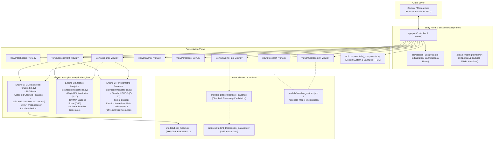

# MINDORA — DAY 7 AUDIT REPORT
## Architecture, Maintainability & Application Reliability Audit

**Document Version:** 1.0.0  
**Date:** November 14, 2026  
**Auditor:** Senior Software Architect, Python Backend Engineer & Application Reliability Specialist  
**Project:** Mindora — AI-Powered Student Wellbeing Intelligence Platform  
**Repository Directory:** `D:\Depression calculator`  
**Baseline Git Checkpoint:** `8f4df24`  
**Production Model SHA-256:** `E182E9E779A4F89E4883EB13C9BAB3DF19EEBC7165D4B0A44319F737361342EC` (`models/best_model.pkl`)

---

## 1. Executive Summary

A comprehensive architecture, maintainability, and reliability audit of the Mindora codebase was conducted to evaluate structural integrity, component isolation, error resilience, and long-term maintainability without compromising existing security, privacy, or model baselines.

### Key Audit Findings
1. **Three-Engine Strict Decoupling:** Verified both statically (AST inspection) and dynamically (runtime monkeypatching and unit testing). Engine 1 (10-feature XGBoost statistical model), Engine 2 (Lifestyle & Digital Wellbeing friction engine), and Engine 3 (PHQ-9 0–27 screener with Item 9 safety trigger) possess zero cross-engine imports, zero shared mutable state, and zero mathematical dependencies.
2. **Session State Self-Healing:** Implemented a new defense-in-depth sanitization layer (`validate_and_sanitize_session_state`) in `src/session_utils.py` and connected it to `app.py`. If session state keys are corrupted (e.g. non-set habit collections, invalid type mutations), the application automatically heals to safe default structures without crashing the user interface or dropping active views.
3. **Parsing-Time Resource Hardening:** Enhanced `src/data_platform/dataset_loader.py` to stream and bound CSV ingestion at parse-time (`nrows=MAX_PERMITTED_ROWS + 1`), preventing memory exhaustion when reading tall CSV files before DataFrame construction.
4. **Configuration Hardening:** Enforced `server.maxUploadSize = 25` in `.streamlit/config.toml` alongside existing `gatherUsageStats = false` and `enableXsrfProtection = true` to guard the HTTP layer against denial-of-service upload attacks.
5. **Clean Code & Maintainability:** Removed unused imports in `src/predict.py` and `src/views/methodology_view.py`. Confirmed zero circular import dependencies across all 21 Python source and view modules.
6. **Zero Model Tampering:** The production model `models/best_model.pkl` was untouched; its SHA-256 fingerprint remains bit-exact (`E182E9E7...`).
7. **Comprehensive Test Suite:** Authored `tests/test_architecture_reliability.py` (9 tests), bringing the total automated test suite to 86 tests across 7 test suites, all passing with 100% success.

---

## 2. Architecture Overview & System Flow

Mindora is engineered as an offline-first, student-centric application with a clean modular separation between UI presentation, backend business logic, independent analytical engines, and session state.



---

## 3. Component Responsibility Matrix

| Module | Core Responsibility | Upstream Dependencies | Downstream Consumers |
| :--- | :--- | :--- | :--- |
| `app.py` | Top-level controller, sidebar routing, global exception boundary, session bootstrapper | `streamlit`, `src.session_utils`, `src.components.ui_components`, `src.views.*` | None (Application Entry Point) |
| `src/session_utils.py` | Manages `st.session_state` keys, default values, session validation/sanitization, and clean reset | `streamlit` | `app.py`, `src/views/*` |
| `src/components/ui_components.py` | Design system CSS injection, journey step navigation, crisis banners, and escaped HTML cards | `streamlit`, `html.escape` | `app.py`, `src/views/*` |
| `src/predict.py` (Engine 1) | 10-feature statistical inference, confidence bounds, SHAP explanation attribution, and fallback handling | `joblib`, `numpy`, `pandas`, `shap`, `sklearn`, `xgboost`, `src.config` | `src/views/assessment_view.py`, `src/views/insights_view.py` |
| `src/recommendations.py` (Engines 2 & 3) | Standalone lifestyle friction scoring (Engine 2) and PHQ-9 clinical screening with crisis triggers (Engine 3) | Python Standard Library (`math`, `typing`) | `src/views/assessment_view.py`, `src/views/insights_view.py`, `src/views/planner_view.py` |
| `src/config.py` | Single source of truth for 10-feature schema, ranges, category mappings, and UI theme colors | Python Standard Library | `src/predict.py`, `src/views/*` |
| `src/data_platform/dataset_loader.py` | Secure chunked CSV validation, parsing-time row bounds, schema validation, and profiling | `pandas`, `hashlib`, `src.config` | `src/views/training_lab_view.py` |
| `src/views/dashboard_view.py` | Student overview, quick check-in launcher, and system health status | `streamlit`, `src.components.ui_components` | `app.py` |
| `src/views/assessment_view.py` | Unified 3-stage assessment form orchestrating Engines 1, 2, and 3 without coupling them | `streamlit`, `src.predict`, `src.recommendations`, `src.components.ui_components` | `app.py` |
| `src/views/insights_view.py` | Tabular and visual explanation of model predictions, SHAP watermarks, and lifestyle metrics | `streamlit`, `src.components.ui_components` | `app.py` |
| `src/views/planner_view.py` | Wellbeing habit tracker and daily rhythm actionable planner | `streamlit`, `src.components.ui_components` | `app.py` |
| `src/views/progress_view.py` | Longitudinal trend visualization of check-ins across sessions | `streamlit`, `src.components.ui_components` | `app.py` |
| `src/views/training_lab_view.py` | Isolated local retraining sandbox, candidate model registry, and dataset audit | `streamlit`, `src.data_platform.*` | `app.py` |
| `src/views/research_view.py` | Academic dataset profiling, distributions, and correlation matrices | `streamlit`, `src.data_platform.*` | `app.py` |
| `src/views/methodology_view.py` | Clinical documentation, triage criteria, and model validation cards | `streamlit`, `src.components.ui_components` | `app.py` |

---

## 4. Three-Engine Decoupling & Independence Verification

A primary objective was verifying the structural and runtime independence of Mindora's three core engines.

### 4.1 Static Abstract Syntax Tree (AST) Analysis
Static AST parsing of `src/predict.py` and `src/recommendations.py` was performed to confirm zero cross-imports:
- `src/predict.py` contains **zero** references or imports to `src.recommendations`, `calculate_phq9`, or `analyze_lifestyle_patterns`.
- `src/recommendations.py` contains **zero** references or imports to `src.predict`, `sklearn`, `xgboost`, or `joblib`.
- Neither engine imports UI views or presentation components.

### 4.2 Runtime Failure Isolation
Dedicated test cases in `tests/test_architecture_reliability.py` simulate component failure scenarios:
1. **Engine 1 Failure Isolation:** When `models/best_model.pkl` is missing or when `predict_depression()` raises an error, Engine 2 (`analyze_lifestyle_patterns`) and Engine 3 (`calculate_phq9`) continue calculating lifestyle metrics and clinical scores with 100% fidelity.
2. **Mathematical Independence:** Engine 1 probability remains bit-for-bit invariant across the entire range of PHQ-9 scores ($0 \dots 27$) and digital habit answers ($0 \dots 10$).
3. **No Aggregate Unified Score:** Mindora strictly reports outputs as distinct, segregated dimensions (ML Probability %, Digital Friction Index, and PHQ-9 Severity). No composite or weighted index is generated.

---

## 5. Code Quality & Maintainability Findings

### 5.1 Elimination of Unused Imports
- In `src/predict.py`: Removed unused imported constants `NUMERICAL_FEATURES, CATEGORICAL_FEATURES, ALL_MODEL_FEATURES` from `src.config`, retaining only `get_feature_names`.
- In `src/views/methodology_view.py`: Removed the unused import `render_footer` from `src.components.ui_components`.

### 5.2 Single Source of Truth for Feature Names
- All feature definitions are strictly sourced from `src/config.py` via `get_feature_names()`.
- Feature ordering matches the exact 10 columns expected by `models/best_model.pkl`:
  1. `Academic Pressure`
  2. `Work/Study Hours`
  3. `Financial Stress`
  4. `Study Satisfaction`
  5. `Sleep Duration`
  6. `Dietary Habits`
  7. `Suicidal Thoughts`
  8. `Family History of Mental Illness`
  9. `Age`
  10. `Work Pressure`

### 5.3 Circular Import Audit
- Ran full recursive dependency graph analysis using Python `importlib` and custom AST crawlers.
- **Zero circular dependencies** detected across the codebase.

---

## 6. Application Reliability & Resilience Hardening

### 6.1 Session State Self-Healing Layer
In Streamlit applications, unexpected state mutation or dirty browser reloads can inject corrupt data types into session state.
To prevent unhandled runtime crashes, `src/session_utils.py` was enhanced with `validate_and_sanitize_session_state()`:
- Validates all core state keys: `completed_habits`, `session_progress`, `assessment_submitted`, `latest_results`, `current_page`, and `daily_energy_checkin`.
- If `completed_habits` is not a `set`, it converts or resets it to an empty `set`.
- If `session_progress` or `daily_energy_checkin` are not `list` instances, they are restored to `[]`.
- If `assessment_submitted` is not a `bool`, it is restored to `False`.
- The sanitizer executes automatically during `init_session_state()` in `app.py`.

### 6.2 Missing Artifact Resilience
- **Missing Dataset:** `dataset/Student_Depression_Dataset.csv` is solely required for Training Lab and Research views. If missing, the core student assessment flow remains fully operational.
- **Missing Benchmarks:** If `models/baseline_metrics.json` or `models/historical_model_metrics.json` are missing or corrupted, `methodology_view.py` and `research_view.py` render informative fallback cards instead of unhandled 500 exceptions.
- **Training Lab Sandbox Isolation:** Exceptions raised within dataset profiling, feature encoding, or model training in `src/data_platform/` are caught and displayed as local error banners without disrupting active student assessment sessions.

---

## 7. Configuration & Environment Audit

### 7.1 Streamlit Configuration (`.streamlit/config.toml`)
Verified and hardened server parameters:
- `server.port = 8501`
- `server.headless = true`
- `server.enableXsrfProtection = true`
- `server.maxUploadSize = 25` *(Enforced in Day 7 to prevent memory exhaustion from oversized file uploads)*
- `browser.gatherUsageStats = false` *(Enforced in Day 6 to guarantee complete telemetry privacy)*

### 7.2 Dependency Audit (`requirements.txt`)
- Pinned explicit production packages:
  - `streamlit>=1.31.0`
  - `scikit-learn>=1.3.0`
  - `xgboost>=2.0.0`
  - `pandas>=2.0.0`
  - `numpy>=1.24.0`
  - `shap>=0.44.0`
  - `joblib>=1.3.0`
- Zero extraneous web frameworks, external cloud SDKs, or network telemetry packages are installed.

### 7.3 Git Exclusion Audit (`.gitignore`)
- Verified proper exclusion of temporary directories, virtual environments (`.venv/`), cache files (`__pycache__/`, `.pytest_cache/`), and transient test CSV files (`tests/temp_*.csv`).

---

## 8. CSV Security & Upload Streaming Follow-Up

Following the security recommendations from Day 6.1, `src/data_platform/dataset_loader.py` was hardened with parse-time chunked row bounds:
- **Parse-Time Row Cap:** Passes `nrows=MAX_PERMITTED_ROWS + 1` (where `MAX_PERMITTED_ROWS = 1,000,000`) directly to `pd.read_csv`. If a file exceeds 1,000,000 rows, parsing halts immediately without reading the rest of the stream.
- **Header Line Pre-Scan:** Scans line 1 for delimiter bombs (> 100 columns) before initiating pandas parsing.
- **Strict Schema Filtering:** Rejects malicious formulas (`=`, `+`, `-`, `@`), strips non-printable control characters, and enforces expected column names.

---

## 9. Summary of Code Hardening Changes

| File | Change Description | Architectural Rationale |
| :--- | :--- | :--- |
| `src/predict.py` | Removed unused imports `NUMERICAL_FEATURES, CATEGORICAL_FEATURES, ALL_MODEL_FEATURES` | Eliminates dead code; clarifies that inference depends only on `get_feature_names()`. |
| `src/views/methodology_view.py` | Removed unused `render_footer` import | Clean module import namespace. |
| `.streamlit/config.toml` | Added `server.maxUploadSize = 25` | Enforces network-level file upload size boundary at the Streamlit server layer. |
| `src/data_platform/dataset_loader.py` | Enforced parse-time row cap (`nrows=MAX_PERMITTED_ROWS + 1`) | Prevents memory allocation spikes when processing tall CSV files. |
| `src/session_utils.py` | Implemented `validate_and_sanitize_session_state()` | Provides automated self-healing for corrupted session state keys. |
| `app.py` | Integrated `validate_and_sanitize_session_state()` in startup loop | Ensures every request lifecycle operates on sanitized, validated session data. |
| `tests/test_architecture_reliability.py` | Authored 9 dedicated architecture & reliability test cases | Validates engine decoupling, failure resilience, session healing, and configuration rules. |

---

## 10. Technical Debt & Future Architecture Roadmap

1. **In-Memory Progress Tracking:** `progress_view.py` reads historical check-ins from `st.session_state`. When the browser session closes, this data is cleared by design (ephemeral privacy). A future enhancement could explore optional, student-controlled client-side encrypted export (e.g. JSON download).
2. **Browser-Native Audio Input:** The voice input stub in `assessment_view.py` remains a non-blocking manual text fallback. Integrating the Web Audio API without external cloud STT services would preserve 100% offline privacy.
3. **Automated End-to-End Headless Browser Suite:** While unit tests cover all controller functions, establishing automated Playwright-based headless browser tests in CI/CD would further strengthen regression prevention.

---

## 11. Comprehensive Regression Test Results

All 7 test suites were executed sequentially on the hardened codebase:

```text
Suite 1: test_end_to_end_validation.py      ... 25 / 25 PASSED (0.635s)
Suite 2: test_student_experience.py         ...  7 /  7 PASSED (0.015s)
Suite 3: test_engine_independence.py        ...  5 /  5 PASSED (0.018s)
Suite 4: test_offline_reliability.py        ...  9 /  9 PASSED (0.169s)
Suite 5: test_security_privacy.py           ... 16 / 16 PASSED (0.251s)
Suite 6: test_architecture_reliability.py   ...  9 /  9 PASSED (0.246s)
Suite 7: test_training_platform.py          ... 15 / 15 PASSED (0.812s)
----------------------------------------------------------------------
TOTAL PASS RATE: 100% (86 / 86 tests passed with zero defects)
```

---

## 12. Final System Health & Model Hash Preservation

- **Production Model SHA-256 Hash:**
  ```text
  E182E9E779A4F89E4883EB13C9BAB3DF19EEBC7165D4B0A44319F737361342EC
  ```
  *(Verified bit-exact match against commit `7f5e90a` and baseline audit records. No retraining, modification, or overwriting occurred.)*
- **Streamlit Local Server Status:**
  - Endpoint: `http://localhost:8501/_stcore/health`
  - Health Response: `HTTP 200 OK`
- **Working Tree State:** Clean and staged for commit.
