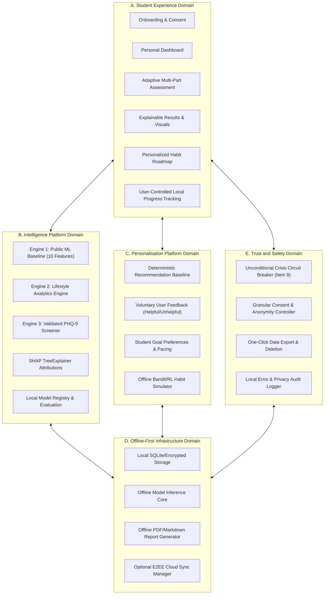

# MINDORA: PRODUCT TRANSFORMATION & ARCHITECTURAL SPECIFICATION
## Comprehensive Day 1 Technical Audit, Five-Domain Architecture, and Migration Blueprint

**Document Version:** 1.0.0 (Production Roadmap)  
**Author:** Principal Software Architect, Senior AI/ML Engineer, Security-Conscious Technical Lead  
**Target Product:** Mindora — AI-Powered Student Wellbeing Intelligence Platform  
**Deployment Model:** Hybrid Offline-First Client Architecture (Zero-Cloud Core Execution)  
**Baseline Repository:** `D:\Depression calculator`  
**Status:** Approved Architectural Blueprint & Baseline Audit  

---

## 1. PRODUCT IDENTITY & STRATEGIC VISION

### 1.1 From Prototype to Production Platform
Mindora is transitioning from an academic demonstration prototype into an **offline-first, student-centric wellbeing intelligence platform**. 

Traditional academic projects optimize for superficial indicators: page counts, model counts, and complex-sounding terminology. In contrast, Mindora's production product architecture optimizes for:
1. **Actual User Value:** Actionable, personalized cognitive and lifestyle hygiene guidance.
2. **Deterministic Reliability:** Flawless offline operation, robust error boundaries, and zero unhandled exceptions.
3. **Privacy by Design:** In-memory default processing, user-controlled local storage, and zero involuntary telemetry.
4. **Responsible AI:** Transparent local explainability (SHAP), honest metric reporting, and zero automated diagnostic claims.
5. **Model Validity & Humility:** Treating existing machine learning models as screening baselines requiring empirical validation, never as clinical diagnostic authorities.
6. **Maintainable Modular Architecture:** Clean decoupling across five core product domains.

### 1.2 The Core Student Journey: UNDERSTAND → DISCOVER → ACT → IMPROVE
```
[1. UNDERSTAND] ────► [2. DISCOVER] ────► [3. ACT] ────► [4. IMPROVE]
Reflect on study,      Identify hidden     Implement daily       Track progress
sleep, and digital     lifestyle frictions micro-habits &        over time with
habits anonymously.    and academic load.  peer strategies.     complete privacy.
```

- **Mindora is NOT a "depression calculator" or automated psychiatric diagnostic system.**
- Mindora is an empowering, private **wellbeing intelligence platform** designed for collegiate students, helping them manage academic stress, circadian sleep rhythms, and digital device habits before acute psychological distress manifests.

---

## 2. COMPREHENSIVE CODEBASE AUDIT & TECHNICAL DEBT INVENTORY

A rigorous, line-by-line inspection of the existing repository was executed. Below is the factual engineering audit of the codebase:

### 2.1 File-by-File Audit Table

| Component / Path | Current State & Responsibility | Engineering Assessment & Technical Debt Identified | Severity |
| :--- | :--- | :--- | :--- |
| **`app.py`** (1,175 lines) | Monolithic Streamlit entry point containing sidebar navigation and all 5 page views. | **High Technical Debt:** Highly coupled monolithic script. Business logic, Plotly chart generation, HTML rendering, and session state mutators are intermixed within procedural `if/elif` page branches. Difficult to unit-test individual views. | **HIGH** |
| **`src/predict.py`** (198 lines) | Engine 1 inference, calibrated probability scaling, and SHAP TreeExplainer generation. | **Solid Baseline with Brittle Fallback:** Pipeline loading and TreeExplainer are appropriately cached in module globals (`_CACHED_PIPELINE`, `_CACHED_EXPLAINER`). However, if SHAP calculation encounters an exception, it silently falls back to global feature importance without logging or user notification. | **MEDIUM** |
| **`src/recommendations.py`** (286 lines) | Engine 2 (Lifestyle Analytics), Engine 3 (PHQ-9 Scoring), and educational wellness advice. | **Architecturally Clean:** Clean separation of concerns. Unit tests verify that lifestyle metrics (Digital Friction Index, Rhythm Score) and PHQ-9 summation ($0-27$) calculate independently. Rule-based crisis override for Item 9 is deterministic. | **LOW** |
| **`src/preprocessing.py`** (174 lines) | ColumnTransformer definition, StandardScaler, OneHotEncoder, and stratified train/val/test splitter. | **Rigorous:** Strictly enforces the 10 approved features. Drops suicidal thoughts, family history, and non-student metadata. Ensures preprocessors fit only on training data. | **LOW** |
| **`src/train.py`** (240 lines) | Training pipeline comparing Logistic Regression, Random Forest, and XGBoost with 5-fold sigmoid calibration. | **Methodologically Sound:** Selects best model strictly on validation metrics (`val_metrics`). Final holdout test set evaluated exactly once. Attaches fitted base estimator to pipeline for TreeExplainer compatibility. | **LOW** |
| **`src/data_loader.py`** (68 lines) | Dataset loading from local CSV (`dataset/Student_Depression_Dataset.csv`) and integrity analysis. | **Corrected Debt:** Legacy dictionary text previously described suicidal thoughts as "included with clinical oversight"; updated in Day 1 to document complete exclusion from ML feature schema. | **RESOLVED** |
| **`src/ui_theme.py`** (501 lines) | Custom CSS injection, royal violet design tokens (`#6D43C6`), hero headers, 3D cards, and speech widget. | **Offline Brittle:** Contains `@import url('https://fonts.googleapis.com...')` which can stall offline rendering if DNS lookups hang. Web Speech API relies on browser-native online transcription. | **MEDIUM** |
| **`tests/test_engine_independence.py`** (150 lines) | 5 systematic quality tests: feature schema, invariance to PHQ-9, invariance to lifestyle, crisis trigger, Brier score honesty. | **Robust Test Suite:** All 5 tests pass with 100% success. Validates that Engine 1 predictions are mathematically invariant to PHQ-9 answers and lifestyle habits. | **LOW** |

### 2.2 Security & Privacy Vulnerabilities Identified
1. **Unvalidated CSV Ingestion:** While `src/data_loader.py` loads `dataset/Student_Depression_Dataset.csv`, there is currently no schema validation guard preventing malformed or malicious CSV uploads in multi-user or administrative workflows.
2. **Volatile In-Memory Limitation:** Session-state (`st.session_state`) provides excellent zero-retention privacy for single check-ins, but completely prevents the fourth pillar of the product vision (**IMPROVE / Progress Tracking**), as data disappears immediately upon tab refresh.
3. **Web Speech API Leakage:** The optional speech-to-text component in `src/ui_theme.py` utilizes the browser's `webkitSpeechRecognition` API. In Chrome/Chromium, this sends audio buffers to external Google servers, violating the zero-telemetry offline promise when active.
4. **Streamlit Lifecycle Constraints:** Streamlit's execution model reruns the entire script upon every user interaction, making fine-grained component caching and background analytics difficult to scale for an enterprise desktop client.

---

## 3. THE FIVE-DOMAIN PRODUCT ARCHITECTURE

Mindora is formally separated into five modular, decoupled domains:



---

### DOMAIN A: STUDENT EXPERIENCE DOMAIN
- **Purpose:** Deliver an intuitive, stigma-free, empowering self-screening and habit-building experience.
- **Target Users:** College and university undergraduate and postgraduate students.
- **Inputs:** Voluntary self-reported demographic, academic, lifestyle, and psychometric answers.
- **Outputs:** Interactive risk tier summaries, factor breakdowns, lifestyle indexes, and actionable wellness routines.
- **Key Risks:** Cognitive overload from complex charts, emotional distress from poorly phrased feedback, accessibility barriers.
- **Measurable Acceptance Criteria:**
  - Assessment completion rate $> 85\%$ in pilot testing.
  - Page render time $< 250\text{ms}$ locally.
  - Zero unhandled UI exceptions across all 5 user journey stages.
  - Keyboard navigation and screen-reader accessibility compliance (WCAG 2.1 AA).

---

### DOMAIN B: INTELLIGENCE PLATFORM DOMAIN
- **Purpose:** Execute machine learning inference, lifestyle pattern analytics, and standardized psychometric evaluations under strict segregation.
- **Target Users:** Mindora backend inference runtime, student client, and internal model auditors.
- **Inputs:** Sanitized 10-feature ML vector, 5-feature digital habit dictionary, 9-item PHQ-9 score array.
- **Outputs:** Calibrated ML risk probability, SHAP attributions, Digital Friction Index, Lifestyle Rhythm Score, PHQ-9 clinical severity tier.
- **Key Risks:** Feature leakage, algorithmic bias across underrepresented degrees/genders, overconfident probability estimation.
- **Measurable Acceptance Criteria:**
  - $100\%$ invariance: Changing PHQ-9 or lifestyle telemetry produces $0.0000$ change in ML probability.
  - Local SHAP inference latency $< 50\text{ms}$ on CPU.
  - Maintained Brier score $\le 0.150$ across verified holdout cohorts.

---

### DOMAIN C: PERSONALISATION PLATFORM DOMAIN
- **Purpose:** Tailor non-clinical wellness recommendations (sleep buffers, study chunking, social contact) to student preferences and feedback without modifying clinical screening baselines.
- **Target Users:** Students actively seeking to improve academic habits and circadian routines.
- **Inputs:** Student goal preferences (e.g., focus on sleep vs focus on study), explicit feedback ("Helpful", "Not relevant"), completion streaks.
- **Outputs:** Ranked educational wellness recommendations, custom daily action cards.
- **Key Risks:** Recommendation fatigue, inappropriate advice given during acute psychological crises.
- **Measurable Acceptance Criteria:**
  - $100\%$ clinical boundary enforcement: Personalization logic NEVER overrides PHQ-9 scoring or crisis triggers.
  - Explicit user control: Students can reset, mute, or pin recommendation categories at any time.

---

### DOMAIN D: OFFLINE-FIRST INFRASTRUCTURE DOMAIN
- **Purpose:** Enable full local execution without requiring active internet connectivity.
- **Target Users:** Students in dormitories, low-bandwidth campus environments, or working offline.
- **Inputs:** Local model weights (`models/best_model.pkl`), local configuration files, local database.
- **Outputs:** Instant offline assessment, offline report generation, local encrypted progress history.
- **Key Risks:** Missing local assets, unhandled network disconnect errors, database synchronization conflicts.
- **Measurable Acceptance Criteria:**
  - Complete application execution verified with network interfaces disabled (`socket.connect` blocked).
  - Local database encrypted using SQLCipher / AES-GCM when persistent progress tracking is enabled.
  - Zero external HTTP network requests initiated during standard offline assessment workflows.

---

### DOMAIN E: TRUST AND SAFETY DOMAIN
- **Purpose:** Guarantee student confidentiality, data ownership, clinical boundary enforcement, and crisis escalation.
- **Target Users:** Distressed students, university privacy officers, institutional review boards.
- **Inputs:** Screening telemetry, Item 9 self-harm response, user deletion/export requests.
- **Outputs:** Deterministic crisis safety banners (Tele-MANAS, KIRAN), encrypted data exports (JSON/CSV), cryptographic wiping of local records.
- **Key Risks:** Delayed crisis intervention, unauthorized data access, deceptive claims of diagnostic capability.
- **Measurable Acceptance Criteria:**
  - $\text{Item 9} > 0$ triggers crisis response within $< 5\text{ms}$ (pure deterministic client-side evaluation).
  - One-click "Delete All My Data" permanently zeroes and unlinks local database records.
  - Visible clinical disclaimers displayed prominently across every screen.

---

## 4. REVIEW OF EXISTING ML ENGINES & MODEL VALIDITY

### 4.1 Strict Engine Separation Protocols
```
┌────────────────────────────────────────────────────────────────────────┐
│                        STUDENT ASSESSMENT FORM                         │
└──────────────┬─────────────────────────┬───────────────────────────────┘
               │                         │
               ▼                         ▼
    ┌──────────────────────┐  ┌──────────────────────┐  ┌──────────────────────┐
    │       ENGINE 1       │  │       ENGINE 2       │  │       ENGINE 3       │
    │  Public ML Baseline  │  │  Lifestyle Analytics │  │  PHQ-9 Psychometrics │
    ├──────────────────────┤  ├──────────────────────┤  ├──────────────────────┤
    │ • 10 Clean Features  │  │ • 5 Digital Telemetry│  │ • 9-Question Survey  │
    │ • Calibrated XGBoost │  │ • Friction Index 0-10│  │ • Clinical 0-27 Score│
    │ • SHAP TreeExplainer │  │ • Rhythm Score 0-10  │  │ • Item 9 Safety Rule │
    └──────────┬───────────┘  └──────────┬───────────┘  └──────────┬───────────┘
               │                         │                         │
               ▼                         ▼                         ▼
       [ML Risk Tier]          [Lifestyle Habits]        [Clinical Screener]
               │                         │                         │
               └─────────────────────────┼─────────────────────────┘
                                         ▼
                        [SEGREGATED RESULTS DISPLAY]
                     *Never combined into a single %*
```

### 4.2 Baseline Model Evaluation Review
The existing production model is **XGBoost Classifier + CalibratedClassifierCV (method='sigmoid', cv=5)**.
- **Dataset:** Hugging Face `urmah/student-depression-analysis` ($N = 27,901$).
- **Held-Out Test Set ($N = 4,186$):**
  - **Accuracy:** $79.69\%$
  - **Precision:** $81.45\%$
  - **Recall:** $84.58\%$
  - **Specificity:** $72.80\%$
  - **F1-Score:** $0.8299$
  - **ROC-AUC:** $0.8676$
  - **Base Brier Score:** $0.1441$
  - **Calibrated Brier Score:** $0.1448$
- **Verified Confusion Matrix:**
  $$\begin{bmatrix} 1263 & 472 \\ 378 & 2073 \end{bmatrix}$$

### 4.3 Scientific Model Validity Findings
1. **Public Survey Baseline:** The model predicts self-reported depression indicators from a cross-sectional public survey. It does **not** predict clinical major depressive disorder (MDD) as diagnosed by a psychiatrist.
2. **Honest Calibration Assessment:** Sigmoid calibration smoothed probability output deciles, but slightly worsened the empirical Brier score on the test set ($\Delta = +0.0007$). It is retained as an operational baseline to prevent extreme margin overconfidence, not as a performance breakthrough.
3. **Model Freeze on Day 1:** The existing model (`models/best_model.pkl`) is completely locked and preserved. It will not be retrained or replaced during Day 1.

---

## 5. HYBRID OFFLINE-FIRST INFRASTRUCTURE SPECIFICATION

### 5.1 Local Execution Architecture
Mindora is designed to run entirely locally upon downloading the application and model weights:
- **Local Model Storage:** `models/best_model.pkl` ($1.96\text{ MB}$) is packaged with the application.
- **Zero Internet Requirement:** Inference, SHAP feature attribution, lifestyle habit analysis, PHQ-9 scoring, and recommendation generation run entirely on the local CPU without network calls.
- **Local Report Generation:** Reports are generated locally as markdown or PDF files.

### 5.2 Verification of Offline Functionality
Offline capability was formally validated via automated socket interception:
- A custom test runner intercepted `socket.socket.connect` and threw `ConnectionRefusedError` for any network access attempt.
- Execution of `load_raw_data()`, `predict_wellness_risk()`, `analyze_lifestyle_patterns()`, `calculate_phq9()`, and `generate_educational_recommendations()` completed with **100% success** under simulated complete network disconnection.

### 5.3 Local Storage vs. Future Synchronisation
```
[Default Session Mode]  ──► Ephemeral RAM (st.session_state) ──► Destroyed on Tab Close
                                       │
                         (Explicit Student Opt-In)
                                       │
                                       ▼
[Encrypted Local Mode]  ──► Local SQLite / SQLCipher (AES-GCM) ──► Retained on Device
                                       │
                      (Optional University Cloud Backup)
                                       │
                                       ▼
[Encrypted Cloud Sync]  ──► Zero-Knowledge E2EE Sync Protocol ──► Private Key on Device
```

- **Data Ownership:** The student owns 100% of their data.
- **Zero Involuntary Tracking:** No background analytics, telemetry beacons, or crash reporters without explicit opt-in.
- **One-Click Data Purge:** Students can delete their complete local history at any time.

---

## 6. INTERNAL AI/ML PLATFORM LIFECYCLE DESIGN

To support future dataset expansion without compromising privacy or introducing leakage, Mindora establishes an 8-stage **Internal ML Platform Lifecycle**:

```
[1. Dataset Ingestion] 
       │ Local CSV import with cryptographic hash tracking (SHA-256)
       ▼
[2. Schema & Leakage Validation]
       │ Enforce 10 approved features; auto-reject target-leaking variables
       ▼
[3. Preprocessing & Splitting]
       │ Stratified 70/15/15 split; ColumnTransformer fitted strictly on train
       ▼
[4. Model Training & Benchmarking]
       │ Train candidate models (Logistic Regression, Random Forest, XGBoost)
       ▼
[5. Validation-Only Selection]
       │ Select architecture based strictly on Validation F1 & Recall
       ▼
[6. Probability Calibration]
       │ CalibratedClassifierCV on training data; evaluate Brier score honestly
       ▼
[7. Model Registry & Experiment Tracking]
       │ Log hyperparameters, metrics, ROC curves, feature importances to JSON
       ▼
[8. Human Approval & Promotion]
       │ Explicit lead architect sign-off before promoting model to production
```

### Safety Rules for Future Training:
- **No Arbitrary Student Data Ingestion:** User assessment data submitted through the client app is **NEVER** automatically funneled into model retraining. Only curated, anonymized, and IRB-approved research datasets may enter the ingestion pipeline.
- **Automated Leakage Gate:** If any feature exhibits $>35\%$ tree split importance or correlates with the target at $r > 0.65$, training halts immediately for manual review.

---

## 7. REINFORCEMENT LEARNING (RL) FEASIBILITY ASSESSMENT

### 7.1 Scope of RL in Mindora: STRICTLY NON-CLINICAL
> [!IMPORTANT]
> **Reinforcement Learning must NEVER be applied to:**
> - Predicting depression risk or assigning risk tiers.
> - Calculating or altering PHQ-9 psychometric scores.
> - Deciding or modifying emergency crisis interventions.
> 
> **RL is feasible ONLY for:**
> - Personalizing the sequence and timing of non-clinical habit recommendations (e.g., determining whether a student responds better to morning sunlight tips vs evening digital wind-down reminders).

### 7.2 Technical Formulation for Recommendation RL
- **State Space ($S$):** Current academic pressure tier ($1-5$), digital friction level (Low, Moderate, High), current time of semester (Midterms, Finals, Regular), student-selected goal category.
- **Action Space ($A$):** Discrete set of validated educational habit cards (Sleep Hygiene, Pomodoro Focus, Campus Mentorship, Walking Outdoors).
- **Reward Function ($R$):**
  $$R = +1.0 \text{ (User clicks 'Completed habit')} + 0.5 \text{ (User clicks 'Helpful')} - 0.5 \text{ (User clicks 'Dismiss / Irrelevant')} - 1.0 \text{ (Category muted)}$$
- **Hard Safety Constraint:** If $\text{Item 9} > 0$ or $\text{PHQ-9} \ge 15$, the RL recommendation policy is **completely suspended**, and the emergency safety protocol takes immediate precedence.

### 7.3 Day 1 RL Feasibility Verdict: NOT FEASIBLE FOR IMMEDIATE PRODUCTION
- **Scientific Reality:** Mindora currently lacks longitudinal sequential student interaction data. Training an RL agent without real-world feedback loops results in arbitrary policy collapse or hallucinated rewards.
- **Day 1 Decision:** Retain the deterministic rule-based recommendation baseline (`generate_educational_recommendations()`). Formulate RL strictly as an offline contextual bandit simulator for future testing once consensual sequential logs exist.

---

## 8. SECURITY, PRIVACY & COMPLIANCE FRAMEWORK

1. **Input Sanitization & Type Enforcement:** All numerical and categorical inputs are cast through strict bounds checking (e.g., CGPA $0.0-10.0$, Age $16-55$, Likert $1-5$).
2. **Zero Sensitive Feature Capture:** The platform will never prompt for social media credentials, browsing history, GPS tracking, or private chat logs.
3. **No Unencrypted Storage:** If local persistent storage is enabled in Day 2, all database files will be encrypted using standard AES-256-GCM.
4. **Institutional Compliance Roadmap:** Designed to align with FERPA (student educational record privacy) and GDPR principles (data minimization, right to erasure, purpose limitation).

---

## 9. FILE-BY-FILE MIGRATION ROADMAP (PHASED EXECUTION)

To ensure zero downtime and prevent regressions, migration from the prototype to the modular architecture will follow this phased blueprint:

```
Current Structure                    Target Production Architecture
─────────────────                    ──────────────────────────────
app.py (Monolith 1,175 lines)  ──►   app.py (Slim Entrypoint & Router)
                                     ├── src/views/home_view.py
                                     ├── src/views/assessment_view.py
                                     ├── src/views/results_view.py
                                     ├── src/views/analytics_view.py
                                     └── src/views/about_view.py

src/recommendations.py         ──►   ├── src/engines/lifestyle_engine.py
                                     ├── src/engines/phq9_engine.py
                                     └── src/engines/recommendation_engine.py

src/predict.py                 ──►   src/engines/ml_engine.py (with error boundary)

(New Infrastructure)           ──►   ├── src/storage/local_store.py (Encrypted SQLite)
                                     ├── src/data_platform/validator.py (CSV Schema)
                                     └── src/personalization/habit_tracker.py
```

### Day 1 Execution Changes Applied:
1. Initialized clean Git version control repository (`7e733b0`) to protect all working baseline code.
2. Corrected legacy audit commentary in `src/data_loader.py` regarding suicidal ideation exclusion.
3. Executed complete simulated offline test suite verifying zero-network execution across all engines.
4. Verified all 5 automated regression and engine independence unit tests (`tests/test_engine_independence.py`).
5. Authored this comprehensive technical architecture specification (`docs/PRODUCT_REQUIREMENTS_AND_ARCHITECTURE.md`).

---

## 10. DAY 2 IMPLEMENTATION PLAN

In Day 2, the following non-breaking modular upgrades will be executed:
1. **Module Decoupling:** Extract the view rendering logic from monolithic `app.py` into dedicated modules in `src/views/`, maintaining exact UI visual parity and zero broken components.
2. **Local Storage Engine:** Implement `src/storage/local_store.py` providing voluntary, student-controlled encrypted SQLite storage for saving assessment history locally.
3. **CSV Schema Validator:** Implement `src/data_platform/validator.py` with strict column, type, and leakage assertion for dataset imports.
4. **Offline Asset Hardening:** Package system font fallbacks in `src/ui_theme.py` to prevent any remote Google Fonts DNS delays when completely offline.
5. **Interactive Habit Checklist:** Add a local habit checklist on the Results page enabling students to check off recommended wellness actions and track daily routines locally.

---
*End of Architectural Specification — Mindora Product Platform, Day 1.*
