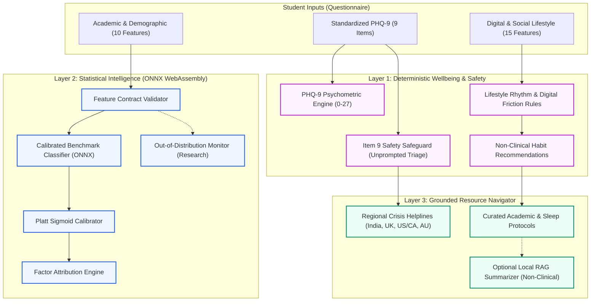
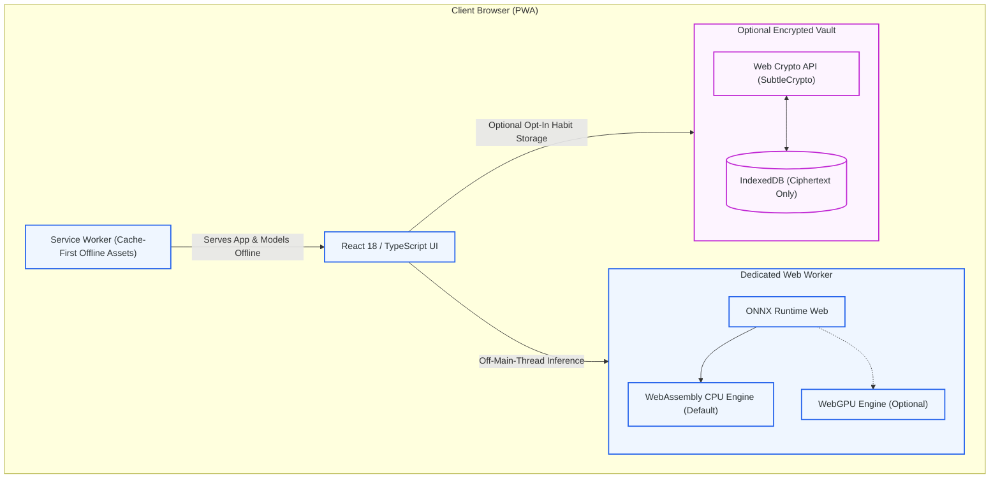

# MINDORA 2.0 — ARCHITECTURE SPECIFICATION
## Offline-First Student Wellbeing Intelligence Platform

**Document Version:** 2.0.0-draft  
**Date:** November 15, 2026  
**Status:** PROPOSED & NOT IMPLEMENTED (Stage 0 Architecture Foundation)  
**Project:** Mindora 2.0 — Offline-First Student Wellbeing Intelligence Platform  
**Repository Directory:** `D:\Depression calculator`  

---

## 1. Product Vision & Principles

Mindora 2.0 is an offline-first, client-side student wellbeing intelligence platform engineered to empower university students through private, scientifically grounded self-reflection and actionable daily habit design.

### Core Student Journey
```
UNDERSTAND ───► DISCOVER ───► ACT ───► IMPROVE
```
1. **UNDERSTAND:** Transparent orientation regarding platform capabilities, ethical scope, tri-layer intelligence boundaries, and data sovereignty.
2. **DISCOVER:** Self-reflection via a structured questionnaire producing explainable machine learning risk patterns, lifestyle friction analytics, and validated psychometric screening.
3. **ACT:** Translation of analytical insights into small, realistic, non-clinical daily lifestyle micro-habits.
4. **IMPROVE:** Longitudinal self-care reflection and habit progress tracking within an optional client-side encrypted local vault.

### What Mindora 2.0 Is NOT
- **NOT a Clinical Diagnostic System:** Mindora does not diagnose major depressive disorder, generalized anxiety, or any psychiatric pathology.
- **NOT a Healthcare Replacement:** Mindora does not prescribe medications, provide formal psychotherapy, or substitute for professional clinical care.
- **NOT a "Depression Calculator":** Mindora rejects gimmicky calculations that collapse complex human psychological states into a single fabricated "depression percentage".
- **NOT a Surveillance Tool:** Mindora does not track students, report findings to university administrations, or harvest personal data for commercial profiling.

---

## 2. Technical Stack Architecture

Mindora 2.0 migrates from a server-dependent Streamlit architecture to a modern, browser-first progressive web application (PWA) with zero mandatory backend inference dependencies:

```
┌────────────────────────────────────────────────────────────────────────┐
│                   MINDORA 2.0 TARGET ARCHITECTURE                     │
├────────────────────────────────────────────────────────────────────────┤
│ 1. CLIENT BROWSER (OFFLINE-FIRST PROGRESSIVE WEB APP)                  │
│    • Framework: React 18+ / Vite / TypeScript                          │
│    • Styling & Design: Tailwind CSS / Heroicons / Lucide               │
│    • Inference Engine: ONNX Runtime Web (WebAssembly CPU + WebGPU)     │
│    • Worker Model: Web Worker for non-blocking background inference   │
│    • Storage: Client Web Crypto API (AES-256-GCM) + IndexedDB Vault    │
│    • Service Worker: Cache-first offline PWA asset caching             │
├────────────────────────────────────────────────────────────────────────┤
│ 2. SHARED CONTRACTS & SCHEMAS                                          │
│    • Single Feature Contract: shared/contracts/feature_contract.json   │
│    • TypeScript Interfaces: frontend/src/contracts/                    │
│    • Python Pydantic Validators: ml_lab/preprocessing/                 │
│    • Reference Benchmark Fixtures: shared/fixtures/                    │
├────────────────────────────────────────────────────────────────────────┤
│ 3. ML RESEARCH & MODEL FACTORY (LOCAL WORKSTATION / RESEARCH LAB)      │
│    • Analytics & Profiling: DuckDB / Pandas / Polars                   │
│    • Training & Benchmarking: Scikit-learn / XGBoost / CatBoost / LGBM │
│    • Calibration & Uncertainty: CalibratedClassifierCV / Platt / OOD   │
│    • Optimization: Optuna (MedianPruner)                               │
│    • Explainability: SHAP (TreeExplainer)                              │
│    • Export Pipeline: skl2onnx / onnx / onnxruntime                    │
├────────────────────────────────────────────────────────────────────────┤
│ 4. OPTIONAL LOCAL COMPANION (OPTIONAL / NON-BLOCKING)                  │
│    • Server: FastAPI (Python 3.12) running locally                     │
│    • Capabilities: Curated resource retrieval & local LLM summarizer   │
│    • Invariant: Student assessment NEVER depends on this companion     │
└────────────────────────────────────────────────────────────────────────┘
```

---

## 3. Three Independent Intelligence Layers

To preserve clinical safety, algorithmic explainability, and ethical boundaries, Mindora 2.0 segregates intelligence into three strictly independent layers:



### Layer 1: Deterministic Wellbeing & Safety
- **Responsibilities:** Validated PHQ-9 psychometric scoring (0–27), clinical severity categorization ("Minimal", "Mild", "Moderate", "Moderately Severe", "Severe"), independent Item 9 self-harm triage pathway, deterministic rule-based lifestyle analytics (Lifestyle Rhythm score 0–10, Digital Friction index 0–10), and self-care habit matching.
- **Strict Invariants:**
  1. *Zero Machine Learning:* Layer 1 contains zero neural networks, tree models, or probabilistic estimators.
  2. *Zero Diagnosis:* Outputs represent self-reported screening indicators, never medical diagnoses.
  3. *Zero Feature Ingestion:* PHQ-9 scores and lifestyle inputs are **NEVER** fed into Layer 2 machine learning models.
  4. *Safety Priority:* Positive Item 9 responses trigger unconditional safety guidance and crisis helpline directories, completely unsuppressed by Layer 2 statistical predictions.

### Layer 2: Statistical Intelligence
- **Responsibilities:** Model inference over the 10 approved survey features, probability calibration, local explainability (factor contributions), uncertainty evaluation, and out-of-distribution (OOD) checks.
- **Benchmark Candidates (Evidence-Driven Selection):**
  1. Calibrated Logistic Regression (interpretable baseline)
  2. Existing Calibrated XGBoost (`models/best_model.pkl`)
  3. CatBoost Classifier (native categorical handling)
  4. LightGBM Classifier (compact, high-speed inference)
- **Deployment Format:** Exported ONNX graph executed client-side via ONNX Runtime Web in a dedicated Web Worker.
- **Strict Invariants:**
  1. Inputs must adhere strictly to `shared/contracts/feature_contract.json`.
  2. The output represents an experimental statistical alignment with historical student survey patterns, not an individual clinical prognosis.

### Layer 3: Grounded Resource Navigator
- **Responsibilities:** Geo-localized emergency dispatch and mental health triage resource matching (India Tele-MANAS/112, UK 999/NHS 111/Lifeline NI, US/Canada 911/988), curated educational sleep and study protocols, and verified academic mentorship services.
- **Strict Invariants:**
  1. *Zero Text Classification:* Does not attempt to diagnose mental states from unstructured text.
  2. *Optional Local Summarization:* If an optional local companion model (e.g. Qwen 2.5 1.5B/3B) is attached, it operates strictly over approved, retrieved source documents with explicit source citations. It is strictly forbidden from inventing medical advice.

---

## 4. Single Feature Contract Architecture

To eliminate training-serving skew between Python model training and browser TypeScript execution, Mindora 2.0 introduces the **Single Feature Contract** (`shared/contracts/feature_contract.json`).

```
                ┌──────────────────────────────────────┐
                │ shared/contracts/feature_contract.json│
                └──────────────────┬───────────────────┘
                                   │
                 ┌─────────────────┴─────────────────┐
                 ▼                                   ▼
┌─────────────────────────────────┐ ┌─────────────────────────────────┐
│ ml_lab/preprocessing/           │ │ frontend/src/contracts/         │
│ Python Pydantic Validators      │ │ TypeScript Zod Schemas          │
│ Scikit-learn Pipeline Config    │ │ Client-side Input Sanitization  │
└─────────────────────────────────┘ └─────────────────────────────────┘
                 │                                   │
                 └─────────────────┬─────────────────┘
                                   ▼
                 ┌───────────────────────────────────┐
                 │ shared/fixtures/benchmark_cases.json│
                 │ Parity Test Suite (Python vs ONNX)│
                 └───────────────────────────────────┘
```

### Approved 10-Feature Schema
1. `Age` (numeric, 16.0–55.0 years)
2. `Academic Pressure` (numeric, 1.0–5.0 ordinal)
3. `CGPA` (numeric, 0.0–10.0 scale)
4. `Study Satisfaction` (numeric, 1.0–5.0 ordinal)
5. `Work/Study Hours` (numeric, 1.0–14.0 hours/day)
6. `Financial Stress` (numeric, 1.0–5.0 ordinal)
7. `Gender` (categorical, 2 categories: "Female", "Male")
8. `Sleep Duration` (categorical, 5 categories: "5-6 hours", "7-8 hours", "Less than 5 hours", "More than 8 hours", "Others")
9. `Dietary Habits` (categorical, 4 categories: "Healthy", "Moderate", "Others", "Unhealthy")
10. `Degree` (categorical, 28 verified categories: "B.Tech", "BSc", "B.Com", etc.)

---

## 5. Offline-First Client Runtime & Storage Architecture



### Client-Side Execution Guarantee
1. **Zero Mandatory Backend:** Following initial PWA asset caching, all inference, scoring, and UI rendering execute 100% locally on the student's hardware.
2. **WebAssembly Baseline:** CPU WebAssembly provides ubiquitous device compatibility across low-end mobile devices, tablets, and laptops without requiring hardware acceleration.
3. **Optional WebGPU:** If supported by the browser and GPU hardware, WebGPU is utilized as a progressive enhancement for sub-millisecond execution.

---

## 6. Implementation Status & Boundary

> [!IMPORTANT]
> **STATUS:** **PROPOSED & NOT IMPLEMENTED**.  
> Stage 0 establishes the architectural contract, directory scaffolding, test fixtures, and technical plans. No production code has been migrated or replaced. The existing Streamlit platform remains fully active and operational.
