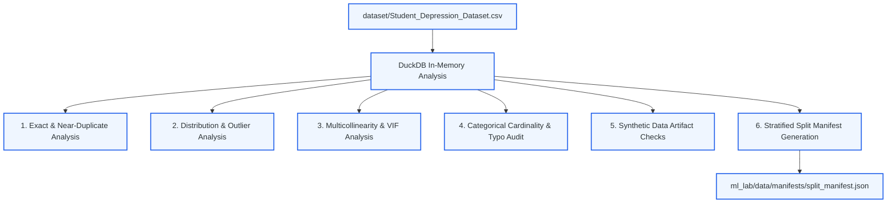

# MINDORA 2.0 — DATA AUDIT PLAN & DATASET SPECIFICATION
## Comprehensive Dataset Audit, Provenance & Profiling Protocol

**Document Version:** 1.0.0  
**Date:** November 15, 2026  
**Status:** PROPOSED & READY FOR EXECUTION (Stage 0 Foundation)  
**Project:** Mindora 2.0 — Offline-First Student Wellbeing Intelligence Platform  
**Repository Directory:** `D:\Depression calculator`  

---

## 1. Verified Dataset Inventory

| Attribute | Verified Value | Verification Method |
|---|---|---|
| **File Path** | `dataset/Student_Depression_Dataset.csv` | File system inspection |
| **Cryptographic SHA-256** | `A3E159E246789BE5A61DCC7B4290FBC238F0140F3D95727585AF50A61FD35404` | SHA-256 byte digest |
| **File Size on Disk** | 2,807,716 bytes (~2.68 MB) | Windows NTFS file size |
| **Total Rows (Observations)**| **27,901** | `pandas.read_csv().shape[0]` |
| **Total Columns (Variables)**| **18** | `pandas.read_csv().shape[1]` |
| **Missing Values (Nulls)** | Exactly 3 null values in `Financial Stress` (0 in all other 17 columns) | Full column null summation |
| **Target Variable** | `Depression` (Binary: `0` = No, `1` = Yes) | Target distribution check |
| **Target Balance** | Class 1: 16,336 (58.55%) • Class 0: 11,565 (41.45%) | Value count verification |

---

## 2. Dataset Provenance & Critical Clinical Disclaimer

> [!CAUTION]
> **DATASET PROVENANCE & CLINICAL VALIDITY WARNING:**  
> The `Student_Depression_Dataset.csv` is derived from an open-access student survey repository (commonly known as the Kaggle Student Depression Dataset).  
> 1. **Self-Reported Survey Indicators:** The target column `Depression` represents a self-reported questionnaire response or survey indicator. It was **NOT collected through structured clinical interviews (e.g. SCID-5)**, DSM-5 psychiatric evaluations, or certified clinician diagnoses.  
> 2. **Ethical Framing:** Any machine learning model trained on this dataset predicts the likelihood that an individual's survey responses match the self-reported patterns of students in this historical sample. **It does NOT predict medical depression.**  
> 3. **Non-Clinical Scope:** Mindora 2.0 must explicitly communicate this limitation across all documentation and user-facing screens to prevent misinterpretation as a clinical diagnostic tool.

---

## 3. Comprehensive Column Inventory & Feature Disposition

| # | Column Name | Raw Data Type | Distinct Values | Sample Values / Categories | Model Feature Disposition | Inclusion / Exclusion Rationale |
|---|---|---|---|---|---|---|
| 1 | `id` | Integer | 27,901 | `1`, `2`, `3` ... | **EXCLUDED** | Arbitrary sequential identifier; potential target leakage if sorted. |
| 2 | `Gender` | String | 2 | `Male`, `Female` | **APPROVED (Feature #7)** | Baseline demographic variable; one-hot encoded (2 classes). |
| 3 | `Age` | Float | 38 | `21.0`, `22.0`, `18.0` | **APPROVED (Feature #1)** | Core demographic marker (16–55 years); median imputed, standardized. |
| 4 | `City` | String | 450+ | `Visakhapatnam`, `Bangalore` | **EXCLUDED** | Highly fragmented, unstandardized text; high cardinality introduces severe overfitting and geographical bias. |
| 5 | `Profession` | String | 15+ | `Student`, `Civil Engineer` | **EXCLUDED** | Dataset contains non-student occupations; irrelevant for dedicated student platform. |
| 6 | `Academic Pressure` | Float | 6 | `3.0`, `4.0`, `5.0` | **APPROVED (Feature #2)** | Primary academic stress indicator (1.0–5.0 scale); standardized. |
| 7 | `Work Pressure` | Float | 6 | `0.0`, `1.0`, `4.0` | **EXCLUDED** | Collinear with Work/Study Hours and largely applies to employed cohorts. |
| 8 | `CGPA` | Float | 100+ | `8.2`, `7.5`, `6.8` | **APPROVED (Feature #3)** | Key objective academic performance metric (0.0–10.0 scale); standardized. |
| 9 | `Study Satisfaction`| Float | 6 | `3.0`, `4.0`, `2.0` | **APPROVED (Feature #4)** | Core subjective academic satisfaction (1.0–5.0 scale); standardized. |
| 10| `Job Satisfaction` | Float | 6 | `0.0`, `1.0`, `3.0` | **EXCLUDED** | Non-student indicator; redundant. |
| 11| `Sleep Duration` | String | 5 | `7-8 hours`, `5-6 hours`, `Less than 5 hours` | **APPROVED (Feature #8)** | Major physiological rhythm variable; one-hot encoded (5 classes). |
| 12| `Dietary Habits` | String | 4 | `Healthy`, `Moderate`, `Unhealthy`, `Others` | **APPROVED (Feature #9)** | Physical lifestyle habit indicator; one-hot encoded (4 classes). |
| 13| `Degree` | String | 28 | `B.Tech`, `BSc`, `B.Com`, `BA` | **APPROVED (Feature #10)** | Academic program tier; one-hot encoded (28 verified classes). |
| 14| `Have you ever had suicidal thoughts ?` | String | 2 | `Yes`, `No` | **STRICTLY EXCLUDED** | **Severe Target Leakage:** Overfits models (~60% split importance). Promotes clinical shortcutting. Triage belongs strictly in Layer 1. |
| 15| `Work/Study Hours` | Float | 28 | `6.0`, `8.0`, `12.0` | **APPROVED (Feature #5)** | Objective time commitment (1.0–14.0 hours/day); standardized. |
| 16| `Financial Stress` | Float | 6 | `2.0`, `3.0`, `5.0` (3 nulls) | **APPROVED (Feature #6)** | Socio-economic strain indicator (1.0–5.0); median imputed, standardized. |
| 17| `Family History of Mental Illness` | String | 2 | `Yes`, `No` | **STRICTLY EXCLUDED** | Excluded for student privacy, unverified clinical disclosure, and family stigmatization prevention. |
| 18| `Depression` | Integer | 2 | `0` (No), `1` (Yes) | **TARGET VARIABLE** | Binary target for statistical survey pattern alignment. |

---

## 4. Systematic Data Audit Protocol (Execution in `ml_lab/audit/`)

During Stage 1, the research lab will execute the following automated profiling protocols:

### Protocol Steps & Quality Criteria
1. **Deduplication Analysis:** Identify identical rows across all 18 columns and across the 10 approved features. Document whether duplicates represent genuine survey collisions or collection artifacts.
2. **Missingness & Imputation Integrity:** Audit the 3 missing values in `Financial Stress`. Verify that median imputation does not introduce distribution shift.
3. **Multicollinearity & Correlation:** Compute Pearson, Spearman, and Cramer's V correlations across all pairs. Assess Variance Inflation Factor (VIF) on numerical features.
4. **Target Leakage Verification:** Run single-feature decision trees to confirm that no single feature yields artificially high AUC (> 0.80) in isolation.
5. **Synthetic Artifact Detection:** Inspect digit distributions (Benford's Law analysis on CGPA and age) to evaluate whether portions of the dataset were synthetically generated (e.g. via CTGAN or Gaussian copulas).
6. **Stratified Split Manifest:** Generate a fixed, immutable JSON split manifest using SHA-256 record hashes:
   - **Training Set (70% = 19,530 rows):** Used for model training and cross-validation calibration.
   - **Validation Set (15% = 4,185 rows):** Used strictly for model selection, threshold tuning, and hyperparameter optimization.
   - **Test Set (15% = 4,186 rows):** Sealed hold-out set evaluated **ONCE** for final unbiased reporting.
