# MINDORA 2.0 — PHASE 5.16 ARCHITECTURE & IMPLEMENTATION PLAN
## Four-Model ML Laboratory, Real-World Dataset Laboratory, Authentication & Guardian Support

**Author:** Principal ML Engineer, Data Scientist, Full-Stack Architect, Cybersecurity Engineer, UX Designer & Student Wellbeing Safety Specialist  
**Date:** November 16, 2026  
**Status:** APPROVED ARCHITECTURAL BLUEPRINT (Pre-Implementation Plan)  
**Project Location:** `D:\Depression calculator`  
**Product:** Mindora 2.0 — Student Mental Wellness & Risk Insights Platform  

---

## 1. Executive Overview & Objectives

Mindora 2.0 is transitioning into an institutional-grade machine learning research platform and student wellbeing support environment. The objective of Phase 5.16 is to implement:
1. **Four Independently Trained & Evaluated Classification Models:** Logistic Regression, Random Forest, XGBoost, and Support Vector Machine (SVM) on tabular student wellbeing data.
2. **Dual-Track Dataset Laboratory:**
   - **Track A (Large Dataset):** 27,901 records (`dataset/Student_Depression_Dataset.csv`), using stratified train/validation/test partitions.
   - **Track B (163-Record Real-World Dataset):** 162 respondent records (`ml_lab/data/raw/STUDENT dataset.xlsx`), rigorously evaluated under small-sample constraints and explicitly marked **"163-RECORD DATASET — PROVENANCE UNVERIFIED"**.
3. **Comprehensive Model Dashboards:** Individual model deep-dives and an interactive Four-Model Comparison Dashboard with calibration curves, ROC/PR curves, confusion matrices, and feature importance.
4. **Secure Student Authentication:** Server-side authentication implemented directly in Mindora's existing FastAPI backend (`local_companion/service.py`), leveraging **Argon2id** and **Bcrypt** cryptographic password hashing, session tokens, rate limiting, and input sanitation.
5. **Optional Parent/Guardian Support & Elevated-Stress Notifications:** Fully consent-driven, revocable, minor-safeguarded contact management with neutral notification previews, zero sensitive health disclosures, and a verified mock SMS provider.
6. **Unified 12-Section Navigation UI:** Professional, responsive sidebar navigation preserving Mindora's signature white, violet, and lavender visual design language.

---

## 2. Pre-Implementation Repository Inspection Summary

### 2.1 Existing Model Assets and Historical Experiments
- **Primary Frozen Asset:** `models/best_model.pkl` (SHA-256: `E182E9E779A4F89E4883EB13C9BAB3DF19EEBC7165D4B0A44319F737361342EC`). Must remain untouched.
- **Historical Experiments:** `experiments/registry.json`, `experiments/models/exp_*` and `ml_lab/experiments/stage_3b_*` represent validated stages (Stage 3b.2, 3b.3, 3b.4).
- **New Experiment Architecture:**
  - Track A artifacts stored in `models/large_dataset/`, `experiments/large_dataset/`, and `reports/large_dataset/`.
  - Track B artifacts stored in `models/real_world_163/`, `experiments/real_world_163/`, and `reports/real_world_163/`.

### 2.2 Dataset Verification & Provenance Analysis
1. **Large Dataset (`dataset/Student_Depression_Dataset.csv`):**
   - **Records:** 27,901 rows, 18 columns.
   - **Target:** `Depression` (Binary: 16,336 positive [58.55%], 11,565 negative [41.45%]).
   - **Contract Features:** 10 approved features governed by `shared/contracts/feature_contract.json`: `Age`, `Academic Pressure`, `CGPA`, `Study Satisfaction`, `Work/Study Hours`, `Financial Stress`, `Gender`, `Sleep Duration`, `Dietary Habits`, `Degree`.
   - **Split Architecture:** Pre-partitioned into group-aware partitions (`ml_lab/splits/partition_assignments.csv`).
2. **Small Dataset (`ml_lab/data/raw/STUDENT dataset.xlsx`):**
   - **Records:** 162 student response rows + 1 header row (163 rows total), 14 columns.
   - **Origin:** Google Form titled "Form Responses 1".
   - **Target:** `Has a qualified healthcare professional ever told you that you have depression` (Self-report: `no`: 98 [60.5%], `yes`: 45 [27.8%], `not sure`: 19 [11.7%]).
   - **Provenance Audit:** No institutional ethics approval identifier, participant consent sheets, or investigator logs are bundled with the raw `.xlsx`. Respondent ages range from 13 to 69; contains raw string CGPA entries ("Nill", "No", emoji), and unstructured degree labels.
   - **Mandated Label:** **"163-RECORD DATASET — PROVENANCE UNVERIFIED"**. Must not be represented as an institutionally validated clinical cohort.

### 2.3 Backend & Frontend Integration Baseline
- **Backend:** FastAPI service in `local_companion/service.py` running on `127.0.0.1:8000`. Fast, lightweight, local-loopback only, already integrated with CORS for `127.0.0.1:5173`.
- **Frontend:** React 18 + Vite + TypeScript + Tailwind CSS running on `127.0.0.1:5173`. Baseline test suite: 111/111 tests passing. Zero compilation errors.
- **Python Runtime:** Python 3.14 / 3.12 with `scikit-learn 1.9.1`, `xgboost 3.4.1`, `argon2-cffi 25.1.0`, `bcrypt 5.0.0`, `pandas 3.1.1`, and `numpy 2.5.4`.

---

## 3. Four-Model Architecture & Training Methodology

### 3.1 Candidate Model Specifications

| Model | Algorithm Class | Key Preprocessing & Hyperparameters | Probability Output Strategy | Interpretability |
| :--- | :--- | :--- | :--- | :--- |
| **Model 1** | **Logistic Regression** | `StandardScaler()`, `C=1.0`, `penalty='l2'`, `solver='lbfgs'`, `class_weight='balanced'`, `max_iter=1500` | Native sigmoid probabilities via `predict_proba()` | Standardized linear coefficients |
| **Model 2** | **Random Forest** | `n_estimators=150`, `max_depth=8`, `min_samples_split=5`, `class_weight='balanced'`, `random_state=42` | Out-of-bag tree ensemble voting probabilities | MDI Feature Importances & Permutation Importance |
| **Model 3** | **XGBoost Classifier** | `n_estimators=150`, `max_depth=5`, `learning_rate=0.05`, `subsample=0.85`, `colsample_bytree=0.85`, `eval_metric='logloss'` | Gradient-boosted logistic loss probability | Gain-based Feature Importance & SHAP values |
| **Model 4** | **Support Vector Machine (SVM)** | `StandardScaler()`, `kernel='rbf'`, `C=1.0`, `gamma='scale'`, `class_weight='balanced'`, `random_state=42` | Platt Scaling via `probability=True` or `CalibratedClassifierCV(cv=3)` | Support vector dual coefficients & permutation importance |

### 3.2 Methodological Safeguards & Fair Comparison
- **Common Preprocessing Pipeline:** Leakage-safe Scikit-Learn `Pipeline` and `ColumnTransformer`. Imputation (median for numeric, mode for categorical) and scaling (`StandardScaler`) fitted strictly on training data folds.
- **Identical Evaluation Protocol:** Both datasets evaluate all four models on the exact same folds or partitions.
- **Metric Definitions:**
  - Positive class: $y = 1$ (Depression indicator).
  - Accuracy, Balanced Accuracy, Precision, Recall (Sensitivity), Specificity, Macro-F1, F1 (positive class), ROC-AUC, PR-AUC, and Brier Score.
  - Per-class metrics and confusion matrix generated for all models.

---

## 4. Dual-Track Dataset Pipelines

### 4.1 Track A: Large Dataset Pipeline (27,901 Records)
1. **Splits:** 70% Training (19,530), 15% Validation (4,185), 15% Untouched Holdout Test (4,186), using stratified random sampling with fixed seed (`42`).
2. **Model Selection:** Hyperparameters tuned and models compared exclusively on the **Validation Set**.
3. **Final Evaluation:** Evaluated once on the **Untouched Test Set**. Test set results are never used for model selection.
4. **Outputs:** Stored in `models/large_dataset/` and `reports/large_dataset/model_metrics.json`.

### 4.2 Track B: 163-Record Dataset Pipeline (Small-Sample Research)
1. **Target Harmonization:** Binary reduction (`yes` = 1, `no` = 0; `not sure` quarantined or handled via documented sensitivity run).
2. **Eligibility Filtering:** Strict non-adult / non-enrolled exclusion vs. pragmatic filtering documented in waterfall.
3. **Small-Sample Strategy:** Repeated Stratified 5-Fold Cross-Validation (5 folds $\times$ 5 repeats = 25 evaluations).
4. **No Premature Oversampling:** Synthetic oversampling (SMOTE) is strictly prohibited on the full dataset. If tested, it is nested inside CV training folds only.
5. **Sample Size Limitations Acknowledged:** 95% Confidence Intervals calculated via studentized bootstrap; standard deviations reported alongside mean metrics.
6. **Outputs:** Stored in `models/real_world_163/` and `reports/real_world_163/small_dataset_metrics.json`.

---

## 5. Authentication & Security Architecture

### 5.1 FastAPI Backend Authentication Engine (`local_companion/service.py`)
- **Password Hashing:** **Argon2id** (memory cost: 65,536 KiB, time cost: 3 iterations, parallelism: 4 threads) with fallback to **Bcrypt** (cost factor: 12). Plaintext passwords never stored or logged.
- **Storage:** Local encrypted SQLite database `data/users.db` managed server-side.
- **Session Tokens:** Cryptographically secure 256-bit random tokens (`secrets.token_urlsafe(32)`), stored with creation timestamp, expiration (8 hours), and user association.
- **Rate Limiting:** Sliding-window rate limiter on login/register endpoints (maximum 5 failed attempts per 15-minute window per IP) to mitigate brute-force attacks.
- **Endpoints:**
  - `POST /api/auth/register`: Full name, email, password, DOB eligibility check, optional guardian fields.
  - `POST /api/auth/login`: Credential validation, returns session token & student profile.
  - `POST /api/auth/logout`: Revokes active session token.
  - `GET /api/auth/me`: Returns sanitized student profile (no password hash).
  - `POST /api/auth/forgot-password`: Generates secure password reset token.
  - `POST /api/auth/reset-password`: Validates token and updates password hash.
  - `PUT /api/auth/profile`: Updates non-sensitive preferences and guardian contacts.

---

## 6. Parent / Guardian Support & Elevated-Stress Notification Workflow

### 6.1 Guardian Contact Management
- **Voluntary & Opt-In:** Contact information is optional; students can fully use all Mindora features without providing guardian details.
- **Fields:** Name, relationship, country code, phone number, verification status, notification permission toggle.
- **Age Governance:**
  - Adults ($\ge 18$): Explicit, informed student consent required before storing or notifying.
  - Minors ($< 18$): Safeguarding boundary restricts notification until age-specific protocol and verification are completed.
- **Revocability:** Single-click revocation instantly purges contact from notification queues.

### 6.2 Elevated-Stress Notification Workflow
- **Trigger Rule:** Non-diagnostic self-reported stress indicator based on high student assessment or check-in scores ($\ge 4$ on academic/financial stress scale + study friction).
- **Communication Guardrails:**
  - **Zero Clinical Disclosures:** Never transmits PHQ-9 answers, Item 9 flags, depression labels, or diagnostic terminology.
  - **Student Approval:** The student must review the exact message and approve the recipient before transmission.
  - **Neutral Standard Message:**  
    `"Your student has requested support from their trusted contact through Mindora. Please check in with them when possible."`
  - **Mock SMS Service:** Integrates a realistic Mock SMS provider logging simulated delivery timestamps, mock message IDs, and carrier delivery receipts without initiating external network calls.
  - **Crisis Hotline Isolation:** Crisis support hotlines (e.g., Tele-MANAS, 988, Crisis Text Line) remain prominently visible on the UI and operate completely independently of guardian notification status.

---

## 7. Application UI Redesign (12 Unified Sidebar Sections)

The React Vite frontend (`frontend/src/`) will be structured into 12 distinct, professional navigation views:

```mermaid
flowchart LR
    subgraph Mindora_Navigation [Mindora 2.0 Sidebar Navigation]
        S1["1. Dashboard"]
        S2["2. Student Assessment"]
        S3["3. Model Laboratory"]
        S4["4. Four-Model Comparison"]
        S5["5. Real-World Dataset Lab"]
        S6["6. Large Dataset Experiments"]
        S7["7. Explainability"]
        S8["8. Personal Goals"]
        S9["9. Wellness Studio"]
        S10["10. Parent / Guardian Support"]
        S11["11. Privacy & My Data"]
        S12["12. Profile & Settings"]
    end
```

- **Visual Theme:** Consistent with Mindora's white, violet (`#7C3AED`), and lavender (`#EDE9FE`) design palette.
- **Clear Demarcation:** Distinct visual badges for **"Research Experiment (Non-Clinical)"**, **"Student Facing Tool"**, **"Dataset B — Provenance Unverified"**, and **"Offline Privacy-Preserving"**.

---

## 8. Implementation Steps & Milestones

1. **Phase 1: Pre-Implementation Documentation & Hash Verification** (Completed).
2. **Phase 2 & 7: Large Dataset Four-Model Training Pipeline:**
   - Implement `scripts/train_four_models_large.py`.
   - Train Logistic Regression, Random Forest, XGBoost, and SVM.
   - Generate metrics, ROC curves, PR curves, and confusion matrices in `reports/large_dataset/`.
3. **Phase 5 & 6: Real-World 163-Record Dataset Pipeline:**
   - Implement `scripts/train_four_models_163.py`.
   - Data cleaning, feature alignment, repeated stratified cross-validation.
   - Generate small-sample validation report in `reports/real_world_163/`.
4. **Phase 8 & 9 & 10: Backend Authentication, Guardian Management & Mock SMS:**
   - Update `local_companion/service.py` with auth, guardian, and stress notification endpoints.
   - Implement `local_companion/auth_db.py` with Argon2id/Bcrypt hashing and SQLite persistence.
   - Implement mock SMS dispatcher with audit logging.
5. **Phase 3, 4, 11: Frontend UI Redesign & Model Dashboards:**
   - Implement 12-section navigation in `frontend/src/components/common/Sidebar.tsx` and `App.tsx`.
   - Implement Model Laboratory with 4 individual model tabs and the Four-Model Comparison view.
   - Implement Real-World Dataset Laboratory view with provenance banner.
   - Implement Student Authentication modal/screens (Signup, Login, Forgot Password, Profile).
   - Implement Parent / Guardian Support & Elevated-Stress Notification screen.
6. **Phase 12: Model Governance & Security Reports:**
   - Create all 7 governance reports in `docs/models/` and `docs/security/`.
7. **Phase 13 & 14: Comprehensive Verification & Final Report:**
   - Run python test suites (`pytest`).
   - Run frontend test suite (`npm test`).
   - Verify all 11 frozen research asset hashes.
   - Produce `docs/experiments/PHASE_5_16_FOUR_MODEL_AND_REAL_WORLD_DATASET_REPORT.md`.

---

## 9. Invariant Safeguards
- **Frozen Research Assets:** The 11 core reference assets will not be modified.
- **Git State Preservation:** The 9 Day 12 tracked modified files remain preserved.
- **No Test Set Model Selection:** Final model selection is governed exclusively by validation split metrics.
- **Zero Real SMS Dispatches:** All SMS workflows interact exclusively with local mock services.
- **Non-Diagnostic Status:** Mindora will not provide psychiatric diagnosis, risk classification, or medical claims.
