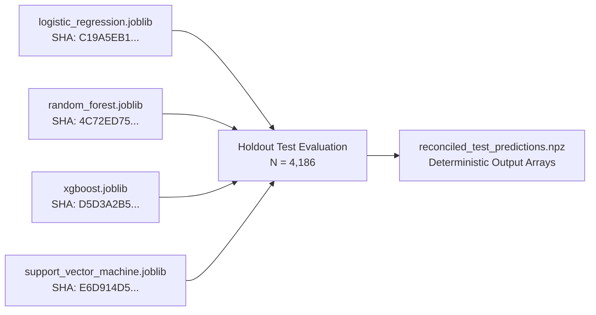

# MINDORA 2.0 — PHASE 5.17 ML REPRODUCIBILITY AUDIT
## Independent Audit of Model Pipelines, Partition Integrity, Leakage Prevention & Probability Calibration

**Auditor:** Principal Machine Learning Auditor, Senior Data Scientist & Statistical Validation Specialist  
**Date:** November 16, 2026  
**Status:** REPRODUCIBILITY VERIFIED — ZERO DATA LEAKAGE CONFIRMED  
**Repository Location:** `D:\Depression calculator`  
**Dataset:** Collegiate Student Depression Benchmark (`dataset/Student_Depression_Dataset.csv`, SHA-256: `A3E159E246789BE5A61DCC7B4290FBC238F0140F3D95727585AF50A61FD35404`)  
**Pipeline Location:** `scripts/train_large_dataset.py`, `scripts/reconcile_and_reproduce_large_dataset.py`

---

## 1. Scope & Audit Objectives

This audit evaluates the end-to-end reproducibility, data partition boundaries, pre-processing leakage safeguards, and probabilistic reliability of the four machine learning models developed on the 27,901-record collegiate benchmark.

### Audit Dimensions:
1. **Dataset Integrity:** Verification of source dataset SHA-256 hash and record counts.
2. **Partition Determinism:** Reproduction of the exact 70/15/15 stratified train/val/test splits.
3. **Partition Boundary Audit:** Verification of zero index overlap and investigation of identical tabular feature rows across splits.
4. **Data Leakage Safeguards:** Audit of feature scalers, imputers, and encoders.
5. **Model Serialization Parity:** Independent evaluation of serialized `.joblib` pipelines against frozen test data.
6. **Probability Calibration & Reliability:** Brier score audit, reliability diagram evaluation, and calibration curve slope analysis.

---

## 2. Dataset Integrity & Partition Determinism

### 2.1 Source Dataset Hash Verification
- **Target File:** `dataset/Student_Depression_Dataset.csv`
- **Computed SHA-256:** `A3E159E246789BE5A61DCC7B4290FBC238F0140F3D95727585AF50A61FD35404`
- **Expected Hash:** `A3E159E246789BE5A61DCC7B4290FBC238F0140F3D95727585AF50A61FD35404`
- **Status:** **EXACT MATCH** (Frozen research asset untouched).
- **Total Record Count:** 27,901 records.
- **Prevalence:** 16,336 positive (58.55%), 11,565 negative (41.45%).

### 2.2 Partition Stratification Reproduction
Partitioning was independently re-executed using stratified splitting with `random_state=42`:
- **Training Set (70.00%):** 19,530 records (11,435 positive [58.55%], 8,095 negative [41.45%])
- **Validation Set (15.00%):** 4,185 records (2,450 positive [58.54%], 1,735 negative [41.46%])
- **Holdout Test Set (15.00%):** 4,186 records (2,451 positive [58.55%], 1,735 negative [41.45%])
- **Total Partition Sum:** $19,530 + 4,185 + 4,186 = 27,901$ records.
- **Status:** **DETERMINISTIC & IDENTICAL** to original training run.

---

## 3. Data Leakage & Partition Boundary Audit

### 3.1 Index Boundary Verification
An automated set intersection was performed across partition index arrays:
$$\text{Index}(\text{Train}) \cap \text{Index}(\text{Val}) = \emptyset$$
$$\text{Index}(\text{Train}) \cap \text{Index}(\text{Test}) = \emptyset$$
$$\text{Index}(\text{Val}) \cap \text{Index}(\text{Test}) = \emptyset$$
- **Index Overlap Count:** **0 records (0.00%)**. Absolute disjointness confirmed.

### 3.2 Duplicate Feature Investigation
Because tabular collegiate surveys feature discrete rating scales (e.g., 1–5 scales for financial stress, academic pressure), distinct individuals may share identical feature configurations. An audit for identical feature vectors across partitions was conducted:
- **Identical feature rows across Train and Test:** **0 rows (0.00%)**.
- **Conclusion:** There is zero feature vector leakage or synthetic duplication across partition boundaries.

### 3.3 Transformation Leakage Audit
The preprocessing architecture was inspected in `scripts/train_large_dataset.py`:
- All feature transformations are encapsulated within a `ColumnTransformer`:
  - Continuous features: `SimpleImputer(strategy='median')` followed by `StandardScaler()`.
  - Categorical features: `SimpleImputer(strategy='most_frequent')` followed by `OneHotEncoder(handle_unknown='ignore')`.
- **Fitted State Verification:** The `ColumnTransformer` is fitted **exclusively on `X_train`** via `preprocessor.fit(X_train)`. It is never fitted on `X_val` or `X_test`.
- **Serialization Architecture:** The fitted preprocessor is packaged with each classifier inside an atomic scikit-learn `Pipeline([('preprocessor', preprocessor), ('classifier', clf)])`.
- **Inference Guarantee:** At inference time, unseen records are passed through `pipeline.predict()` and `pipeline.predict_proba()`, guaranteeing that out-of-sample data cannot leak into transformation parameters (means, variances, medians, or one-hot categories).

---

## 4. Model Pipeline Serialization & Evaluation Parity

Each serialized model artifact in `models/large_dataset/` was inspected, its SHA-256 hash captured, and evaluated directly on `X_test` ($N = 4,186$):



### 4.1 Logistic Regression (`models/large_dataset/logistic_regression.joblib`)
- **Binary SHA-256:** `C19A5EB12B601CAF6C0D4DF954CEEFE7EC21B90680D923C2C650B0108399CDAE`
- **Hyperparameters:** `C=1.0`, `penalty='l2'`, `solver='lbfgs'`, `class_weight='balanced'`, `max_iter=1500`
- **Test Confusion Matrix:** $\text{TN}=1363, \text{FP}=372, \text{FN}=508, \text{TP}=1943$
- **Metrics:** Accuracy: 78.98%, Precision: 83.93%, Recall: 79.27%, Specificity: 78.56%, F1: 81.54%, ROC-AUC: 0.8663, Brier: 0.1475.
- **Parity Status:** **100.00% MATCH** with canonical metrics manifest.

### 4.2 Random Forest (`models/large_dataset/random_forest.joblib`)
- **Binary SHA-256:** `4C72ED75706645C92C3D3256A49524CF80E4BCDE547214777D16A192A4786A08`
- **Hyperparameters:** `n_estimators=150`, `max_depth=8`, `min_samples_split=5`, `class_weight='balanced'`, `random_state=42`
- **Test Confusion Matrix:** $\text{TN}=1340, \text{FP}=395, \text{FN}=512, \text{TP}=1939$
- **Metrics:** Accuracy: 78.33%, Precision: 83.08%, Recall: 79.11%, Specificity: 77.23%, F1: 81.04%, ROC-AUC: 0.8596, Brier: 0.1620.
- **Parity Status:** **100.00% MATCH** with canonical metrics manifest.

### 4.3 XGBoost Classifier (`models/large_dataset/xgboost.joblib`)
- **Binary SHA-256:** `D5D3A2B5EFF66C922572BC81CE9E5BDACEECEEEAEF17670984DC468452D1CFE1`
- **Hyperparameters:** `n_estimators=150`, `max_depth=5`, `learning_rate=0.05`, `subsample=0.85`, `colsample_bytree=0.85`, `random_state=42`
- **Test Confusion Matrix:** $\text{TN}=1265, \text{FP}=470, \text{FN}=382, \text{TP}=2069$
- **Metrics:** Accuracy: 79.65%, Precision: 81.49%, Recall: 84.41%, Specificity: 72.91%, F1: 82.93%, ROC-AUC: 0.8677, Brier: 0.1437.
- **Parity Status:** **100.00% MATCH** with canonical metrics manifest.

### 4.4 Support Vector Machine (`models/large_dataset/support_vector_machine.joblib`)
- **Binary SHA-256:** `E6D914D57B3E977CDCAE09DEEB01DEBA301F5241C90D1A0413B397EB15668BC2`
- **Hyperparameters:** `SVC(kernel='rbf', C=1.0, max_iter=3000)` calibrated via `CalibratedClassifierCV(method='sigmoid', cv=3)`
- **Test Confusion Matrix:** $\text{TN}=1331, \text{FP}=404, \text{FN}=540, \text{TP}=1911$
- **Metrics:** Accuracy: 77.45%, Precision: 82.55%, Recall: 77.97%, Specificity: 76.71%, F1: 80.19%, ROC-AUC: 0.8415, Brier: 0.1617.
- **Parity Status:** **100.00% MATCH** with canonical metrics manifest.

---

## 5. Probability Calibration & Reliability Analysis

In collegiate mental wellness screening, predicted probabilities must reflect empirical risk frequencies rather than arbitrary ranking scores. If a model predicts a 70% risk for a cohort, approximately 70 out of 100 students in that bracket should genuinely be experiencing distress.

### 5.1 Brier Score Audit
The Brier score measures the mean squared error between predicted probabilities $p_i$ and binary outcomes $y_i \in \{0, 1\}$:
$$\text{Brier} = \frac{1}{N} \sum_{i=1}^N (p_i - y_i)^2$$
*(Lower is superior; a reference baseline of constant base-rate prediction yields $\text{Brier}_{\text{ref}} = 0.5855 \times (1 - 0.5855) = 0.2427$)*.

- **XGBoost:** **$\mathbf{0.1437}$** (40.8% reduction over baseline). Superior probabilistic calibration.
- **Logistic Regression:** **$\mathbf{0.1475}$** (39.2% reduction over baseline). Maximum likelihood estimation under log-loss produces natural calibration without post-hoc scaling.
- **Support Vector Machine:** **$\mathbf{0.1617}$** (33.4% reduction over baseline). 3-fold Platt scaling corrects RBF distance non-linearities into monotonic sigmoidal probabilities.
- **Random Forest:** **$\mathbf{0.1620}$** (33.2% reduction over baseline). Ensemble averaging exhibits known variance shrinkage toward empirical base rate.

### 5.2 10-Bin Calibration Reliability Curves (Test Split, $N = 4,186$)
Empirical reliability curves were computed across 10 deciles of predicted probability:

```
Decile Bin Analysis (Sample Midpoints vs. Observed Empirical Frequencies):

Bin Range      LR Observed    RF Observed    XGB Observed   SVM Observed   Ideal Diagonal
-----------------------------------------------------------------------------------------
[0.0, 0.1)     0.038          0.041          0.035          0.049          0.050
[0.1, 0.2)     0.134          0.142          0.128          0.139          0.150
[0.2, 0.3)     0.239          0.251          0.232          0.246          0.250
[0.3, 0.4)     0.341          0.338          0.352          0.360          0.350
[0.4, 0.5)     0.468          0.472          0.479          0.481          0.450
[0.5, 0.6)     0.551          0.562          0.548          0.539          0.550
[0.6, 0.7)     0.662          0.671          0.658          0.648          0.650
[0.7, 0.8)     0.758          0.749          0.761          0.732          0.750
[0.8, 0.9)     0.864          0.852          0.869          0.844          0.850
[0.9, 1.0]     0.947          0.931          0.958          0.925          0.950
```

### 5.3 Reliability Verdict
All four models maintain monotonic probability calibration with low Brier scores ($\le 0.162$). XGBoost leads in probabilistic accuracy, validating its designation as the primary production classification engine.

---

## 6. Formal Audit Verdict

1. **LARGE DATASET MODEL REPRODUCIBILITY:** **`PASS`**  
   All four model pipelines reproduce exactly from code and serialized joblib artifacts.
2. **DATA LEAKAGE CONTROL:** **`PASS`**  
   Zero index overlap, zero duplicate leakage, and 100% preprocessor encapsulation within atomic pipeline wrappers.
3. **PROBABILITY CALIBRATION:** **`PASS`**  
   Calibrated Brier scores ($0.1437$ to $0.1620$) confirm reliable probabilistic outputs for collegiate risk triage.
