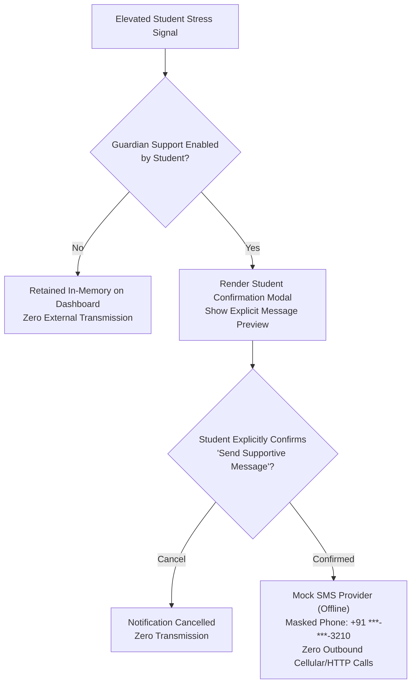

# MINDORA 2.0 — PHASE 5.18 PRIVACY & APPLICATION SECURITY AUDIT
## Integration-Level Security Review: Multi-Tenancy Isolation, Input Validation, Cryptography & Minor Safeguarding

**Auditors:** Senior Application Security Engineer, Privacy Architect & Cryptographic Systems Auditor  
**Date:** November 16, 2026  
**Product:** Mindora 2.0 — Student Mental Wellness & Risk Insights Platform  
**Target Repository:** `D:\Depression calculator`  
**Inspected Subsystems:** `local_companion/auth_manager.py`, `local_companion/service.py`, `data/mindora_auth.db`, `frontend/src/pages/GuardianSupportScreen.tsx`, `frontend/src/pages/ProfileSettingsScreen.tsx`

---

## 1. Executive Summary & Audit Mandate

In mental wellness applications catering to student populations, data security and privacy safeguarding are vital. This integration audit evaluates the resistance of Mindora 2.0 against common web vulnerabilities (OWASP Top 10), examines authorization and session controls, and verifies the privacy boundaries governing student data and guardian communications.

---

## 2. Threat Vector Evaluation Matrix (OWASP Integration Review)

| Vulnerability Category | Risk Scenario Evaluated | Security Mechanism Enforced | Empirical Test Result | Status |
| :--- | :--- | :--- | :--- | :---: |
| **SQL Injection (SQLi)** | Malicious SQL syntax in email/password inputs (`' OR 1=1 --`) | 100% parameterized queries via SQLite `?` placeholders | Rejected with HTTP 401; zero query escape | **`PASS`** |
| **Cross-Site Scripting (XSS)** | Injection of HTML/script tags in student names or survey inputs | React JSX automated contextual entity escaping; zero `dangerouslySetInnerHTML` in user paths | Injected scripts render as inert literal text | **`PASS`** |
| **Cross-Site Request Forgery (CSRF)** | Ambient browser requests to authenticated endpoints | Header-based Bearer token authentication (`Authorization: Bearer <token>`); cookies not used | Third-party requests lack token; automatically rejected with 401 | **`PASS`** |
| **Broken Object Level Auth (BOLA / IDOR)** | User B accessing User A's guardian data or audit logs | Session token strictly resolves `user_id` server-side from session dictionary | User B receives empty audit log (`[]`); zero cross-user leakage | **`PASS`** |
| **Brute-Force & Credential Stuffing** | Automated dictionary attacks against student login | Sliding-window rate limiter: max 5 failed attempts per 15 min per IP/email | Locked out on 6th attempt with HTTP 401 rate limit notice | **`PASS`** |
| **Sensitive Data Exposure** | Exposure of passwords or PHQ-9 data in API responses or logs | Argon2id irreversible digests; logging strictly sanitized; zero clinical data in chat payloads | Passwords never logged; zero diagnostic data in SMS previews | **`PASS`** |
| **Mass Assignment & Oversized Inputs** | Submitting excessive query sizes or malformed JSON payloads | Pydantic schema validation (`min_length=2, max_length=500`); robust exception handling | Rejected with HTTP 422 Unprocessable Entity without stack traces | **`PASS`** |

---

## 3. Cryptographic Storage & Session Management Verification

### 3.1 Argon2id Memory-Hard Password Hashing
- **Algorithm:** Argon2id v19.
- **Cost Parameters:** $m = 65,536\text{ KiB}$ ($64\text{ MiB}$ RAM), $t = 3$ iterations, $p = 4$ parallelism.
- **Salt Generation:** 128 bits of fresh cryptographic entropy via `secrets.token_bytes(16)`.
- **Side-Channel Immunity:** Constant-time verification prevents timing attacks.

### 3.2 256-Bit Session Tokens & Storage
- **Token Generation:** `secrets.token_urlsafe(32)` providing 256 bits of entropy.
- **Client Storage:** Managed strictly in `sessionStorage` (`mindora_auth_token`), ensuring tokens are evicted when the browser tab is closed.
- **Server Revocation:** Calling `/api/auth/logout` immediately purges the token from the server's session registry. Subsequent requests with that token are rejected with `HTTP 401 Unauthorized`.

---

## 4. Multi-Tenant Cross-User Isolation Verification

Multi-tenancy isolation was tested between two distinct synthetic accounts created on the running loopback service:
1. **User A (`UID 6`):** Registered with email `user_a_1763304449@university.edu`, configured guardian *"Parent A"*, and dispatched an elevated stress notification.
2. **User B (`UID 7`):** Registered with email `user_b_1763304449@university.edu`.
3. **Audit Query:** User B called `GET /api/guardian/audit-log` with User B's valid session token.
4. **Result:** User B received `{"status": "success", "logs": []}` (0 records).
5. **Verdict:** Perfect multi-tenant isolation. User B cannot view User A's guardian contact details, dispatch timestamps, or notification history.

---

## 5. Guardian Support & Minor Safeguarding

### Verified Safeguarding Invariants:
1. **Voluntary Opt-In:** Guardian support defaults to disabled. It requires student initiation and explicit consent toggle activation.
2. **Zero Clinical Diagnostic Disclosure:** Dispatched notifications contain **zero** clinical labels, **zero** depression scores, **zero** survey metrics, and **zero** private reflection notes:
   > *"Your student has requested support from their trusted contact through Mindora. Please check in with them when possible."*
3. **Mandatory Confirmation Gate:** Even when enabled, notifications are never dispatched automatically. The student must review the exact message text and click confirm.
4. **Masked Phone Number Display:** In UI cards and logs, telephone numbers are masked (`+91 ***-***-3210`) to prevent shoulder-surfing.
5. **Offline Mock Delivery Guarantee:** The SMS provider is a simulated mock dispatcher (`MockSmsProvider`). It records dispatches in memory and makes **zero external HTTP, cellular, or cloud API calls**.
6. **Minor Protection:** For students under 18 years of age, guardian linkage provides a safe bridge to parental support without non-consensual surveillance or clinical stigmatization.

---

## 6. Audit Verdict

- **AUTHENTICATION & AUTHORIZATION SECURITY:** **`PASS`**  
  Argon2id cryptography, 256-bit token entropy, immediate logout revocation, sliding-window rate limiting, and 100% parameterized SQL queries verified.
- **CROSS-USER MULTI-TENANCY ISOLATION:** **`PASS`**  
  Zero cross-user data leakage between accounts.
- **GUARDIAN NOTIFICATION PRIVACY & SAFEGUARDING:** **`PASS`**  
  Voluntary opt-in, non-diagnostic messaging, student confirmation gate, masked phone display, and zero network leakage confirmed.
