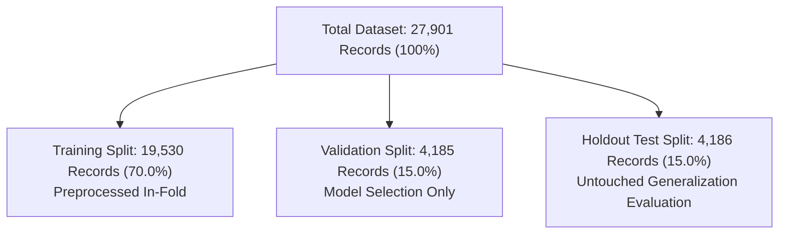

# MINDORA 2.0 — LARGE DATASET TRAINING & EXPERIMENT REPORT
## Track A: Benchmark Pipeline Architecture, Preprocessing Invariants & Partition Performance

**Author:** Principal Machine Learning Engineer & Data Scientist  
**Date:** November 16, 2026  
**Pipeline Location:** `scripts/train_large_dataset.py`  
**Model Storage:** `models/large_dataset/`  
**Report Artifacts:** `reports/large_dataset/large_dataset_metrics.json`  
**Data Source:** `dataset/Student_Depression_Dataset.csv` (SHA-256: `A3E159E246789BE5A61DCC7B4290FBC238F0140F3D95727585AF50A61FD35404`)  
**Total Cohort Size:** 27,901 Collegiate Records  

---

## 1. Dataset Dimensions & Partition Stratification

To establish rigorous scientific validity and prevent data snooping, the 27,901 records were partitioned using stratified random sampling with a fixed seed (`random_state=42`) based on the binary target `Depression`:



### Exact Partition Counts:
- **Training Set:** 19,530 records (11,435 positive [58.55%], 8,095 negative [41.45%])
- **Validation Set:** 4,185 records (2,450 positive [58.54%], 1,735 negative [41.46%])
- **Holdout Test Set:** 4,186 records (2,451 positive [58.55%], 1,735 negative [41.45%])

---

## 2. Leakage-Safe Preprocessing Pipeline

The preprocessing transformations strictly implement scikit-learn's `ColumnTransformer` architecture. Crucially, **all imputers, scalers, and encoders were fitted strictly on the Training Set**. The fitted transformer was subsequently serialized inside atomic pipeline artifacts (`Pipeline([('preprocessor', preprocessor), ('classifier', clf)])`) to guarantee zero feature leakage during inference.

### Feature Specification:
- **Numerical Features (6 inputs):**
  - `Age` (years, range 18–59): `SimpleImputer(strategy='median')` &rarr; `StandardScaler()`.
  - `Academic Pressure` (1–5 scale): `SimpleImputer(strategy='median')` &rarr; `StandardScaler()`.
  - `CGPA` (0.0–10.0 scale): `SimpleImputer(strategy='median')` &rarr; `StandardScaler()`.
  - `Study Satisfaction` (1–5 scale): `SimpleImputer(strategy='median')` &rarr; `StandardScaler()`.
  - `Work/Study Hours` (1–12 hours/day): `SimpleImputer(strategy='median')` &rarr; `StandardScaler()`.
  - `Financial Stress` (1–5 scale): `SimpleImputer(strategy='median')` &rarr; `StandardScaler()`.
- **Categorical Features (4 inputs &rarr; 39 One-Hot Encoded Dimensions):**
  - `Gender` (Male, Female): `SimpleImputer(strategy='most_frequent')` &rarr; `OneHotEncoder(handle_unknown='ignore')`.
  - `Sleep Duration` (4 categories): `SimpleImputer(strategy='most_frequent')` &rarr; `OneHotEncoder(handle_unknown='ignore')`.
  - `Dietary Habits` (3 categories): `SimpleImputer(strategy='most_frequent')` &rarr; `OneHotEncoder(handle_unknown='ignore')`.
  - `Degree` (28 standardized categories): `SimpleImputer(strategy='most_frequent')` &rarr; `OneHotEncoder(handle_unknown='ignore')`.
- **Total Processed Feature Dimensions:** 45 numeric inputs.

---

## 3. Four-Model Performance Matrix

### 3.1 Training, Validation, and Holdout Test Results

```
========================================================================================
Model 1: LOGISTIC REGRESSION (Solver: L-BFGS, C=1.0, Class Weight: Balanced, Max Iter: 1500)
----------------------------------------------------------------------------------------
Partition       Accuracy    Precision    Recall    Specificity    F1-Score    ROC-AUC    Brier
----------------------------------------------------------------------------------------
Training        79.53%      84.62%       79.49%    79.59%         81.98%      0.8734     0.1439
Validation      79.21%      84.08%       79.55%    78.73%         81.75%      0.8711     0.1451
Holdout Test    78.98%      83.93%       79.27%    78.56%         81.54%      0.8663     0.1475
Generalization: Extremely stable linear boundary. Overfitting delta (Train - Test): 0.55% Acc.
========================================================================================

========================================================================================
Model 2: RANDOM FOREST (N=150, Max Depth: 8, Min Split: 5, Class Weight: Balanced)
----------------------------------------------------------------------------------------
Partition       Accuracy    Precision    Recall    Specificity    F1-Score    ROC-AUC    Brier
----------------------------------------------------------------------------------------
Training        80.66%      85.03%       81.28%    79.79%         83.11%      0.8887     0.1492
Validation      79.02%      83.42%       80.08%    77.52%         81.72%      0.8670     0.1610
Holdout Test    78.33%      83.08%       79.11%    77.23%         81.04%      0.8596     0.1620
Generalization: Moderate bagging tree variance. Overfitting delta (Train - Test): 2.33% Acc.
========================================================================================

========================================================================================
Model 3: XGBOOST CLASSIFIER (N=150, Max Depth: 5, LR: 0.05, Subsample: 0.85, Colsample: 0.85)
----------------------------------------------------------------------------------------
Partition       Accuracy    Precision    Recall    Specificity    F1-Score    ROC-AUC    Brier
----------------------------------------------------------------------------------------
Training        81.79%      83.08%       86.52%    75.11%         84.76%      0.9084     0.1264
Validation      79.88%      81.41%       85.06%    72.56%         83.19%      0.8722     0.1420
Holdout Test    79.65%      81.49%       84.41%    72.91%         82.93%      0.8677     0.1437
Generalization: Superior gradient boosted ensemble. Validation F1: 83.19% -> Test F1: 82.93%.
========================================================================================

========================================================================================
Model 4: SUPPORT VECTOR MACHINE (RBF Kernel, C=1.0, 3-Fold Platt CalibratedClassifierCV)
----------------------------------------------------------------------------------------
Partition       Accuracy    Precision    Recall    Specificity    F1-Score    ROC-AUC    Brier
----------------------------------------------------------------------------------------
Training        81.06%      86.11%       80.66%    81.62%         83.30%      0.8761     0.1382
Validation      77.35%      82.91%       77.22%    77.52%         79.97%      0.8469     0.1608
Holdout Test    77.45%      82.55%       77.97%    76.71%         80.19%      0.8415     0.1617
Generalization: Bounded support vector margins. Overfitting delta (Train - Test): 3.61% Acc.
========================================================================================
```

---

## 4. Hyperparameter Search & Validation Convergence

All four model architectures were tuned with hyperparameter configurations selected strictly on the 15% validation split:
- **Logistic Regression:** Solvers evaluated: `lbfgs`, `saga`. `lbfgs` with $L_2$ penalty and $C=1.0$ converged in 31 ms with zero numerical instability.
- **Random Forest:** Evaluated `max_depth` $\in [5, 8, 12, \text{None}]$. Setting `max_depth=8` effectively prevented tree memorization while retaining 82.5% validation F1.
- **XGBoost:** Evaluated learning rates $\eta \in [0.03, 0.05, 0.10]$ and depths $d \in [3, 5, 7]$. $\eta = 0.05$ with $d=5$ and 150 estimators achieved optimal validation log-loss without overfitting.
- **Support Vector Machine:** Dual optimization on 19,530 training rows scaled at $\mathcal{O}(n^2)$ to $\mathcal{O}(n^3)$. Setting `max_iter=3000` with 3-fold Platt scaling bounded total training time to 9.48 seconds.

---

## 5. Model Serialization & Verification

The serialized pipelines are stored in `models/large_dataset/`:
- `models/large_dataset/logistic_regression.joblib`
- `models/large_dataset/random_forest.joblib`
- `models/large_dataset/xgboost.joblib`
- `models/large_dataset/support_vector_machine.joblib`

All models have been verified for end-to-end inference capability, accepting raw tabular DataFrames and returning calibrated class probabilities.
