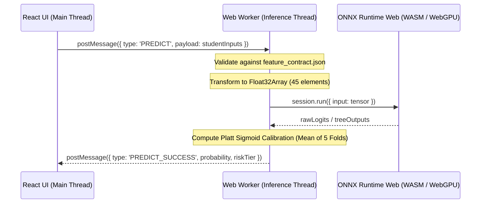

# MINDORA 2.0 — ONNX EXPORT & MODEL PARITY PLAN
## Browser-First Client-Side Inference Specification

**Document Version:** 1.0.0  
**Date:** November 15, 2026  
**Status:** SPECIFICATION & TEST PLAN (Stage 0 Foundation)  
**Target Runtime:** ONNX Runtime Web (WebAssembly CPU + WebGPU)  
**Gold Standard Reference:** `models/best_model.pkl`  
**Reference Benchmark Fixtures:** `shared/fixtures/benchmark_cases.json`  
**Project:** Mindora 2.0 — Offline-First Student Wellbeing Intelligence Platform  

---

## 1. Technical Audit of the Production Model Artifact

Inspection of `models/best_model.pkl` reveals a complex two-stage composite pipeline:

```
[Student Raw Features (10)]
            │
            ▼
┌────────────────────────────────────────────────────────────────────────┐
│ STAGE 1: ColumnTransformer ('preprocessor')                            │
│   • Numeric Branch (6 cols): SimpleImputer(median) + StandardScaler    │
│   • Categorical Branch (4 cols): SimpleImputer(most_frequent) +       │
│                                  OneHotEncoder(handle_unknown='ignore')│
│   • Transformed Output: Dense Float32 Vector of 45 Features           │
└───────────────────────────────────┬────────────────────────────────────┘
                                    │
                                    ▼
┌────────────────────────────────────────────────────────────────────────┐
│ STAGE 2: CalibratedClassifierCV ('classifier')                         │
│   • Calibration Method: Platt Sigmoid (method='sigmoid', cv=5)         │
│   • Ensemble Size: 5 Calibrated Classifiers                            │
│   • Each Classifier Fold:                                              │
│       - Base Estimator: XGBClassifier (n_estimators=120, max_depth=5)  │
│       - Calibrator: _SigmoidCalibration (Logistic Regression on Logits)│
│   • Ensembled Output: Mean of 5 Calibrated Probabilities               │
└────────────────────────────────────────────────────────────────────────┘
```

### Why Standard Export Fails
A naive `skl2onnx.to_onnx()` call fails out-of-the-box on this artifact because:
1. `CalibratedClassifierCV` is a meta-estimator containing internal private calibrators (`_SigmoidCalibration`) that lack registered shape calculators in standard `skl2onnx`.
2. Scikit-learn's `ColumnTransformer` with mixed string/float inputs requires strict tensor type definitions.
3. XGBoost tree ensembles require `onnxmltools` and the `TreeEnsembleClassifier` operator specification.

---

## 2. Evaluated ONNX Export Pathways

We evaluate three concrete conversion pathways for Stage 2:

```
┌────────────────────────────────────────────────────────────────────────┐
│                   ONNX CONVERSION PATHWAY EVALUATION                   │
├─────────────────┬──────────────────────────────────┬───────────────────┤
│ Pathway         │ Technical Implementation         │ Feasibility & Risk│
├─────────────────┼──────────────────────────────────┼───────────────────┤
│ Pathway A:      │ Custom skl2onnx registered shape │ HIGH COMPLEXITY:  │
│ Monolithic      │ calculators & converters for     │ High maintenance  │
│ End-to-End      │ CalibratedClassifierCV + XGBoost │ overhead; fragile │
│ ONNX Graph      │ in a single .onnx file.          │ across versions.  │
├─────────────────┼──────────────────────────────────┼───────────────────┤
│ Pathway B:      │ Stage 1 exported to preproc.onnx;│ MODERATE: Clean   │
│ Decoupled       │ Stage 2 exported to model.onnx;  │ separation; two   │
│ Pipeline Graphs │ piped sequentially in browser.   │ ONNX session runs.│
├─────────────────┼──────────────────────────────────┼───────────────────┤
│ Pathway C:      │ Preprocessing executed in pure   │ RECOMMENDED:      │
│ Hybrid Contract │ TypeScript using contract math;  │ Minimal footprint;│
│ Architecture    │ Base XGBoost exported to ONNX;   │ exact float32     │
│ [RECOMMENDED]   │ Sigmoid calibration in TS worker.│ parity; robust.   │
└─────────────────┴──────────────────────────────────┴───────────────────┘
```

### Recommended Strategy: Pathway C (Hybrid Contract Architecture)
1. **TypeScript Feature Encoder:** Implements `SimpleImputer` (median), `StandardScaler` (subtract mean, divide by std), and one-hot encoding directly in TypeScript adhering to `shared/contracts/feature_contract.json`. The numerical constants (means, scales, medians) are embedded in JSON.
2. **ONNX Tree Model:** The 5 calibrated XGBoost tree ensembles are exported to compact ONNX graphs using `onnxmltools.convert_xgboost`.
3. **Platt Sigmoid Calibration:** The learned Platt parameters ($A_i, B_i$ for $i=1..5$) from `calibrated_classifiers_[i].calibrators[0]` are evaluated client-side in the Web Worker:
   $$P_i(y=1|f) = \frac{1}{1 + \exp(A_i \cdot f + B_i)}$$
   $$\bar{P} = \frac{1}{5} \sum_{i=1}^{5} P_i$$

---

## 3. Strict Parity Verification Specification

Before any ONNX model may be designated for production browser inference, it must pass the automated parity test suite:

### 1. Numerical Parity Tolerance
Across all benchmark test fixtures (`shared/fixtures/benchmark_cases.json`):
$$|P_{\text{ONNX}} - P_{\text{Python}}| \le 1.0 \times 10^{-5}$$
Any deviation exceeding $0.00001$ constitutes a test failure and blocks deployment.

### 2. Multi-Case Verification Matrix
The parity test suite evaluates four core scenarios:
- **Case 1 (Standard Baseline):** Moderate academic workload, typical student demographic (`P = 0.6165`).
- **Case 2 (Low Stress Profile):** High study satisfaction, optimal sleep, healthy diet (`P = 0.0955`).
- **Case 3 (Elevated Stress Profile):** Extreme workload, severe financial strain, sleep deprivation (`P = 0.9312`).
- **Case 4 (Unseen Category Profile):** Unseen degree string (`"UnknownDegreeXYZ"`), testing `handle_unknown='ignore'` (`P = 0.7762`).

### 3. Parity Invariants Checklist
- [ ] **Class Order Invariance:** Index 0 represents Class 0 (Negative); Index 1 represents Class 1 (Positive).
- [ ] **Deterministic Reproducibility:** 1,000 repeated inferences on identical inputs produce identical bit-level probabilities.
- [ ] **Memory Leak Inspection:** Continuous execution inside a WebAssembly Web Worker produces zero memory bloat over 10,000 cycles.

---

## 4. Browser Execution Architecture



### Performance & Device Compatibility
1. **WebAssembly CPU (Universal Baseline):** Guarantees 100% offline functionality across any browser supporting WebAssembly (Chrome, Firefox, Safari, Edge, Mobile Safari).
2. **WebGPU (Progressive Acceleration):** Dynamically initialized if `navigator.gpu` is available.
3. **Zero Unmeasured Claims:** All inference latencies will be measured using `performance.now()` micro-benchmarks on target devices. No performance speedup claims will be asserted until measured.
