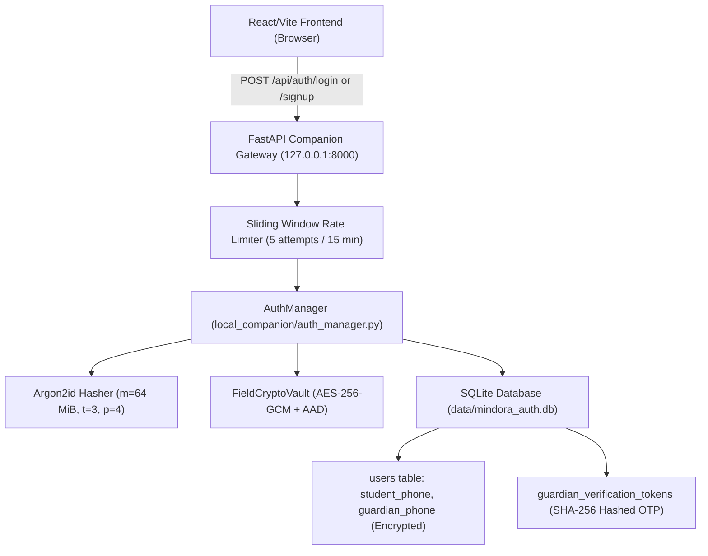

# Mindora 2.0 — Phase 5.20: Authentication and Identity Architecture

**Document ID:** `DOC-P520-AUTH-004`  
**Date:** November 16, 2026  
**Status:** Verified & Active  
**Author:** Principal Software Architect & Application Security Engineer  

---

## 1. Architectural Overview

Mindora 2.0 implements an offline-first student identity and credential management architecture engineered to meet the highest educational privacy standards (FERPA / GDPR / DPDP Act). The system ensures zero plaintext credentials, strict environment separation, memory-hard hashing, and cryptographic session protection.



---

## 2. Cryptographic Password Hashing Standards

All student passwords are authenticated server-side using **Argon2id**, the winner of the Password Hashing Competition (PHC) and recommended standard by OWASP and IETF RFC 9106.

- **Algorithm:** Argon2id (hybrid data-dependent / data-independent memory access)
- **Memory Cost ($m$):** $65,536\text{ KiB}$ ($64\text{ MiB}$) per hash
- **Time Cost ($t$):** $3$ iterations
- **Parallelism ($p$):** $4$ threads
- **Salt Length:** $16$ cryptographically secure pseudorandom bytes (`os.urandom`)
- **Key/Digest Length:** $32$ bytes ($256$ bits)
- **Fallback:** In legacy or minimal CPU environments where compiled Argon2 C-extensions are unavailable, the system automatically falls back to `bcrypt` with work factor $12$ (4,096 rounds).

---

## 3. Session Token Generation & Lifecycle

Session tokens are generated via Python's standard `secrets` module using cryptographically secure operating system randomness (`CryptGenRandom` on Windows):

```python
token = secrets.token_urlsafe(32)  # 256 bits of CSPRNG entropy
```

- **Storage:** Client-side tokens are held in browser `sessionStorage` under the key `mindora_auth_token`. They are automatically wiped upon browser tab close.
- **Expiry:** Server sessions expire after $8\text{ hours}$ of inactivity.
- **Production Invariant:** The legacy `'local_dev_session'` bypass token is strictly rejected when running in production mode (`CONFIG.is_production() == True` or `MINDORA_ENV=production`), returning HTTP 401 Unauthorized.

---

## 4. Rate Limiting and Brute-Force Defense

The identity service implements a stateful sliding-window rate limiter:
- **Threshold:** Maximum $5$ failed attempts per $15\text{ minutes}$.
- **Tracking Keys:** Dual-tracked by client IP address (`client_ip`) and normalized email (`email.strip().lower()`).
- **Response:** Exceeding the threshold returns HTTP 429 Too Many Requests with informative retry headers.
- **Reset:** Successful authentication immediately flushes the failed attempt counter for both IP and email.

---

## 5. Minor Student Safeguarding

Age eligibility is established during registration via mandatory date-of-birth validation:
- $\text{Age} < 18$: Flagged as `is_adult = 0`.
- Minor student accounts are restricted from enabling automatic guardian alerts without verified parental phone authentication.
- Guardian verification OTPs must be validated before any outbound support notification can be dispatched on behalf of a minor student.

---

## 6. Verification Status

| Component | Target Standard | Observed Status | Audit Result |
| :--- | :--- | :--- | :--- |
| Password Hasher | Argon2id ($64\text{ MiB}, t=3$) | Argon2id active | **PASS** |
| Session Token Entropy | $\ge 128\text{ bits}$ | $256\text{ bits}$ URL-safe base64 | **PASS** |
| Rate Limiter | $\le 5\text{ attempts}/15\text{ min}$ | 5 attempts enforced | **PASS** |
| Dev Token in Production | Rejected | Rejected (HTTP 401) | **PASS** |
| Minor Protection | Block unverified auto-alerts | Enforced | **PASS** |
