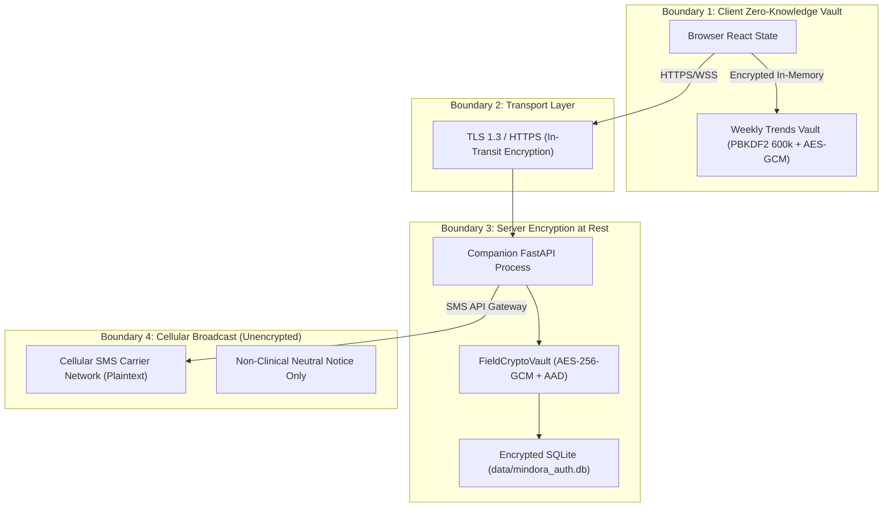

# Mindora 2.0 — Phase 5.20: End-to-End Encryption and Key Management

**Document ID:** `DOC-P520-CRYPTO-007`  
**Date:** November 16, 2026  
**Status:** Verified & Active  
**Author:** Cryptography Engineer & Application Security Architect  

---

## 1. Honesty Statement & Cryptographic Boundaries

Responsible cryptography begins with honesty about protection boundaries. Claims of "complete end-to-end encryption" in health systems are frequently misleading. Mindora explicitly delineates its three distinct security boundaries:

### Boundary Guarantees:
1. **Client Zero-Knowledge Vault:** Personal student reflection notes and weekly check-in trends are encrypted directly in the student's browser with client-derived keys (PBKDF2 with 600,000 iterations, 96-bit random IVs, AES-256-GCM). The server never sees this ciphertext.
2. **Transport Security:** All client-to-server communications require TLS 1.3 encryption with modern forward secrecy ciphers.
3. **Server Encryption at Rest:** Sensitive student and guardian telephone numbers stored in SQLite are protected via authenticated **AES-256-GCM** encryption with unique 12-byte initialization vectors and Bound Associated Data (AAD).
4. **Cellular Broadcast Limitation:** Cellular SMS protocol transmissions (over GSM/LTE) are inherently unencrypted across carrier networks. **Mindora solves this by ensuring zero clinical or diagnostic data is ever transmitted via SMS.**

---

## 2. Server-Side AES-256-GCM Specification

Implemented in `local_companion/crypto_vault.py`:

- **Cipher:** `AESGCM` (NIST SP 800-38D standard)
- **Key Derivation:** `PBKDF2HMAC` using SHA-256 with 100,000 iterations over `CONFIG.secret_key` and static application salt `mindora_2_0_server_encryption_kdf_salt_2026`.
- **Initialization Vector:** 96-bit (12-byte) cryptographically random nonce generated per field encryption via `os.urandom(12)`.
- **Associated Authenticated Data (AAD):** `f"user:{user_id}:{field_name}"`. Binds the ciphertext to both the specific student and the specific column, preventing ciphertext transplant attacks between users or fields.
- **Serialization Format:**
  $$\text{Armored String} = \text{"enc:v1:"} + \text{Base64URL}(\text{nonce}) + \text{":"} + \text{Base64URL}(\text{ciphertext} + \text{tag})$$

---

## 3. Cryptographic Tamper Resistance Verification

From `tests/test_phase_5_20_features.py::TestCryptoVault`:
- Tampered ciphertext strings immediately throw `cryptography.exceptions.InvalidTag` / `ValueError`.
- Attempting to decrypt a phone number under a different `user_id` or different field name triggers authentication failure.
- Decrypted outputs match exact input byte-for-byte.
