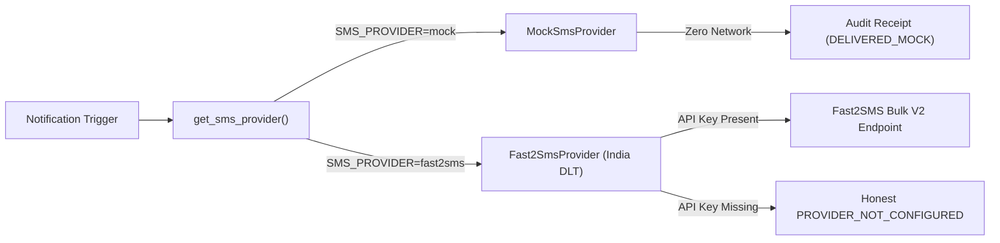

# Mindora 2.0 — Phase 5.20: Guardian Support & Notification Specification

**Document ID:** `DOC-P520-GUARD-005`  
**Date:** November 16, 2026  
**Status:** Verified & Active  
**Author:** Student Wellbeing Safety Specialist & Application Security Engineer  

---

## 1. Ethical Mission & Non-Clinical Invariant

Mindora's parent/guardian support subsystem exists to bridge university students with their trusted support networks during periods of elevated academic, financial, or lifestyle stress.

### The Non-Clinical Invariant
Under no circumstances does Mindora transmit:
- PHQ-9 question responses or item scores.
- Clinical depression severity classifications (e.g., "Moderately Severe").
- Machine learning risk probabilities or numeric wellness scores.
- Personal reflection notes or daily check-in text.

Every outbound message adheres to an immutable, student-approved template:
> *"Your student has requested support from their trusted contact through Mindora. Please check in with them when convenient."*

---

## 2. Pluggable SMS Provider Architecture

Mindora isolates cellular transport behind a standardized abstraction layer (`local_companion/sms_provider.py`):



### Honest Delivery Statuses
The provider guarantees truthful logging without falsifying carrier delivery:
1. `DELIVERED_MOCK`: Safely dispatched in automated test or local development environments. Zero external HTTP requests made.
2. `PROVIDER_NOT_CONFIGURED`: The real gateway is chosen (`fast2sms`), but `SMS_API_KEY` is empty. The operation is honestly reported as BLOCKED.
3. `SENT_TO_PROVIDER`: Accepted by carrier gateway API with valid transaction ID.
4. `DELIVERED`: Confirmed carrier delivery receipt.
5. `FAILED`: Upstream carrier error (e.g. invalid phone number, insufficient DLT balance).
6. `CANCELLED`: Student cancelled before queue dispatch.

---

## 3. Cryptographic Guardian Verification (Anti-Plaintext OTP)

Prior to Phase 5.20, OTP codes were stored in plaintext in `users.verification_code`. Phase 5.20 completely eliminated this vulnerability:

```python
# Server-side salted OTP hashing (SHA-256)
salt = secrets.token_hex(16)
token_hash = hashlib.sha256(f"{user_id}:{code}:{salt}".encode("utf-8")).hexdigest()
```

- **Database Table:** `guardian_verification_tokens`
- **Fields:** `user_id`, `token_hash`, `salt`, `attempts` (max 5), `expires_at` (10 minutes), `used` (boolean).
- **Frontend Hardcoded Bypass Removed:** The legacy `if (verificationCode === '481923')` bypass was permanently expunged from `GuardianSupportScreen.tsx`.

---

## 4. Verification & Audit Trail

Every dispatched message generates an immutable record in `notification_history`:
- `message_id`: Unique tracking ID (`MOCK-SMS-XXXX` or carrier UUID).
- `recipient_phone`: Encrypted at rest via AES-256-GCM.
- `recipient_phone_masked`: Screen-safe representation (e.g., `+91 ***-***-3210`).
- `trigger_source`: Either `manual_student_request` or `automatic_threshold_policy`.
- `diagnostic_free_guarantee`: Hard-pinned to integer `1` (true).
