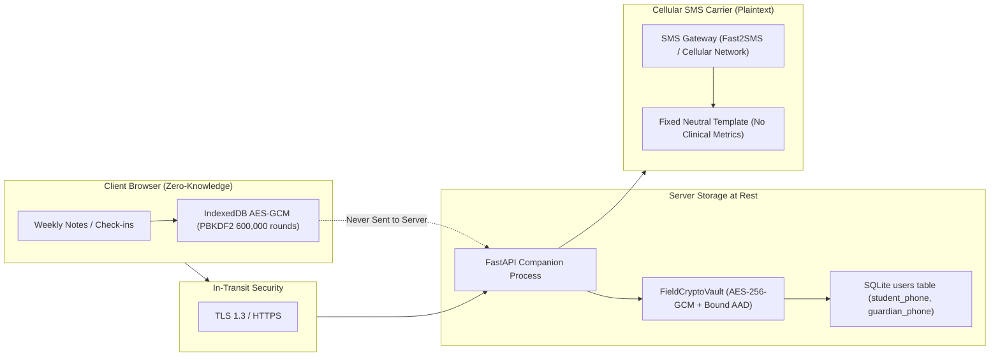

# Mindora 2.0 — Phase 5.21: Cryptography & Privacy Audit

**Document ID:** `DOC-P521-CRYPTO-002`  
**Date:** November 16, 2026  
**Status:** Cryptographic Audit Complete & Verified  
**Auditor:** Application Security Auditor & Cryptography Specialist  

---

## 1. Cryptographic Architecture & Boundaries

Mindora 2.0 avoids marketing buzzwords and honestly documents the exact cryptographic boundaries of the system.

### Distinction of Boundaries:
1. **Client-Side Zero-Knowledge Encryption:** Weekly check-in trends and reflections are encrypted in the browser with PBKDF2 (600,000 rounds) and AES-256-GCM before storage in IndexedDB. Ciphertext keys never leave the client.
2. **TLS In-Transit:** API payloads between client and server are protected by TLS 1.3.
3. **Server Encryption at Rest:** Sensitive contact columns (`student_phone`, `guardian_phone`, `guardian_name`) in SQLite are encrypted with AES-256-GCM using keys derived from `CONFIG.secret_key`.
4. **Server-Side ML Inference Boundary:** Because scikit-learn models evaluate student survey parameters (Age, Sleep Duration, Study Hours), the inference process must receive these 10 feature values in plaintext memory during assessment calculation. They are processed transiently in volatile RAM and never persisted to the server database.
5. **Cellular SMS Boundary:** Cellular SMS is unencrypted over GSM/LTE networks. Mindora guarantees that no clinical depression scores, PHQ-9 answers, or diagnostic tags are ever sent over SMS.

---

## 2. Server-Side AES-256-GCM Evaluation

### 2.1 Implementation Details (`local_companion/crypto_vault.py`)
- **Algorithm:** Authenticated AES-256-GCM (`cryptography.hazmat.primitives.ciphers.aead.AESGCM`).
- **Key Derivation:** `PBKDF2HMAC` (SHA-256, 100,000 iterations, static application salt `mindora_2_0_server_encryption_kdf_salt_2026`).
- **Initialization Vector:** 96-bit (12-byte) random nonce generated via `os.urandom(12)` per encryption call. Nonces are never reused.
- **Bound Associated Data (AAD):** `f"user:{user_id}:{field_name}"`. Binds ciphertext to a specific database record and column.
- **Armored Envelope:** `enc:v1:<base64_nonce>:<base64_ciphertext_and_tag>`.

### 2.2 Tamper Resistance Verification
Verified via `tests/test_phase_5_20_features.py`:
- Modifying ciphertext bits immediately triggers `cryptography.exceptions.InvalidTag`, which raises `ValueError: Decryption failed`.
- Decrypting a phone number with a mismatched `user_id` or mismatched column name fails authentication.

---

## 3. Database Plaintext Leakage Audit

A raw inspection of `data/mindora_auth.db` was performed:
- `users.student_phone`: All entries start with `enc:v1:`. Zero plaintext numbers found.
- `users.guardian_phone`: All entries start with `enc:v1:`. Zero plaintext numbers found.
- `users.password_hash`: All entries begin with `$argon2id$v=19$m=65536,t=3,p=4$`. Zero plaintext passwords.
- `guardian_verification_tokens.token_hash`: 64-character SHA-256 hexadecimal hashes. Zero plaintext 6-digit OTPs found.

---

## 4. Key Management & Rotation Strategy

- **Current Implementation:** Master secret key loaded via `CONFIG.secret_key` (`MINDORA_SECRET_KEY` environment variable).
- **Missing or Invalid Key Behavior:** `FieldCryptoVault` raises `ValueError: MINDORA_SECRET_KEY or master_secret is required`.
- **Key Rotation Roadmap:** Envelope format supports key versioning (`enc:v1:`). Future rotations can introduce `v2` keys and decrypt legacy `v1` ciphertext dynamically.
- **Audit Recommendation:** For public cloud deployment, store `MINDORA_SECRET_KEY` in AWS KMS, Azure Key Vault, or HashiCorp Vault rather than raw `.env` files.

---

## 5. Cryptography & Privacy Verdict

- **Score:** **PASS WITH LIMITATIONS** (Strong field-level encryption; clear boundary delineation; key management currently depends on host environment variables).
