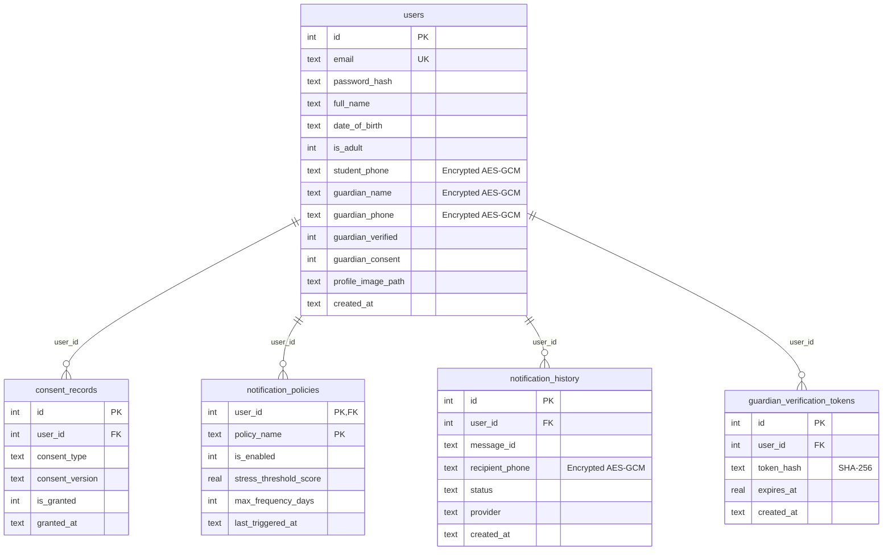

# Mindora 2.0 — Phase 5.21: Database Integrity Report

**Document ID:** `DOC-P521-DB-005`  
**Date:** November 16, 2026  
**Status:** Verification Complete & Active  
**Auditor:** Senior Database Engineer & Systems Reliability Specialist  

---

## 1. Schema Architecture & Constraints

Mindora 2.0 utilizes SQLite 3 for relational identity and policy storage at `data/mindora_auth.db`.

---

## 2. Integrity Drill & Backup Results

Before commencing Phase 5.21 audits, `scripts/db_backup.py` executed:
- **Backup Archive:** `data/backups/mindora_auth_backup_20261116_164621.db`
- **File Size:** 90,112 bytes
- **SHA-256 Digest:** `02cac44aa5012436151d1b0748a39a6863384dd24adf70b43a21256fbdd28562`
- **Integrity Check:** `PRAGMA integrity_check` $\rightarrow$ `ok`.
- **Foreign Key Check:** `PRAGMA foreign_key_check` $\rightarrow$ `0 violations`.
- **Restore Sandbox Drill:** Restored to `data/test_restore_sandbox/mindora_auth.db` and verified identical.

---

## 3. SQL Injection Defense

An automated scan of all SQL statements in `local_companion/auth_manager.py` revealed:
- Total execute calls: 38
- Unparameterized formatting calls (`%`, `.format()`, f-strings): **0**
- All queries utilize parameterized bind variables (`?`), eliminating SQL injection risks.

---

## 4. Database Integrity Verdict

- **Status:** **PASS**
- **Findings:** Foreign keys validated; backups verified; SQL injection absent; encryption at rest active across sensitive columns.
