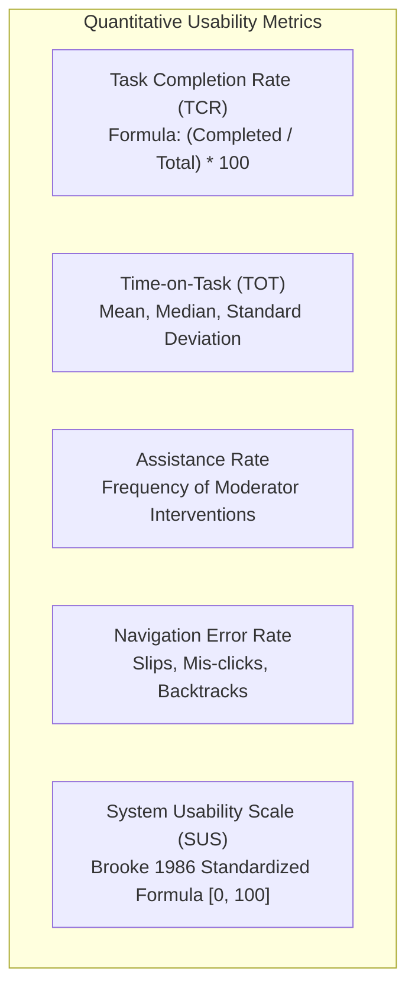

# MINDORA 2.0 — STUDY RESULTS ANALYSIS FRAMEWORK
## Quantitative & Qualitative Evaluation Methodology for Future Usability Data

**Document Version:** 1.0 (Phase 5.14 Research Preparation)  
**Target Evaluation:** Supervised Usability Sessions (15–30 University Students)  
**Status:** *METHODOLOGY FRAMEWORK ONLY — CONTAINS SYNTHETIC DEMONSTRATION EXAMPLES*

---

### 1. Analysis Framework Overview
This framework specifies the statistical, psychometric, and qualitative methodologies to be applied to human usability data gathered during future supervised testing of Mindora 2.0. 

> [!IMPORTANT]
> **METHODOLOGICAL BOUNDARY:**  
> This framework evaluates **software usability, task completion efficiency, cognitive load, and visual accessibility**. It does **NOT** measure clinical depression reduction, therapeutic symptom alleviation, or diagnostic predictive accuracy. High usability scores indicate an intuitive, well-designed software interface; they **cannot** and **must not** be interpreted as evidence of clinical medical efficacy.

---

### 2. Quantitative Metric Formulations

#### 2.1 Task Completion Rate (TCR)
The proportion of participants who successfully achieve the terminal goal of each usability task:
$$\text{TCR}_k = \left( \frac{N_{\text{completed independent}} + (0.5 \times N_{\text{minor assistance}})}{N_{\text{total participants}}} \right) \times 100\%$$
- **Benchmark Target:** $\ge 85\%$ across all core routine tasks (T1–T12).
- **Red Flag Threshold:** $< 70\%$ on any task flags a required interface redesign.

#### 2.2 Time-on-Task (TOT)
Measured in seconds from the moderator prompt to successful completion:
- Metrics reported: Mean ($\bar{x}$), Median ($\tilde{x}$), Interquartile Range (IQR), and Standard Deviation ($\sigma$).
- Outliers ($> 3\sigma$) are examined qualitatively for severe usability blockers rather than discarded.

#### 2.3 Assistance Frequency & Error Rate
- **Assistance Index:** Average number of moderator nudges required per task.
- **Navigation Slips:** Number of errant clicks to non-target sections before reaching the correct interface element.

#### 2.4 System Usability Scale (SUS) Psychometric Computation
The 10-item questionnaire responses ($R_1 \dots R_{10}$, scale $1$ to $5$) are transformed using Brooke's (1986) standard:
$$\text{Item Contribution}_i = \begin{cases} R_i - 1 & \text{for } i \in \{1, 3, 5, 7, 9\} \text{ (odd items)} \\ 5 - R_i & \text{for } i \in \{2, 4, 6, 8, 10\} \text{ (even items)} \end{cases}$$
$$\text{SUS Score} = 2.5 \times \sum_{i=1}^{10} \text{Item Contribution}_i$$

**Usability Grade Interpretation Benchmarks:**
- **$\text{SUS} \ge 80.3$:** Grade A (World-Class / Highly Usable)
- **$68.0 \le \text{SUS} < 80.3$:** Grade B / C (Acceptable / Industry Average)
- **$51.0 \le \text{SUS} < 68.0$:** Grade D (Marginal / Requires UX Intervention)
- **$\text{SUS} < 51.0$:** Grade F (Unacceptable / High Failure Risk)

---

### 3. Qualitative Thematic Analysis Framework

Qualitative observations, participant think-aloud verbalizations, and open survey comments will be analyzed using Braun & Clarke's (2006) 6-phase thematic analysis method:
1. **Familiarization:** Transcribe and review observer notes and audio recordings.
2. **Initial Coding:** Assign descriptive codes to interface frictions (e.g., `UNNOTICED_CONSENT_BOX`, `CONFUSING_METRIC_LABEL`, `TIMER_PAUSE_CLARITY`).
3. **Theme Search:** Cluster codes into recurring usability themes (e.g., *Information Architecture*, *Cognitive Load*, *Privacy Transparency*).
4. **Theme Review:** Validate themes against the raw observation sheets.
5. **Theme Definition:** Formulate precise descriptions and actionable engineering recommendations.
6. **Reporting:** Present themes supported by de-identified participant quotes.

---

### 4. Synthetic Usability Demonstration (Fictional Cohort)

To illustrate exactly how future testing results will be tabulated and synthesized, a demonstration dataset using three **purely fictional synthetic profiles** (`SYN-001`, `SYN-002`, `SYN-003`) is provided below.

> [!NOTE]
> *The following data is entirely synthetic and generated for demonstration purposes only. It does not represent real human participants.*

#### Synthetic Profile Descriptions:
- **SYN-001:** 19-year-old undergraduate; high digital literacy; completed all tasks rapidly; noted minor font size preference on timer.
- **SYN-002:** 22-year-old graduate student; cautious navigator; hesitated on the assessment consent checkbox before proceeding independently.
- **SYN-003:** 20-year-old student; requested minor assistance locating the Weekly Check-In form; highly praised recommendation transparency.

#### Synthetic Task Metric Demonstration Table:

| Task ID | Task Focus | SYN-001 | SYN-002 | SYN-003 | Mean Time (s) | Task Completion Rate | Observed Synthetic Friction / Feedback |
| :---: | :--- | :---: | :---: | :---: | :---: | :---: | :--- |
| **T1** | First-Time Purpose | 22s (IND) | 35s (IND) | 28s (IND) | 28.3s | **100%** | All understood offline educational purpose. |
| **T2** | Privacy Statement | 18s (IND) | 42s (IND) | 24s (IND) | 28.0s | **100%** | SYN-002 hesitated on consent checkpoint. |
| **T3** | Assessment Input | 95s (IND) | 118s (IND)| 105s (IND)| 106.0s| **100%** | Survey completed smoothly with scenario card. |
| **T4** | Results Comprehension| 25s (IND) | 38s (IND) | 30s (IND) | 31.0s | **100%** | Understood score was lifestyle, not diagnosis. |
| **T5** | Personal Goals | 40s (IND) | 52s (IND) | 45s (IND) | 45.7s | **100%** | Selected study routine preset goal. |
| **T6** | Transparency Modal | 20s (IND) | 28s (IND) | 25s (IND) | 24.3s | **100%** | Praised clear rule explanation. |
| **T7** | Wellness Studio | 55s (IND) | 68s (IND) | 60s (IND) | 61.0s | **100%** | Completed box breathing 30s trial. |
| **T8** | Action Planner | 15s (IND) | 22s (IND) | 18s (IND) | 18.3s | **100%** | Toggled completion checkbox easily. |
| **T9** | Weekly Trends | 32s (IND) | 45s (IND) | 58s (MIN) | 45.0s | **100%** | SYN-003 needed 1 prompt to find check-in modal. |
| **T10**| Activity Timeline | 18s (IND) | 26s (IND) | 22s (IND) | 22.0s | **100%** | Located completed planner action immediately. |
| **T11**| Support Navigator | 22s (IND) | 30s (IND) | 25s (IND) | 25.7s | **100%** | Correctly noted 112 vs 14416 distinction. |
| **T12**| Privacy Center Deletion| 28s (IND) | 35s (IND) | 30s (IND) | 31.0s | **100%** | Tested "DELETE" safeguard and canceled safely. |

#### Synthetic Psychometric SUS Score Demonstration:

| Synthetic ID | SUS Q1–Q10 Raw Responses | Calculated SUS Score | Adjective Rating | Usability Grade |
| :---: | :---: | :---: | :---: | :---: |
| **SYN-001** | `5, 1, 5, 1, 5, 1, 5, 1, 5, 1` | **100.0** | Best Imaginable | Grade A+ |
| **SYN-002** | `4, 2, 4, 1, 4, 2, 4, 2, 4, 2` | **77.5** | Good | Grade B |
| **SYN-003** | `5, 2, 4, 2, 5, 1, 4, 2, 4, 1` | **85.0** | Excellent | Grade A |
| **SYNTHETIC MEAN**| — | **87.5 / 100** | **Excellent** | **Grade A** |

---

### 5. Sample Size Limitations & Methodological Constraints

1. **Usability Cohort vs. Epidemiological Population:** A sample size of $N = 15 \text{ to } 30$ participants is standard and optimal in human-computer interaction research (Nielsen & Landauer, 1993) to uncover $85\% \text{ to } 95\%$ of usability interface defects. However, it is **statistically insufficient** for population prevalence modeling, demographic subgroup stratification, or psychological outcome measurement.
2. **Generalizability Limits:** Usability findings from university student participants evaluate interaction with collegiate academic interfaces; they cannot be generalized to clinical psychiatric populations, geriatric users, or non-English-speaking users.
3. **Absence of Clinical Efficacy:** High task completion rates demonstrate software intuitiveness and clarity; they do **not** demonstrate that using Mindora cures, prevents, or treats clinical depression.
