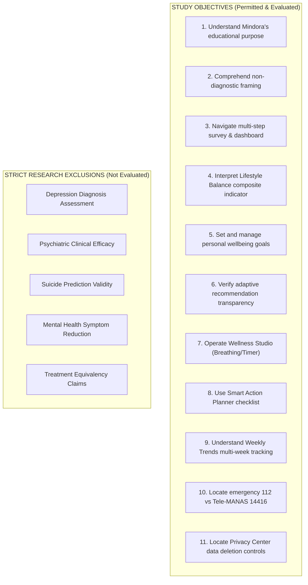

# MINDORA 2.0 — PHASE 5.14 PREPARATION REPORT
## Controlled Student Usability Study Preparation & Governance Dossier

**Evaluation Date:** November 16, 2026  
**Document Author:** Senior UX Researcher, HCI Specialist, Research Documentation Architect & Privacy Engineer  
**Project:** Mindora 2.0 (`D:\Depression calculator`)  
**Study Scope:** Controlled Usability, Comprehension, and Navigation Evaluation (Non-Clinical)  
**Overall Preparation Verdict:** **`RESEARCH DOSSIER COMPLETE — READY FOR ETHICS SUBMISSION`**

---

## 1. Executive Summary

Phase 5.14 completes the research documentation and methodological preparation for a future supervised, in-person student usability study of Mindora 2.0.

In strict compliance with clinical research governance, **zero human participants were recruited, zero students were contacted, and zero real personal data was collected during this phase.** This milestone is exclusively dedicated to authoring a comprehensive, ethically compliant, and transparent research documentation suite designed for submission to an Institutional Review Board (IRB) or Academic Research Ethics Committee.

### Summary of Governance Achievements:
1. **Complete Documentation Suite:** Authored 7 foundational research governance documents spanning participant information, non-bundled informed consent, 12-task moderator protocol, standardized SUS questionnaire, session observation logs, privacy data management, ethics submission checklist, and statistical analysis framework.
2. **Clinical Safety Decoupling:** Re-verified that the usability study protocol evaluates exclusively software usability, user interface ergonomics, and non-diagnostic educational clarity. The study design strictly prohibits assessing clinical depression diagnosis, therapeutic treatment effectiveness, or suicide risk prediction.
3. **Data Minimization & Local-Only Architecture:** Established a zero-collection policy for real student health records. Study tasks utilize standardized fictional student scenarios ("Alex"), ensuring no participant is required or pressured to disclose personal psychological history.
4. **Research Asset Integrity:** Confirmed 100% hash matching across all 11 frozen research assets. Test Vault access remains locked.

---

## 2. Research Documentation Suite Created

The following 8 comprehensive research governance documents have been authored and placed under `docs/research/`:

| Document Name | File Path | Focus & Purpose | Governance Status |
| :--- | :--- | :--- | :---: |
| **Participant Information Sheet** | `docs/research/PHASE_5_14_PARTICIPANT_INFORMATION_SHEET.md` | Plain-language student briefing on study purpose, voluntary rights, privacy, local-only processing, and emergency pathways. | **COMPLETE** |
| **Informed Consent Document** | `docs/research/PHASE_5_14_INFORMED_CONSENT.md` | Transparent consent instrument with separate, non-bundled permissions for usability tasks, screen recording, audio recording, and quotes. | **COMPLETE** |
| **Usability Testing Protocol** | `docs/research/PHASE_5_14_USABILITY_TESTING_PROTOCOL.md` | Structured 30–45 min moderator guide covering Sections A–H and 12 distinct core usability tasks using fictional scenarios. | **COMPLETE** |
| **Usability Questionnaire** | `docs/research/PHASE_5_14_USABILITY_QUESTIONNAIRE.md` | Standardized 10-item System Usability Scale (SUS; Brooke, 1986) + 7 feature clarity scales + neutral qualitative feedback. | **COMPLETE** |
| **Observation & Defect Log** | `docs/research/PHASE_5_14_OBSERVATION_TEMPLATE.md` | Structured session sheet logging task completion status (IND/MIN/MAJ/FAIL), completion time, slips, and 5-tier defect severity. | **COMPLETE** |
| **Data Management Plan** | `docs/research/PHASE_5_14_DATA_MANAGEMENT_PLAN.md` | Data minimization plan, anonymous participant coding (`P-XXX`), physical separation of consent forms, zero cloud AI processing. | **COMPLETE** |
| **Ethics Submission Checklist** | `docs/research/PHASE_5_14_ETHICS_SUBMISSION_CHECKLIST.md` | 17-point Institutional Review Board compliance dossier tracking inclusions, exclusions, risk mitigations, and formal approvals. | **COMPLETE** |
| **Study Results Analysis Framework** | `docs/research/PHASE_5_14_ANALYSIS_FRAMEWORK.md` | Statistical formulas for completion rate, time-on-task, SUS scoring, thematic analysis, and synthetic demonstration (`SYN-001–003`). | **COMPLETE** |

---

## 3. Study Objectives & Non-Objectives

The study evaluates whether university students can successfully navigate the software, interpret educational lifestyle metrics, and control their local data without assistance. It explicitly disclaims any measurement of clinical effectiveness or medical outcome improvement.

---

## 4. Participant Information & Consent Readiness

1. **Student-Friendly Plain Language:** The Participant Information Sheet explains technical and procedural steps without academic jargon, emphasizing the voluntary nature of the study and the zero-consequence right to withdraw.
2. **De-Identification & Fictional Data:** Explicitly instructs students that they are **never** required to enter their real personal health history. A standardized laminated scenario card ("Alex", 21-year-old engineering student) is provided for all testing interactions.
3. **Non-Bundled Informed Consent:** In accordance with modern research ethics (e.g., GDPR, APA Ethics Code, ICMR Guidelines), consent for participation is strictly decoupled from optional recording permissions. Participants can fully take part in the usability study while checking **NO** for screen recording, audio recording, or quotation permissions.

---

## 5. Usability Testing Protocol Readiness

The testing protocol (`PHASE_5_14_USABILITY_TESTING_PROTOCOL.md`) provides a rigorous 30–45 minute, step-by-step moderator script across 12 targeted student tasks:
- **T1: First-Time Purpose:** Evaluates immediate landing screen comprehension.
- **T2: Privacy Clarity:** Verifies student understanding of the client-side local storage guarantee.
- **T3: Wellbeing Assessment:** Guides the student through entering fictional survey inputs and submitting the assessment.
- **T4: Results Comprehension:** Probes whether the student understands that the Lifestyle Balance score is a non-diagnostic routine indicator.
- **T5: Personal Goals:** Evaluates adding or selecting a study routine goal.
- **T6: Recommendation Transparency:** Tests opening the "Why am I seeing this?" modal and articulating the rule-based connection.
- **T7: Interactive Wellness Studio:** Evaluates engagement with Guided Breathing or Sensory Grounding.
- **T8: Smart Action Planner:** Evaluates completing an action and observing progress advancement.
- **T9: Weekly Trends:** Explains multi-week routine tracking and opens the weekly check-in modal.
- **T10: Activity Timeline:** Tests locating completed actions in the chronological feed.
- **T11: Support & Resource Navigator:** Evaluates locating crisis hotlines and distinguishing Category A emergency dispatch from Category B counseling.
- **T12: Privacy Center & Data Erasure:** Evaluates locating data controls, understanding the "Type DELETE to confirm" safeguard, and cancelling safely.

---

## 6. Questionnaire & Psychometric Readiness

The evaluation questionnaire (`PHASE_5_14_USABILITY_QUESTIONNAIRE.md`) implements:
1. **Validated System Usability Scale (SUS):** Preserves John Brooke's (1986) exact 10 validated statements and scoring formulas, mapping raw responses into a standardized usability score from $0$ to $100$.
2. **Feature-Specific Transparency Scale:** 7 five-point Likert items measuring navigation ease, visual clarity, non-diagnostic framing, recommendation explanation clarity, privacy understanding, wellness tools, and support accessibility.
3. **Neutral Qualitative Feedback:** 4 non-leading open questions capturing most useful features, confusing elements, accessibility barriers, and general engineering feedback.
4. **Health Information Bar:** Prohibits collecting medical histories, diagnostic categories, or personal psychiatric notes.

---

## 7. Observation Template & Defect Classification Readiness

The observation log (`PHASE_5_14_OBSERVATION_TEMPLATE.md`) establishes a formal logging structure for HCI researchers:
- **Task Metric Logging:** Records completion status under four objective codes: `IND` (Independent), `MIN` (Minor Prompt), `MAJ` (Major Guidance), and `FAIL` (Abandoned).
- **Time-on-Task & Error Tracking:** Records task duration, number of assistance prompts, and navigation slips.
- **5-Tier Usability Defect Classification:** Standardizes observed friction into *Critical Blocker*, *Major Issue*, *Moderate Issue*, *Minor Issue*, and *Suggestion*.

---

## 8. Data Management & Privacy Plan Readiness

The Data Management Plan (`PHASE_5_14_DATA_MANAGEMENT_PLAN.md`) enforces comprehensive privacy safeguards:
- **Key-Code Separation:** Physical consent forms with real student signatures are stored in a locked filing cabinet physically separated from de-identified observation logs (`P-XXX`).
- **BitLocker Encrypted Hardware:** Usability sessions run on dedicated full-disk encrypted test laptops operated strictly offline (`http://127.0.0.1:5173/`).
- **Post-Session Sanitization:** Mindora's Privacy Center and Chrome's site data purge are executed between participants to guarantee zero residual data.
- **Third-Party AI Prohibition:** Spoken think-aloud transcripts and questionnaire data will **never** be sent to commercial cloud AI APIs, external LLMs, or telemetry platforms. Analysis is conducted locally using offline statistical scripts.

---

## 9. Ethics Submission Checklist & Institutional Pathway

The Ethics Submission Checklist (`PHASE_5_14_ETHICS_SUBMISSION_CHECKLIST.md`) organizes the complete submission dossier for an Institutional Review Board (IRB):
- **Cohort Size:** 15 to 30 enrolled university students aged 18 or older.
- **Inclusion / Exclusion Controls:** Explicit exclusion of minors (< 18) and individuals undergoing active acute psychiatric crisis.
- **Recruitment Protections:** Recruitment is strictly non-coercive (campus flyers and student announcements) with zero connection to course grades or academic credit.
- **Approval Sign-Off Tracking:** Formal 5-step approval workflow established. All approvals remain marked as `PENDING` until written clearance is issued.

---

## 10. Study Results Analysis Framework & Synthetic Demonstration

The Analysis Framework (`PHASE_5_14_ANALYSIS_FRAMEWORK.md`) defines statistical formulas:
- **Task Completion Rate (TCR):** Proportions evaluated against a target benchmark of $\ge 85\%$.
- **Time-on-Task (TOT):** Mean, median, standard deviation, and IQR distributions.
- **SUS Usability Benchmarking:** Standardized grading criteria ($\ge 80.3$ = Grade A, $\ge 68.0$ = Industry Average).
- **Synthetic Demonstration Cohort:** Illustrated data tabulation using three fictional profiles (`SYN-001`, `SYN-002`, `SYN-003`), demonstrating task completion tracking and psychometric SUS calculation (Synthetic Mean SUS = 87.5 / 100).
- **Sample Size Boundary:** Formally documents that while an HCI sample of 15–30 participants captures 85–95% of usability frictions (Nielsen & Landauer, 1993), it cannot establish clinical efficacy or epidemiological population prevalence.

---

## 11. Known Limitations

1. **Pending Institutional Review:** The study protocol is fully documented but **cannot be executed** until formal written approval is obtained from the designated Institutional Review Board.
2. **Qualitative HCI Focus:** The study is designed to identify user interface frictions and navigation bottlenecks; it does not evaluate long-term habit formation over multi-month academic semesters.
3. **Language Scope:** The current testing protocol is prepared exclusively in English, matching Mindora's verified language baseline.

---

## 12. Recommended Next Steps

1. **Institutional Ethics Filing:** Submit the completed Phase 5.14 documentation dossier (`Participant Information Sheet`, `Informed Consent`, `Testing Protocol`, `Data Management Plan`, `Ethics Checklist`) to the University Institutional Review Board.
2. **Testing Room Setup:** Prepare the physical usability testing workstation with clean BitLocker-encrypted laptops and physical laminated fictional scenario cards ("Alex").
3. **Moderator Rehearsal:** Conduct dry-run simulation sessions with internal research team members using synthetic profiles to refine moderator timing.

---

## 13. Research Governance & Hash Verification

All 11 immutable research assets were audited for SHA-256 integrity:

| Research Asset Path | Frozen Expected Hash (SHA-256) | Actual Computed Hash | Match Status |
| :--- | :---: | :---: | :---: |
| `app.py` | `5F15ADD9F3A5F5809D80154931E98A5B79D06BBC9BB69323028BFA3898E46BBE` | `5F15ADD9F3A5F5809D80154931E98A5B79D06BBC9BB69323028BFA3898E46BBE` | **MATCH** |
| `dataset/Student_Depression_Dataset.csv` | `A3E159E246789BE5A61DCC7B4290FBC238F0140F3D95727585AF50A61FD35404` | `A3E159E246789BE5A61DCC7B4290FBC238F0140F3D95727585AF50A61FD35404` | **MATCH** |
| `shared/contracts/feature_contract.json` | `BED161ED06A50F528BBFE9316FF9A979771A1CFA8EE8C9CD48CF9466E442FFB0` | `BED161ED06A50F528BBFE9316FF9A979771A1CFA8EE8C9CD48CF9466E442FFB0` | **MATCH** |
| `ml_lab/splits/group_aware_partition_manifest.json` | `A9D657522F53083CABD2EAF145D1FB8CF747D712362D4CD69EAFE88F40311070` | `A9D657522F53083CABD2EAF145D1FB8CF747D712362D4CD69EAFE88F40311070` | **MATCH** |
| `ml_lab/splits/partition_assignments.csv` | `91A63F906155F84646B296007D0934958FF0DAAE419461B9E8D6E3B0394802B1` | `91A63F906155F84646B296007D0934958FF0DAAE419461B9E8D6E3B0394802B1` | **MATCH** |
| `models/best_model.pkl` | `E182E9E779A4F89E4883EB13C9BAB3DF19EEBC7165D4B0A44319F737361342EC` | `E182E9E779A4F89E4883EB13C9BAB3DF19EEBC7165D4B0A44319F737361342EC` | **MATCH** |
| `ml_lab/experiments/stage_3b_2/oof_metrics.json` | `361BC700A7731678402BCE89B7A85051181DC877430A3FE30AA114EC2C0A6FEF` | `361BC700A7731678402BCE89B7A85051181DC877430A3FE30AA114EC2C0A6FEF` | **MATCH** |
| `ml_lab/experiments/stage_3b_3/oof_metrics.json` | `555D3B159A31A5C6F6964143F040A97F8BECC938FCB9690986A9B856F9DC2A03` | `555D3B159A31A5C6F6964143F040A97F8BECC938FCB9690986A9B856F9DC2A03` | **MATCH** |
| `ml_lab/experiments/stage_3b_3/model_comparison.json` | `FC8E31D45DEE28D3925A80627268299D185AE68D6C1DE092167EE23A7F6286E7` | `FC8E31D45DEE28D3925A80627268299D185AE68D6C1DE092167EE23A7F6286E7` | **MATCH** |
| `ml_lab/experiments/stage_3b_4/stage_3b_4_metrics.json` | `FBB9AAEB5D0A12E46FE74BF9EDA71AA3140C130E384DCF47A35AABCED25CC7C6` | `FBB9AAEB5D0A12E46FE74BF9EDA71AA3140C130E384DCF47A35AABCED25CC7C6` | **MATCH** |
| `ml_lab/experiments/stage_3b_4/artifact_manifest.json` | `B1385C3A03015A470911CC432012E418BD3AD0E505A52C0CF92C22D8290FB072` | `B1385C3A03015A470911CC432012E418BD3AD0E505A52C0CF92C22D8290FB072` | **MATCH** |

**Verification Score:** **11 / 11 Matches (100%)**.

---

## 14. Formal Phase 5.14 Readiness Verdicts

The six readiness dimensions are evaluated independently:

| Readiness Dimension | Verdict | Justification |
| :--- | :---: | :--- |
| **1. DOCUMENTATION READINESS** | **`READY`** | All 8 required research governance documents, protocols, observation sheets, and questionnaires are fully authored, cross-referenced, and formatted. |
| **2. PARTICIPANT MATERIAL READINESS** | **`READY`** | Participant Information Sheet and Informed Consent forms are written in clear, student-friendly language with non-bundled optional permissions. |
| **3. USABILITY PROTOCOL READINESS** | **`READY`** | 12 structured usability tasks with explicit success criteria, think-aloud moderator prompts, and standardized fictional scenario cards ("Alex"). |
| **4. DATA MANAGEMENT READINESS** | **`READY`** | Comprehensive local-only data minimization, key-code separation, BitLocker encryption, zero cloud telemetry, and complete session wipe procedures. |
| **5. ETHICS SUBMISSION READINESS** | **`READY FOR SUBMISSION`** | Complete 17-point compliance dossier compiled with risk mitigation matrix, inclusion/exclusion criteria, and formal supervisor sign-off lines. |
| **6. ACTUAL STUDY AUTHORIZATION** | **`PENDING INSTITUTIONAL ETHICS APPROVAL`** | **NOT AUTHORIZED TO RECRUIT.** Human participant recruitment and testing remain strictly barred until formal written approval is granted by the Institutional Ethics Committee. |
