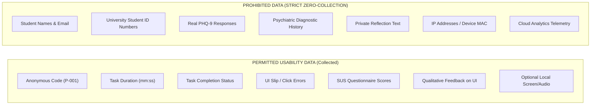

# MINDORA 2.0 — DATA MANAGEMENT & PRIVACY PLAN
## Usability Evaluation Research Data Governance Protocol

**Document Version:** 1.0 (Phase 5.14 Research Preparation)  
**Lead Research Team:** Student Wellbeing Human-Computer Interaction Laboratory  
**Status:** *AWAITING INSTITUTIONAL ETHICS COMMITTEE REVIEW & CLEARANCE*

---

### 1. Purpose & Core Governance Philosophy
This Data Management Plan (DMP) establishes strict data minimization, privacy protection, and security protocols for human usability evaluation sessions of **Mindora 2.0**. 

Mindora 2.0 is designed from the ground up as a **privacy-first, client-side, offline application**. The research data collection methodology must rigorously reflect these same principles. The research protocol collects exclusively usability and user interface performance metrics—it **never** collects, persists, or transmits real clinical, psychiatric, or personal student health records.

---

### 2. Permitted Data Collection vs. Strict Exclusions

#### Detailed Boundary Specifications:
1. **Permitted Research Usability Data:**
   - Sequential, random anonymous participant codes (e.g., `P-101`, `P-102`).
   - Task completion outcomes (`Independent`, `Assisted`, `Failed`).
   - Task duration timestamps recorded via stopwatch by the observer.
   - Count of navigation slips, mis-clicks, and assistance requests.
   - Responses to the standardized System Usability Scale (SUS) questionnaire.
   - Transcribed qualitative comments regarding visual design, font size, button layout, and clarity.
   - Screen interaction video and think-aloud audio **strictly if** the participant provided explicit, non-bundled written consent.

2. **Strictly Prohibited Data (Zero-Collection Policy):**
   - **No Personal Identifiers:** Student names, phone numbers, email addresses, university enrollment numbers, or national identification numbers are strictly barred from research observation sheets.
   - **No Clinical Psychological Data:** Researchers will **never** record, score, or compile participants' personal depression levels, medical histories, medication status, or real-life trauma.
   - **No Private Reflection Persistence:** Any temporary text typed into Mindora's "Daily Check-in" reflection field vanishes on session reset and is never transcribed or saved by researchers.
   - **No Behavioral Telemetry:** Zero analytics trackers, Google Analytics, Mixpanel, or third-party cookies are present in the software.

---

### 3. Identity De-Identification & The "Key Code" Barrier
To guarantee confidentiality:
- Each participant is assigned an anonymous identifier (e.g., `P-101`).
- The paper informed consent document bearing the participant's physical signature is stored in a **physically separate, locked fireproof cabinet** accessible only to the Faculty Research Supervisor.
- No electronic master linkage document connecting participant names to codes will be created unless explicitly mandated by the university ethics board for verified withdrawal logging.
- All observation sheets, questionnaire files, and data spreadsheets reference **only** the anonymous participant code.

---

### 4. Storage Security & Access Controls

1. **Local Test Hardware Storage:**
   - Usability evaluations occur on designated study testing laptops with BitLocker full-disk encryption enabled (AES-256).
   - Test machines are disconnected from public Wi-Fi during testing sessions or restricted to offline localhost (`http://127.0.0.1:5173/`).
2. **Research Data Repository:**
   - Completed paper observation logs and questionnaires are stored in a locked filing cabinet within the secure research laboratory.
   - Digitized usability spreadsheets are stored on an encrypted institutional network storage volume protected by multi-factor authentication (MFA).
3. **Personnel Access Limitations:**
   - Access to raw observation logs and audio files is restricted strictly to the named Lead Researcher and the Faculty Supervisor.
   - Research assistants and statistical analysts will work exclusively with fully de-identified aggregate CSV datasets.
4. **Third-Party AI & Cloud Analytics Prohibition:**
   - Usability feedback, think-aloud transcripts, and observation notes will **never** be uploaded to commercial cloud AI APIs (e.g., OpenAI ChatGPT, Anthropic Claude, Google Gemini) or processed through local Ollama companions. All thematic and statistical analysis is conducted using local, offline statistical software (e.g., R, Python scripts run locally).

---

### 5. Management of Optional Recordings
If a participant consents to optional audio or screen interaction recording:
- **Audio Recordings:** Transcribed into text within 14 days of session completion. Transcripts are de-identified immediately (removing any accidental mention of campus names, instructor names, or personal details). The raw audio file is permanently shredded following verified transcript audit.
- **Screen Recordings:** Captured using local offline software (e.g., OBS Studio recording local screen only; no webcam). Screen recordings are inspected solely to verify click errors and are permanently deleted at the end of the data compilation phase.

---

### 6. Data Retention, Archival & Destruction Timelines

- **Usability Session Device Wipe:** Executed immediately following each session. The browser's `localStorage`, `IndexedDB`, and cache are permanently wiped using Mindora's `PrivacyCenterModal` and Chrome's site data purge.
- **Raw Questionnaire & Observation Paper Records:** Retained in locked storage for `[TO BE COMPLETED: e.g., 3 years post-publication]` in compliance with institutional research data integrity regulations.
- **Permanent Destruction Protocol:** At the expiration of the retention window:
  - Paper records are destroyed using cross-cut document shredders.
  - Digital datasets and recordings are sanitized using DoD 5220.22-M compliant electronic file shredding.

---

### 7. Participant Withdrawal Procedure
If a participant exercises their right to withdraw:
- **During the Session:** The session halts immediately. All observation sheets and notes taken during the session are shredded on the spot in the participant's presence.
- **Post-Session (Prior to Aggregate Analysis):** The participant may email the research supervisor quoting their anonymous participant code (`P-XXX`). Upon receipt, all digital records corresponding to that code are permanently excised from the dataset.
- **Post-Publication:** Once study results are aggregated and published in academic reports, individual data points cannot be extracted from statistical group distributions (e.g., mean SUS score).

---

### 8. Academic Reporting & Publication Boundaries
Publications resulting from this usability study will report:
- Aggregated descriptive statistics (mean System Usability Scale score, task completion percentage, average completion time per task).
- Categorized usability friction themes (e.g., *"3 of 20 participants requested larger font sizing on the Focus Timer"*).
- De-identified, anonymized participant quotations attributed solely by code (e.g., *"P-104 remarked: 'The explanation on why actions were recommended made me trust the system more.'"*).
- **Prohibited Claims:** Reports will **never** present usability findings as evidence of clinical treatment efficacy, depression reduction, or psychiatric diagnostic validity.
