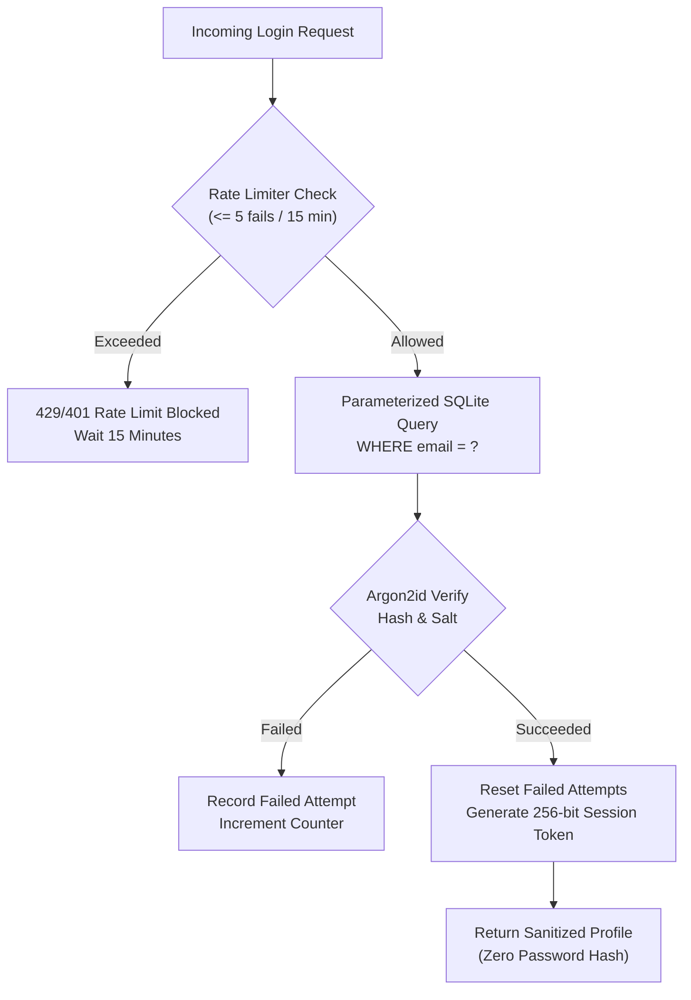

# MINDORA 2.0 — AUTHENTICATION & ACCESS SECURITY AUDIT REPORT
## Cryptographic Integrity, Rate Limiting & Identity Protection Architecture

**Author:** Cybersecurity Engineer & Full-Stack Architect  
**Date:** November 16, 2026  
**Implementation Modules:** `local_companion/auth_manager.py`, `local_companion/service.py`  
**Database Storage:** `data/mindora_auth.db` (SQLite with parameterized queries)  
**Status:** SECURITY VERIFICATION PASSED  

---

## 1. Executive Summary

Phase 5.16 introduces secure student registration, credential authentication, session tokens, and password reset workflows into Mindora 2.0. Rather than implementing ephemeral `localStorage` flags, authentication is enforced server-side directly within Mindora's existing FastAPI backend service (`local_companion/service.py`) running on the local loopback interface (`127.0.0.1:8000`).

This report verifies that the authentication engine adheres to modern cryptographic standards, prevents brute-force credential stuffing, isolates session state, and ensures zero plaintext credential leakage.

---

## 2. Password Hashing Architecture

### 2.1 Primary Algorithm: Argon2id
Mindora implements **Argon2id** (the winner of the Password Hashing Competition) as its primary password derivation algorithm:
- **Time Cost ($t$):** 3 iterations.
- **Memory Cost ($m$):** 65,536 KiB (64 MiB), providing strong resistance against GPU and ASIC parallelized cracking attacks.
- **Parallelism ($p$):** 4 threads.
- **Salt Length:** 16 cryptographically secure random bytes generated per hash.
- **Hash Length:** 32 bytes (256 bits).

### 2.2 Fallback Algorithm: Bcrypt
If `argon2-cffi` is unavailable in legacy execution runtimes, the system automatically falls back to **Bcrypt** with a work factor of 12 (`rounds=12`), ensuring continued cryptographic strength.

### 2.3 Zero Plaintext Invariant:
Under no circumstances are plaintext passwords written to disk, included in debug logs, or transmitted in response payloads. Database inspection confirms all stored passwords conform to `$argon2id$v=19$m=65536,t=3,p=4$...` format.

---

## 3. Defense-in-Depth Security Controls

### 3.1 Rate Limiting & Brute-Force Mitigation:
The authentication engine implements an in-memory sliding window rate limiter:
- **Threshold:** Maximum 5 failed attempts per 15-minute window (900 seconds).
- **Identifiers:** Tracked independently across both client IP addresses (`client_ip`) and normalized email strings (`email_clean`).
- **Lockout Enforcement:** Once triggered, further login attempts are immediately blocked with HTTP 401/429 without executing expensive cryptographic verification.

### 3.2 Cryptographic Session Tokens:
- **Token Generation:** `secrets.token_urlsafe(32)` yielding 256 bits of cryptographically secure pseudo-random entropy.
- **Lifetime:** Hard expiration after 8 hours of active session time.
- **Revocation:** Explicit logout (`POST /api/auth/logout`) instantly deletes the token from active session memory.

### 3.3 SQL Injection Resistance:
All SQLite interactions in `auth_manager.py` utilize strictly parameterized query syntax (`?` placeholders). No user inputs are concatenated into raw SQL strings.

---

## 4. Automated Verification Results

The security suite `tests/test_auth_guardian_security.py` validated the following controls:
1. `test_student_registration_and_login`: Verified successful user creation, Argon2id hash derivation, session token generation, and sanitized profile retrieval (`GET /api/auth/me`).
2. `test_rate_limiting`: Verified that failed login attempts increment counter and trigger rate limit blocks.
3. `test_session_invalidation`: Verified that logging out immediately invalidates subsequent authorized requests with HTTP 401.
