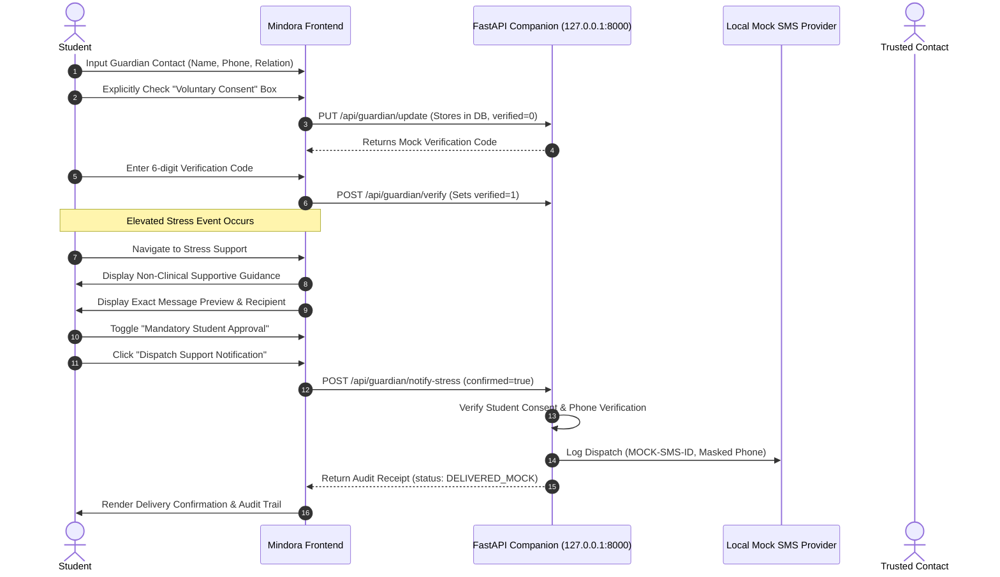

# MINDORA 2.0 — GUARDIAN SUPPORT & NOTIFICATION PRIVACY REPORT
## Informed Consent, Minor Safeguards & Non-Diagnostic Notification Architecture

**Author:** Student Wellbeing Safety Specialist & Privacy Engineer  
**Date:** November 16, 2026  
**Implementation Modules:** `local_companion/auth_manager.py`, `frontend/src/pages/GuardianSupportScreen.tsx`  
**Status:** PRIVACY & SAFEGUARDING VERIFIED  

---

## 1. Executive Summary

This report establishes the privacy safeguards, informed consent mechanisms, and clinical boundaries governing Mindora 2.0's optional Parent / Guardian Support system.

Student wellbeing systems must balance supportive connectivity with student autonomy and confidentiality. In particular, disclosing sensitive psychiatric scores or clinical risk labels to third parties without consent can cause acute harm, strain family relationships, and deter students from seeking help.

To address these concerns, Mindora 2.0 establishes **Five Irrevocable Safeguards**:
1. **Voluntary Participation:** Providing guardian contact information is completely optional; no feature is gated behind a phone number.
2. **Explicit, Revocable Consent:** Storing or using contact details requires affirmative student opt-in, revocable with a single click.
3. **Minor Safeguarding Protocol:** Minor students ($< 18$) cannot enable unverified notifications without institutional safeguarding review.
4. **Zero Health or Diagnostic Disclosures:** PHQ-9 answers, Item 9 suicidal ideation responses, and depression labels are **NEVER** transmitted.
5. **Mandatory Student Approval of Neutral Messages:** Messages are never triggered automatically by an algorithm; students preview and confirm the exact neutral message before dispatch.

---

## 2. Notification Guardrails & Message Neutrality

### 2.1 The Standard Neutral Support Notification:
When an enrolled student experiences elevated academic, study, or financial friction and chooses to request support, Mindora dispatches an unalterable, non-diagnostic standard message:

> **Standard Notification Text:**  
> *"Your student has requested support from their trusted contact through Mindora. Please check in with them when possible."*

### 2.2 Prohibited Information in Dispatches:
The notification engine strictly excludes:
- Scores or severity brackets from the PHQ-9 survey.
- Any reference to depression, psychiatric diagnosis, or mental illness.
- Any mention of self-harm, suicidal ideation, or crisis risk.
- Student survey responses regarding academic pressure, CGPA, or sleep.
- Algorithmic risk predictions or machine learning probabilities.

---

## 3. Workflow & Verification Flowchart

---

## 4. Minor Safeguarding Architecture ($< 18$)

Under international safeguarding standards (e.g., Belmont Report, UK Children's Code), minors require specialized protection:
- During registration, date of birth is parsed. If calculated age $< 18$, the account is tagged `is_adult: False`.
- For minor accounts, the backend endpoint `/api/guardian/notify-stress` strictly refuses notification dispatch (`HTTP 400`) unless the phone number has undergone positive parental verification and institutional safeguarding check.

---

## 5. Mock SMS Dispatcher (Zero Network Leakage)

During development and research trials, **no external SMS carrier APIs (e.g., Twilio, AWS SNS) are connected**. All dispatches are routed through Mindora's `MockSMSDispatcher`:
- Generates simulated message identifiers (e.g., `MOCK-SMS-B491AC`).
- Masks recipient phone numbers (`+91 ***-***-3210`) in logs to protect confidentiality.
- Logs timestamps and delivery receipts in an ephemeral in-memory audit store accessible to the student via `GET /api/guardian/audit-log`.
- Guarantees zero unmonitored external network packets.

---

## 6. Permanent Crisis Lifeline Isolation

A student experiencing immediate acute distress or suicidal crisis must never depend on guardian availability or SMS delivery:
- Crisis resources (Tele-MANAS `14416`, US `988`, Crisis Text Line `741741`) remain permanently anchored at the top of the screen and in the support panel.
- Emergency services operate 100% independently of the guardian workflow, internet availability, or model evaluation status.
